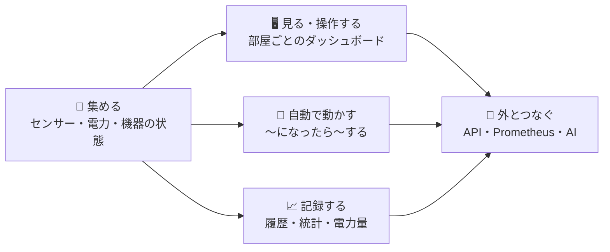

# 🎯 00. HomeManager で実現する機能

> 📌 **この章の目的**: HomeManager で「何ができるようになるか」を一覧にし、**採用する機能を決める**。
> ✅ **2026-10-31 に提案どおりで決定**。決定は [05 実装機能](05-feature-scope.md) のフェーズと [07〜09 の設計](07-screen-design.md) に反映済みで、次は実装（P0）。
> 🔗 元にしたもの: [02 Home Assistant のソース分析](02-ha-core-architecture.md)・[10 Prometheus Exporter](10-prometheus-exporter.md)（手持ちの機器の実績）

---

## ⚡ ひとことで

> **家の中の機器（センサー・電源・照明 …）の状態を 1 か所に集め、ブラウザでリアルタイムに見て・操作し、条件に応じて自動で動かし、記録を残す ── 自宅のサーバー（Raspberry Pi）で動く Web アプリ。**

### 📖 凡例

| 記号 | 意味 |
|:-:|---|
| 🏠 | Home Assistant にある機能を手本にする |
| 📡 | Prometheus Exporter の資産（実機で動いているコード・ライブラリ）を流用する |
| 🆕 | HomeManager 独自 |
| ⭐ | **採用** |
| 🟡 | **保留**（P6 の候補。使い方・手持ちの機器しだいで採用する） |
| ⛔ | **見送り** |
| P0〜P6 | 実装フェーズ（[05](05-feature-scope.md) §4）。🔁 は今回の決定で変えたもの |

---

## 📋 機能一覧

### 📡 1. 機器とつなぐ（集める・操作する）

| ID | 実現する機能 | 例 | 由来 | 決定 | Phase |
|---|---|---|:-:|:-:|:-:|
| F-01 | 🧪 仮想の機器で動きを試せる | 実機なしで照明・センサーの動作を確認 | 🏠 | ⭐ | P1 |
| F-02 | 🌡️ **SwitchBot** の温湿度計・CO2 センサー・プラグミニを見つけて登録し、値を即時に受け取る | 部屋ごとの温湿度・CO2、冷蔵庫の消費電力 | 📡 | ⭐ | P2 🔁 |
| F-03 | ⚡ **ワットチェッカー**（BLE 版・Wi-Fi 版）で家電の消費電力を測る | 洗濯機・冷蔵庫・PC の電力・電流・電圧 | 📡 | ⭐ | P2 🔁 |
| F-04 | 🌫️ **オムロン環境センサー**（2JCIE-BU）で部屋の環境を 10 項目測る | 照度・騒音・気圧・TVOC・不快指数・熱中症の危険度・地震 | 📡 | ⭐ | P2 🔁 |
| F-05 | 📶 機器・回線の**死活監視**（Ping） | ルーターや NAS が応答しなくなったら分かる | 📡🏠 | ⭐ | P2 🔁 |
| F-06 | 📡 **MQTT** の機器をつなぐ（HA と同じ形式の自動登録） | Zigbee2MQTT・Tasmota・ESPHome の機器を一気に | 🏠 | 🟡 MQTT の機器があれば ⭐ | P2 |
| F-07 | ☀️ 日の出・日の入り・天気 | 日没で照明、雨の予報で通知 | 🏠 | ⭐ | P3 |
| F-08 | 🌐 汎用の HTTP 連携（Web API の値をセンサーにする） | 電気料金・ごみの日の API | 🏠 | 🟡 | P3 |
| F-09 | 🍓 サーバー自身の監視（CPU 温度・負荷・ディスク寿命・電圧低下） | Raspberry Pi の熱・電源不足に気付く | 📡🏠 | 🟡 | P6 |
| F-10 | 🏃 BLE の電波で**在宅を判定** | スマホやタグが近くにあれば「在宅」 | 📡🏠 | 🟡 | P6 |
| F-11 | 🔁 他の PC の Exporter から値を取り込む | ゲーミング PC の温度・電力で自動化 | 📡 | 🟡 | P6 |
| F-12 | ☁️ クラウド連携の機器（Nature Remo・SwitchBot クラウド） | エアコン・テレビを赤外線で操作 | 🏠 | 🟡 | P6 |
| F-13 | 🏠 LAN 内の機器を直接操作（Shelly・WLED・Hue） | スマートリレー・LED テープ | 🏠 | 🟡 | P6 |
| F-14 | 🔍 新しい機器の**自動検出**（mDNS など） | 「新しい機器が見つかりました。追加しますか？」 | 🏠 | 🟡（BLE は F-02 に含む） | P6 |
| F-15 | 🌊 Z-Wave・Matter・ESPHome | — | 🏠 | ⛔ 機器が無ければ | P6 |

### 🖥️ 2. 見る・操作する

| ID | 実現する機能 | 例 | 由来 | 決定 | Phase |
|---|---|---|:-:|:-:|:-:|
| F-20 | 🏠 **部屋ごとのダッシュボードを自動で作り、リアルタイムに更新** | 照明を点けると、開いている全員の画面が即座に変わる | 🏠 | ⭐ | P1 |
| F-21 | 🎛️ ブラウザから機器を操作 | ON / OFF・明るさ・数値・選択肢 | 🏠 | ⭐ | P1 |
| F-22 | 🪟 機器の詳細を見る（操作・属性・履歴・設定） | 「誰が・いつ」変えたかも分かる | 🏠 | ⭐ | P1 |
| F-23 | 🛠️ 開発者ツール（状態の一覧・アクションの実行・イベントの監視） | 動作の確認・デバッグ | 🏠 | ⭐ | P1 |
| F-24 | 🧙 機器の追加ウィザード | IP・MAC・シリアルポートを入れて追加 | 🏠 | ⭐ | P2 |
| F-25 | 🗂️ 機器・部屋・階・ラベルの管理 | 「リビング」「1 階」に機器を割り当て | 🏠 | ⭐ | P2 |
| F-26 | 📶 **Bluetooth 診断**（受信中の機器と電波の一覧） | SwitchBot の MAC アドレスを調べる | 🏠📡 | ⭐ BLE 機器を使うなら | P2 |
| F-27 | 🎨 自分好みのダッシュボード（カード・グラフ・ゲージ） | 電力のゲージ、室温の 24 時間グラフ | 🏠📡 | ⭐ | P4 |
| F-28 | 📱 スマホ向け表示・ダークモード・ホーム画面に追加（PWA） | | 🏠 | ⭐ | P4 |
| F-29 | 🧱 壁掛けタブレット用の表示（キオスク） | 上部バーなしで常時表示 | 🏠 | 🟡 | P4 |

### 🤖 3. 自動で動かす

| ID | 実現する機能 | 例 | 由来 | 決定 | Phase |
|---|---|---|:-:|:-:|:-:|
| F-30 | 🤖 **オートメーション**（〜になったら → 〜なら → 〜する） | CO2 が 1,000ppm を超えたら換気を通知／洗濯機の電力が 5 分間 5W 未満で「洗濯終了」／日没後に人感で照明 | 🏠 | ⭐ | P3 |
| F-31 | 🔍 実行の**トレース**（なぜ動いた／動かなかったか） | | 🏠 | ⭐ | P3 |
| F-32 | 📜 スクリプト・🎬 シーン | 「おやすみ」で一括 OFF | 🏠 | ⭐ | P3 |
| F-33 | 🎛️ ヘルパー（仮想スイッチ・数値・タイマー・カウンター・週間スケジュール） | 「外出モード」スイッチ | 🏠 | ⭐ | P3 |
| F-34 | 🔔 画面内の通知 | 自動化から「換気してください」 | 🏠 | ⭐ | P3 |
| F-35 | ⚡ **電力量の計算**（W を時間で積分して kWh に） | 家電ごとの 1 日の電力量 | 🏠📡 | ⭐ ワットチェッカーがあるので | P4 |
| F-36 | 🧮 テンプレート（式で計算・文章に差し込み） | 「不快指数は 78 です」 | 🏠 | 🟡 | P4 |
| F-37 | 📣 スマホ・LINE への通知 | 外出先で洗濯終了を知る | 🏠 | 🟡 | P6 |
| F-38 | 🎯 用途別トリガー（部屋の「人感」「温度」をまとめて扱う。HA 2026 の新方式） | 「リビングで誰かを検知したら」 | 🏠 | 🟡 | P6 |
| F-39 | 📘 ブループリント（自動化の雛形の共有） | | 🏠 | ⛔ | P6 |

### 📈 4. 記録する

| ID | 実現する機能 | 例 | 由来 | 決定 | Phase |
|---|---|---|:-:|:-:|:-:|
| F-40 | 📜 状態の**履歴**（グラフ・タイムライン） | 昨日の室温の推移、照明が点いていた時間 | 🏠📡 | ⭐ | P4 |
| F-41 | 📒 ログブック（いつ・何が・誰によって） | 「21:03 玄関の照明が ON（自動化: 帰宅）」 | 🏠 | ⭐ | P4 |
| F-42 | 📊 長期の統計（5 分・1 時間ごと） | 1 年分の室温・電力の推移 | 🏠 | ⭐ | P4 |
| F-43 | ⚡ **エネルギーダッシュボード** | 家電ごとの電力量の日・月の比較 | 🏠📡 | ⭐ ワットチェッカーがあるので | P4 🔁（P6 から前倒し） |
| F-44 | 📤 **Prometheus への出力**（今の Grafana のダッシュボードをそのまま使える互換モード付き） | 既存の部屋・電力・センサーのダッシュボード | 🏠📡 | ⭐ | P4 |
| F-45 | 💾 バックアップと復元 | 設定を丸ごと保存・別の機械に移す | 🏠 | ⭐ | P5 |

### 🔐 5. 外とつなぐ・守る

| ID | 実現する機能 | 例 | 由来 | 決定 | Phase |
|---|---|---|:-:|:-:|:-:|
| F-50 | 🔑 ログイン（Cookie）と初回セットアップ | 初期パスワードの変更・家の位置の設定 | 🏠 | ⭐ | P1 |
| F-51 | 🌐 外部 API（REST・リアルタイム）と長期アクセストークン | スクリプトや他のシステムから値を読む・操作する | 🏠 | ⭐ | P5 |
| F-52 | 👥 ユーザーとロール（管理者・一般・閲覧のみ） | 家族は操作だけ、子どもは見るだけ | 🏠 | 🟡 | P5 |
| F-53 | 🪝 Webhook | 外部サービスからの通知で自動化を動かす | 🏠 | 🟡 | P5 |
| F-54 | 🤖 AI 連携（MCP で Claude などから操作・質問） | 「リビングの温度は？」「全部消して」 | 🏠 | 🟡 | P6 |
| F-55 | 📱 モバイル・キオスクのアプリ（MAUI） | プッシュ通知・ネイティブの壁掛けパネル | 🏠 | 🟡 | P6 |
| F-56 | 🔐 二段階認証 | | 🏠 | ⛔ | P6 |
| F-57 | 🤝 HA 互換の API | HA 用のツールから接続 | 🏠 | ⛔ | P6 |

### 🛠️ 6. 運用

| ID | 実現する機能 | 例 | 由来 | 決定 | Phase |
|---|---|---|:-:|:-:|:-:|
| F-60 | 🍓 Raspberry Pi で 24 時間稼働（アプリは systemd、PostgreSQL・Mosquitto は Docker） | | 🆕 | ⭐ | P0 / P5 |
| F-61 | 🔭 ログ・ヘルスチェック・アプリのメトリクス | | 🏠 | ⭐ | P0 |
| F-62 | ℹ️ システム情報（版・稼働時間・DB の大きさ・各連携の状態） | | 🏠 | ⭐ | P1 |
| F-63 | 🩹 修復（要対応事項の一覧と案内） | | 🏠 | 🟡 | P6 |

### ⛔ 7. 作らないもの（再掲）

| 作らないもの | 代わりに |
|---|---|
| 🖥️ 専用 OS・Supervisor・Apps（旧アドオン） | systemd + Docker Compose |
| 🐝 Zigbee / Thread の無線スタック | Zigbee2MQTT・Matter Server などを外部サーバーとして使う |
| 📦 大量のインテグレーション | 手持ちの機器だけ |
| ☁️ クラウド中継（Nabu Casa 相当） | Tailscale / Cloudflare Tunnel |
| 🎙️ 音声アシスタント（音声認識・合成・ウェイクワード） | テキストの会話・AI 連携（F-54）から |
| 🖥️ Windows PC の詳しい監視 | 各 PC の Exporter に任せ、必要なら F-11 で取り込む |

---

## 🪜 フェーズごとに「できるようになること」

| Phase | できるようになること | 主な機能 |
|:-:|---|---|
| 🏗️ **P0** | 器ができ、Raspberry Pi と開発機で起動する | F-60・F-61 |
| 🌱 **P1** | 仮想の機器をブラウザで操作でき、**全員の画面が即座に変わる** | F-01・F-20〜23・F-50・F-62 |
| 🔌 **P2** | **手持ちの機器（SwitchBot・ワットチェッカー・オムロン・Ping）の値が部屋ごとに見える** | F-02〜06・F-24〜26 |
| 🤖 **P3** | 「CO2 が高い」「洗濯が終わった」などで**自動で通知・操作**できる | F-07・F-08・F-30〜34 |
| 📈 **P4** | 室温や電力の**履歴・統計・電力量**が見られ、**Grafana も続けて使える** | F-27〜29・F-35・F-36・F-40〜44 |
| 🔐 **P5** | スクリプトや他のシステムから**安全に API で**使える。バックアップできる | F-45・F-51〜53 |
| 🚀 **P6** | 好きな方向に伸ばす（在宅判定・クラウド機器・AI・アプリ …） | F-09〜15・F-37〜39・F-54〜57・F-63 |

> 🔁 **今回の決定で変えたこと**: P2 の主役を「MQTT」から「**手持ちの機器**（Exporter で実績のある SwitchBot・ワットチェッカー・オムロン・Ping）」に変え、**エネルギーダッシュボードを P6 → P4 に前倒し**した。理由は、すぐに実データで試せ、電力の可視化はワットチェッカーで価値がはっきりしているため。

---

## ✅ 決定事項（2026-10-31・提案どおり）

| # | 論点 | 決定 |
|:-:|---|---|
| 1 | 🟡 任意の機能 | **F-06（MQTT）は MQTT の機器があれば採用**。ほかの 🟡 は P6 の候補として保留 |
| 2 | 🔌 P2 で最初につなぐ機器と順番 | **SwitchBot → ワットチェッカー → オムロン → Ping**（→ MQTT） |
| 3 | 📡 Exporter との関係 | **段階的に役割分担**（[10](10-prometheus-exporter.md) §6 の案 C）: 家の機器は HomeManager に移し、PC の監視は Exporter に残す |
| 4 | ⚡ エネルギー（F-35・F-43） | **P4 に前倒し** |
| 5 | 📤 Prometheus 出力の互換モード（F-44） | **作る**（移行の間だけ使う） |
| 6 | ⛔ 見送り | **F-15・F-39・F-56・F-57 と §7 は作らない** |

> ✍️ 決定は [05](05-feature-scope.md) のフェーズと [07](07-screen-design.md)〜[09](09-db-design.md) の設計に反映済み。次は **P0（器づくり）**。
