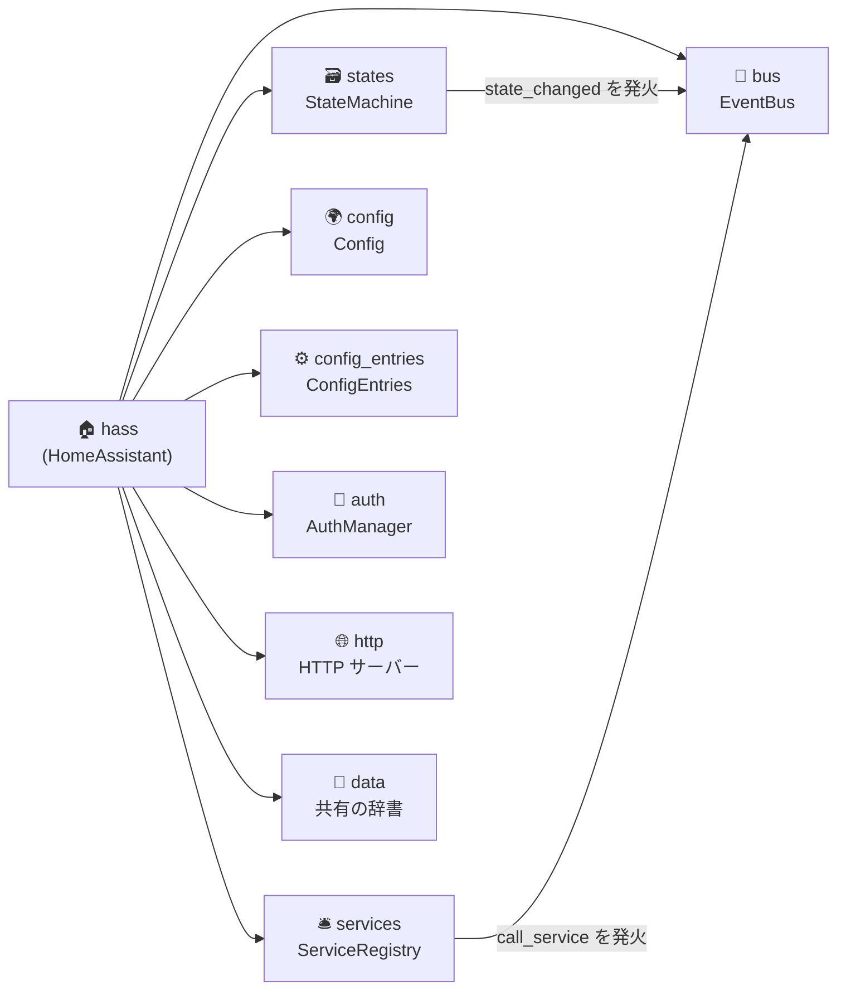
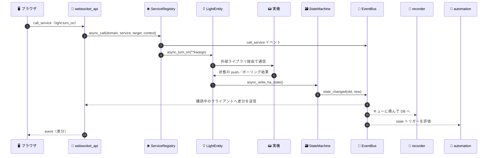
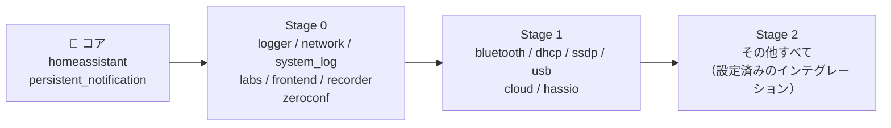
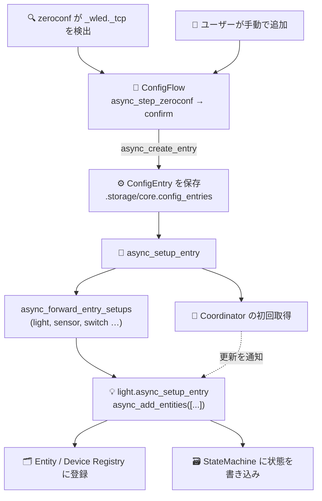
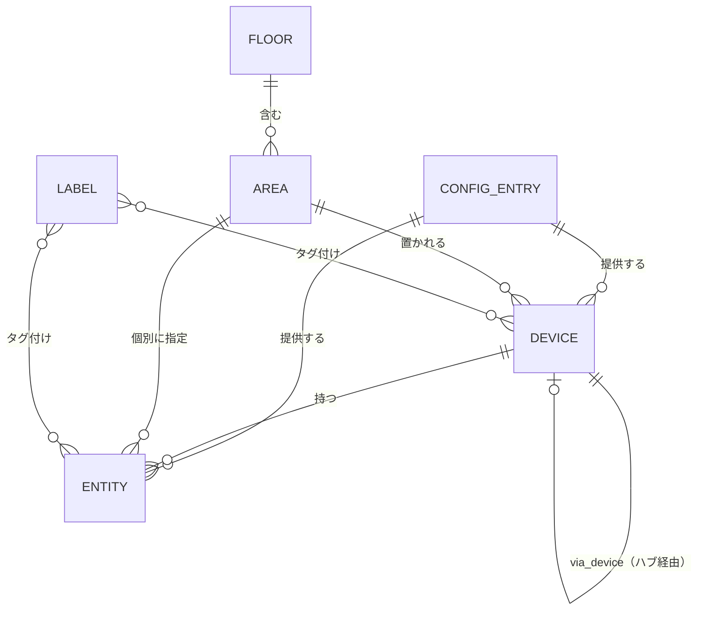

# 🔬 02. Home Assistant core ソース分析

> 📌 **調査対象**: [`home-assistant/core`](https://github.com/home-assistant/core) の `dev` ブランチ
> 🔖 コミット `abbe09a`（2026-10-31）／ バージョン **2026.12.0.dev0** ／ **Python 3.14.2 以上**が必須
> 🛠️ **方法**: shallow clone して `homeassistant/` 配下（テスト除く）を読み、全 `manifest.json` を集計

---

## 📊 ひと目でわかる規模感

| 指標 | 値 | メモ |
|---|---:|---|
| 🧩 インテグレーション数（manifest.json の数） | **1,563** | `homeassistant/components/*` |
| 📦 外部 PyPI ライブラリを使うもの | 1,153 | デバイスとの通信はほぼ外部ライブラリに任せている |
| 🧙 UI から追加できるもの（`config_flow`） | 977 | 残り 586 は YAML 設定か、設定が要らないもの |
| 💡 エンティティの種類（プラットフォーム） | **45** | light / sensor / climate … |
| 🔄 WebSocket コマンドの種類 | **353** | UI の通信はほぼすべて WebSocket |
| 🐍 Python ファイル数／行数 | 10,926 ／ 約 166 万行 | `homeassistant/` 配下 |

> 💡 **ポイント**: 「コア」はとても小さく、機能の大半は **インテグレーション（＝プラグイン）** として作られている。自作版も「**小さなコア + 拡張**」の形にするのが肝。

---

## 🗂️ 1. パッケージ構成

```text
homeassistant/
├── core.py            (3,083 行) 🧠 HomeAssistant / EventBus / StateMachine / ServiceRegistry
├── config_entries.py  (4,479 行) ⚙️ Config Entry（UI で追加した接続設定）とライフサイクル
├── data_entry_flow.py (1,126 行) 🧙 ステップ式フォーム（Config Flow の土台）
├── loader.py          (1,945 行) 📥 インテグレーションの発見・manifest の読み込み
├── setup.py             (837 行) 🚀 依存解決 → 必要パッケージのインストール → async_setup
├── bootstrap.py       (1,106 行) 🥾 起動シーケンス（Stage 0 / 1 / 2）
├── core_config.py       (911 行) 🌍 位置・単位系・タイムゾーンなど全体の設定
├── config.py          (1,380 行) 📝 configuration.yaml の読み込み
├── requirements.py      (353 行) 📦 実行時に PyPI パッケージをインストール（uv / pip）
├── auth/              🔐 ユーザー・トークン・認証プロバイダ・MFA・権限
├── helpers/           🧰 エンティティ基盤・レジストリ・イベント追跡・テンプレート・スクリプト実行 …
├── components/        🧩 1,563 のインテグレーション
├── util/              🔧 日時・JSON・単位変換などの汎用関数
└── generated/         🤖 hassfest（開発ツール）が生成する一覧（エンティティ種別・探索条件 等）
```

> 💡 HTTP サーバー・WebSocket API・DB への記録（recorder）・フロントエンドの配信でさえ **`components/` 配下の普通のインテグレーション**。`core.py` が持つのは「**イベント・状態・サービス**」の 3 本柱だけ。

---

## 🧠 2. 中核: `HomeAssistant` オブジェクト（通称 `hass`）

`core.py:447` で定義。すべてのコードが `hass` を受け取り、ここから各機能にアクセスする。



### 🔁 実行モデル

- 🧵 **単一の asyncio イベントループ**で全体が動く（`hass.loop`）。状態の書き換えはループのスレッドからだけ許される（`verify_event_loop_thread`）
- ⚡ `@callback` を付けた関数は、ループ上ですぐ実行される同期関数。ブロッキング I/O は `async_add_executor_job` でスレッドプールへ逃がす
- 🏷️ `HassJob` が「コルーチン／コールバック／同期関数」を見分けて、いちばん速い方法で実行する
- 🚦 ライフサイクル（`CoreState`）: `not_running → starting → running → stopping → final_write → stopped`

### 📣 2-1. EventBus（イベントバス）

| 項目 | 内容 |
|---|---|
| 🔥 発火 | `hass.bus.async_fire(event_type, data, origin, context)` |
| 👂 購読 | `async_listen(event_type, listener, event_filter)`／`MATCH_ALL` で全イベント／`async_listen_once` |
| 📦 Event の中身 | `event_type`・`data`・`origin`（local / remote）・`time_fired`・`context` |
| 🛡️ 安全装置 | 配信中に発火されたイベントはキューに積んで後で配信。積みすぎ（無限ループ）は例外にする |

🗒️ コアが発火する主なイベント: `state_changed` / `state_reported` / `call_service` / `service_registered` / `component_loaded` / `homeassistant_start` / `homeassistant_started` / `homeassistant_stop` / `core_config_updated` / `logbook_entry` など

### 🗃️ 2-2. StateMachine（ステートマシン）= 「家の“今”」

- 📌 キーは **`entity_id`**（`<domain>.<object_id>`、例: `light.living_room`）
- 📦 値は **`State`**: `state`（**文字列**・最大 255 文字）／`attributes`（読み取り専用の辞書）／`last_changed`・`last_updated`・`last_reported`／`context`
- 🔄 `async_set` の振る舞い（`core.py:2493`）:
  - 状態も属性も同じ → 新しい State は作らず `last_reported` だけ更新し、**`state_reported`** を発火
  - どちらかが変化 → 新しい**イミュータブルな** State を作り、**`state_changed`**（`old_state` / `new_state`）を発火
  - 属性だけ変化 → `last_changed` は据え置き、`last_updated` だけ更新

> 💡 UI の表示・オートメーション・履歴の記録は、**どれも `state_changed` を購読しているだけ**。「状態を書く → イベントが飛ぶ → みんなが反応する」が HA の心臓部。

### 🛎️ 2-3. ServiceRegistry（サービス = 操作の窓口）

- 🏷️ `<domain>.<service>` 形式（例: `light.turn_on`）。2024 年から UI 上は「**アクション**」と呼ばれる
- ✅ 呼び出し時にスキーマで検証（`probatio`）→ `call_service` イベントを発火 → ハンドラを実行
- ⏳ `blocking=True` で完了を待つ。`return_response=True` で戻り値を受け取る（`SupportsResponse`: none / optional / only）
- 🎯 **ターゲット指定**: `entity_id` / `device_id` / `area_id` / `floor_id` / `label_id` を `helpers/target.py` が実際のエンティティ群に展開する

### 🧵 2-4. Context（「なぜ変わったか」の追跡）

- `id`（ULID）・`user_id`・`parent_id` を、イベント・状態・サービス呼び出しに付ける
- 「誰の操作で」「どのオートメーションの結果で」変わったかを辿れる。ログブックの「〜によってトリガー」表示はこれで作られる

### 🔄 2-5. 1 回の操作の流れ



---

## 🧩 3. インテグレーション（プラグイン）の仕組み

### 📄 3-1. manifest.json

`wled`（LED コントローラー）の例:

```json
{
  "domain": "wled",
  "name": "WLED",
  "config_flow": true,
  "integration_type": "device",
  "iot_class": "local_push",
  "quality_scale": "platinum",
  "requirements": ["wled==1.1.1"],
  "zeroconf": ["_wled._tcp.local."]
}
```

| キー | 意味 |
|---|---|
| `domain` | 一意な ID（= フォルダ名） |
| `dependencies` / `after_dependencies` | 先にセットアップが必要なもの／存在すれば先に読むもの |
| `requirements` | 必要な PyPI パッケージ（**実行時にインストール**される） |
| `config_flow` | UI から追加できるか |
| `integration_type` | hub / device / service / helper / entity / system / hardware / virtual |
| `iot_class` | 通信方式: local_push / local_polling / cloud_push / cloud_polling / calculated / assumed_state |
| `quality_scale` | 品質: 🥉 bronze → 🥈 silver → 🥇 gold → 💎 platinum（internal / legacy もある） |
| `zeroconf` / `ssdp` / `dhcp` / `bluetooth` / `usb` / `mqtt` / `homekit` | 自動検出の条件 |

📊 **1,563 件の集計結果**

| iot_class | 件数 | | integration_type | 件数 |
|---|---:|---|---|---:|
| 🏠 local_polling | 436 | | 🏢 hub | 632（明示 299 + 既定値 333） |
| ☁️ cloud_polling | 406 | | 📟 device | 325 |
| ⚡ local_push | 271 | | 🌐 service | 284 |
| ☁️⚡ cloud_push | 119 | | 👻 virtual | 147 |
| 🧮 calculated | 35 | | ⚙️ system | 95 |
| 🤷 assumed_state | 27 | | entity / helper / hardware | 46 / 28 / 6 |
| （未指定） | 269 | | | |

| quality_scale | 件数 | | 自動検出 | 件数 |
|---|---:|---|---|---:|
| 💎 platinum | 133 | | zeroconf（mDNS） | 123 |
| 🥇 gold | 16 | | dhcp | 118 |
| 🥈 silver | 79 | | bluetooth | 60 |
| 🥉 bronze | 152 | | ssdp（UPnP） | 44 |
| internal / legacy | 185 / 281 | | homekit / mqtt / usb | 21 / 10 / 9 |
| （未指定） | 717 | | | |

### 🧱 3-2. 「2 種類のプラットフォーム」= 規約ベースの拡張ポイント

インテグレーションのフォルダに**決まった名前のファイルを置くと、他のインテグレーションが自動で見つけて使う**。これが HA の拡張性の正体。

**① エンティティプラットフォーム**（`light.py`、`sensor.py` …）: そのインテグレーションのエンティティを提供する

| 順位 | プラットフォーム | 実装数 | | 順位 | プラットフォーム | 実装数 |
|:-:|---|---:|---|:-:|---|---:|
| 1 | 🌡️ sensor | 789 | | 9 | 📺 media_player | 109 |
| 2 | 🚪 binary_sensor | 376 | | 10 | 🪟 cover | 92 |
| 3 | 🔌 switch | 337 | | 11 | 📍 device_tracker | 84 |
| 4 | 🔘 button | 187 | | 12 | ⚡ event | 71 |
| 5 | 💡 light | 163 | | 13 | 🔔 notify | 69 |
| 6 | 📋 select | 152 | | 14 | 🌀 fan | 64 |
| 7 | 🔥 climate | 148 | | 15 | ⬆️ update | 63 |
| 8 | 🔢 number | 140 | | … | （全 45 種） | |

**② インテグレーションプラットフォーム**（機能を拡張するためのファイル）

| ファイル | 件数 | 誰が使う？ |
|---|---:|---|
| `config_flow.py` | 1,003 | UI からの追加・再設定 |
| `coordinator.py` | 632 | （慣習）データ取得の集約 |
| `diagnostics.py` | 430 | 診断情報のダウンロード |
| `services.yaml` / `services.py` | 356 / 326 | 独自サービスの定義 |
| `trigger.py` / `condition.py` | 61 / 44 | オートメーションのトリガー・条件 |
| `device_trigger.py` / `device_action.py` / `device_condition.py` | 41 / 20 / 16 | デバイス単位のオートメーション |
| `repairs.py` | 36 | 「修復」画面 |
| `reproduce_state.py` | 25 | シーンの再現 |
| `llm.py` / `intent.py` | 21 / 13 | 音声・AI アシスタント連携 |
| `backup.py` / `significant_change.py` / `logbook.py` / `system_health.py` | 20 / 19 / 16 / 16 | 各機能へのフック |

> 💡 **.NET での示唆**: 「インターフェースを実装したクラスを DI に登録し、各機能が `IEnumerable<T>` で集める」形にすると、同じ発想を**型安全に**再現できる（詳細は [06](06-dotnet-architecture.md)）。

### 📥 3-3. 読み込みと起動

- 📂 `loader.py`: 組み込みの `homeassistant.components` と、ユーザーが追加する **`custom_components`** を探す。カスタムは同名の組み込みを上書きできる
- 🚀 `setup.py`: 依存関係を解決 → `requirements` を**実行時に pip / uv でインストール** → `async_setup()` → Config Entry ごとに `async_setup_entry()`
- 🥾 `bootstrap.py` の起動ステージ:



- 🎁 既定で読み込まれるもの（`DEFAULT_INTEGRATIONS`）: analytics・backup・frontend・**automation / script / scene / person / zone / tag**・ヘルパー類（`input_boolean` / `input_number` / `input_select` / `input_text` / `input_datetime` / `input_button` / `counter` / `timer` / `schedule`）・全エンティティ基盤・用途別トリガー（motion / temperature / door / window …）

### 🔁 3-4. 典型的な実装パターン（💎 Platinum 品質の `wled` を例に）

```text
components/wled/
├── manifest.json        📄 メタ情報（zeroconf で自動検出）
├── config_flow.py       🧙 user / zeroconf / reconfigure / options の各ステップ
├── __init__.py          🚀 async_setup_entry: コーディネーター作成 → 初回取得 → 各プラットフォームへ転送
├── coordinator.py       🔄 DataUpdateCoordinator（WebSocket の push + 定期取得）
├── entity.py            🏷️ 共通の基底クラス WLEDEntity（device_info を返す）
├── light.py / sensor.py / switch.py / number.py / select.py / button.py / update.py
├── diagnostics.py       🩺 診断
├── strings.json / icons.json   🌐 翻訳キー・アイコン
└── quality_scale.yaml   ✅ 品質チェックリストの達成状況
```



---

## 💡 4. エンティティモデル

`helpers/entity.py:500` の `Entity` 基底クラス → ドメイン別の基底（`LightEntity`、`SensorEntity` …）→ 各インテグレーションの具象クラス、という 3 段構え。

| 分類 | 主なプロパティ（`_attr_xxx` に値を入れるのが流儀） |
|---|---|
| 🆔 識別 | `unique_id`（再起動しても変わらない ID）、`entity_id` |
| 🏷️ 名前 | `has_entity_name`、`name`、`translation_key`（多言語化） |
| 📊 状態 | `state`、`extra_state_attributes`、`available`、`assumed_state` |
| 🧬 分類 | `device_class`（temperature / motion …）、`unit_of_measurement`、`entity_category`（config / diagnostic）、`supported_features`（ビットフラグ） |
| 📟 デバイス | `device_info`（identifiers / connections / manufacturer / model / sw_version …） |
| ⏱️ 更新方式 | `should_poll` が True ならプラットフォームが定期的に `async_update()` を呼ぶ／push 型は自分で `async_write_ha_state()` |

- 🔄 **DataUpdateCoordinator**（`helpers/update_coordinator.py`）: 1 回の API 取得結果を複数のエンティティで共有。`update_interval`・`async_request_refresh`・失敗時は `UpdateFailed` でエンティティを unavailable にする
- ♻️ **RestoreEntity**: 再起動前の状態を `.storage/core.restore_state` から復元（ヘルパー類などで使う）
- 🧾 **EntityDescription**: センサーの定義をデータとして並べるパターン（`key`、`device_class`、`value_fn` …）

---

## 🗂️ 5. レジストリ（永続メタデータ）

状態（StateMachine）は**揮発**、レジストリは**永続**。レジストリは `.storage/` に JSON で保存される。



| レジストリ | 保存先（`.storage/`） | 主な項目 |
|---|---|---|
| 🧩 Entity | `core.entity_registry` | entity_id ↔（platform, unique_id）、ユーザーが付けた名前・アイコン・エリア・ラベル・別名、無効化／非表示、`options` |
| 📟 Device | `core.device_registry` | identifiers、connections（MAC など）、メーカー・型番・FW バージョン、`via_device`、エリア |
| 🛋️ Area / 🏢 Floor | `core.area_registry` / `core.floor_registry` | 部屋・階、別名、代表の温度／湿度センサー |
| 🏷️ Label / 📁 Category | `core.label_registry` / `core.category_registry` | 自由なタグ／一覧画面での分類 |
| ⚙️ Config Entries | `core.config_entries` | インテグレーションの接続設定 |
| 🩹 Issue | `repairs.issue_registry` | 「修復」画面に出す要対応事項 |

- 💾 保存は `helpers/storage.py` の `Store`: **バージョン + マイグレーション関数**付き。**遅延書き込み**（`async_delay_save`）でディスクへの書き込みをまとめる
- 🆕 2026 年の変更: デバイスは **1 つの Config Entry に属する**形に整理された（複数にまたがるものは「composite device」）

---

## ⚙️ 6. 設定: YAML と Config Entry

| 方式 | 中身 | 今の位置づけ |
|---|---|---|
| 📝 `configuration.yaml` | YAML（`!include` / `!secret` / packages） | 基本設定・一部のインテグレーション・テンプレートなど |
| 🧙 **Config Entry**（UI） | Config Flow で作り、`.storage/core.config_entries` に保存 | **新しいインテグレーションの標準**（977 件が対応） |

- 🧙 **Config Flow**（`data_entry_flow.py`）: `async_step_<id>` を順にたどる**ステップ式ウィザード**。各ステップは `async_show_form`（フォーム表示）／`async_create_entry`（完了）／`async_abort`（中断）のどれかを返す
  - 起点（source）: `user`・`zeroconf`・`dhcp`・`ssdp`・`bluetooth`・`usb`・`mqtt`・`homekit`・`import`・`reauth`（再認証）・`reconfigure`（再設定）・`ignore` など
  - フォームは「スキーマ + **selector**（entity / device / area / number / select / time … といった UI 部品の種類）」で定義し、フロントエンドが自動で描画する
- 🚦 `ConfigEntryState`: `not_loaded` → `setup_in_progress` → `loaded`。失敗時は `setup_error`・**`setup_retry`**（一時的な接続失敗は自動で再試行）・`migration_error`。停止時は `unload_in_progress`・`failed_unload`
- 🔧 そのほか: Options Flow（後から設定を変える）、Subentry（1 つの接続に複数の子設定）、`version` + `async_migrate_entry`（設定の移行）、`runtime_data`（実行中のオブジェクトの置き場）

---

## 🤖 7. オートメーション・スクリプト・テンプレート

### 7-1. オートメーション = 🎯 トリガー → ✅ 条件 → 🎬 アクション

- 💾 保存先: UI で作っても **`automations.yaml`**（YAML ファイル）に書き込まれる
- 🎯 **トリガー**: 組み込みは `state` / `numeric_state` / `event` / `time` / `time_pattern` / `homeassistant`（起動・停止）。さらに `trigger.py` を持つ **61 のインテグレーション**が追加する（sun・zone・mqtt・webhook・template・tag・calendar・conversation・デバイストリガー …、2026 年は motion / temperature / door / window などの**用途別トリガー**）
- ✅ **条件**: and / or / not、state、numeric_state、template、time、sun、zone、device …（`condition.py` を持つインテグレーションは 44）
- 🎬 **アクション**（スクリプト実行エンジン `helpers/script.py` のステップ）:

| アクション | 説明 |
|---|---|
| `action`（旧 service） | サービスの呼び出し |
| `delay` / `wait_template` / `wait_for_trigger` | 待つ |
| `choose` / `if`-`then`-`else` | 分岐 |
| `repeat`（count / while / until / for_each） | 繰り返し |
| `parallel` / `sequence` | 並列・直列 |
| `variables` / `stop` / `condition` | 変数・停止・途中の条件チェック |
| `event` / `scene` / `device` / `set_conversation_response` | イベント発火・シーン・デバイス操作・音声の応答 |

- 🔀 実行モード: `single` / `restart` / `queued` / `parallel`（すでに実行中のときの扱い）
- 🔍 **トレース**: 実行の経路を記録し、UI で後からデバッグできる（`trace` インテグレーション）
- 📘 **ブループリント**: 入力パラメータ付きのオートメーションの雛形（共有用）

### 7-2. テンプレート（Jinja2）

- 🧪 `jinja2.ImmutableSandboxedEnvironment` に HA 独自の関数を追加: `states('sensor.x')`、`is_state()`、`area_*`、`device_*`、`label_*`、数学・正規表現・日時 …（`helpers/template/extensions/`）
- 🧠 **RenderInfo**: 描画中に参照したエンティティを記録し、それらが変わったときだけ再評価する（`async_track_template_result`）

### 7-3. 時間・状態を追跡するヘルパー（`helpers/event.py`）

`async_track_state_change_event`・`async_track_time_interval`・`async_track_point_in_time`・`async_call_later`・`async_track_sunrise` / `async_track_sunset`・`async_track_time_change`・`async_track_template_result` など

> 💡 どれも **EventBus + タイマー** の上に乗った薄いラッパー。自作版でも同じ層構造で作れる。

---

## 💾 8. Recorder（履歴・統計）

| 項目 | 内容 |
|---|---|
| 🧵 実行方式 | **専用スレッド**（`Recorder(threading.Thread)`）+ キュー。イベントループを止めない |
| 🗄️ DB | SQLAlchemy 2.0。既定は **SQLite**（`home-assistant_v2.db`）。MySQL / MariaDB・PostgreSQL にも対応 |
| 💽 書き込み | 既定で **5 秒ごと**にまとめてコミット |
| 🧹 保持期間 | 既定 **10 日**（`purge_keep_days`）。古い states / events を削除 |
| 🔢 スキーマ | `SCHEMA_VERSION = 53`。自前のマイグレーション機構（3,347 行） |

主なテーブル:

| テーブル | 役割 |
|---|---|
| `states` | 状態の履歴（state 文字列 + タイムスタンプ + context） |
| `states_meta` | entity_id の正規化（文字列を数値 ID に） |
| `state_attributes` | 属性 JSON の重複排除（同じ属性なら 1 行を共有） |
| `events` / `event_data` / `event_types` | イベントの履歴（同じように正規化） |
| `statistics_short_term` | **5 分ごと**の統計（mean / min / max / sum / state）→ 削除対象 |
| `statistics` | **1 時間ごと**の長期統計 → **削除されない**（エネルギー集計などで使う） |
| `statistics_meta` | 統計の対象と単位 |

- 📈 `history`（履歴グラフ）・`logbook`（出来事のタイムライン）・`energy`（エネルギーダッシュボード）は recorder の上に乗るインテグレーション
- 🏷️ sensor の `state_class`（measurement / total / total_increasing）で統計の取り方が決まる

---

## 🔐 9. 認証と HTTP 層

- 🌐 HTTP サーバーは **aiohttp**（`components/http`）。ミドルウェア: `forwarded`（リバースプロキシ）・`security_filter`・`ban`（ログイン失敗で IP を BAN）・`cors`・`headers`・`auth`・`request_context`
- 👥 ユーザーとグループ: `system-admin` / `system-users` / `system-read-only` + ポリシー型の権限（`auth/permissions/`）
- 🔑 認証プロバイダ: `homeassistant`（ユーザー名 + bcrypt パスワード）・`trusted_networks`・`command_line`
- 📱 MFA: TOTP・notify（通知でワンタイムコードを送る）
- 🎟️ トークン（`auth/__init__.py:626`）:

| トークン | 形式 | 有効期限 |
|---|---|---|
| 🔁 リフレッシュトークン（種類: `normal` / `system` / `long_lived_access_token`） | ランダム文字列（`.storage/auth` に保存） | 使うたびに延長、**90 日**使わないと失効 |
| 🎫 アクセストークン | **JWT（HS256）**。署名鍵は**リフレッシュトークンごとに別**、`iss` = リフレッシュトークン ID | **30 分** |
| 🗝️ 長期アクセストークン | 種類 `long_lived_access_token` のリフレッシュトークンから JWT を 1 回だけ発行 | 発行時に日数（`lifespan`）で指定 |

> 💡 「リフレッシュトークンを消すと、そこから発行した JWT も即座に無効になる」設計。自作版でもそのまま真似できる。

---

## 🔌 10. 外部 API（概要。詳細は [03](03-ha-interfaces.md)）

- 🔄 **WebSocket API**（`/api/websocket`）: UI の通信はほぼすべてこれ。コマンドは全体で **353 種類**
  - 🤝 認証: サーバー `auth_required` → クライアント `{"type":"auth","access_token":"..."}` → `auth_ok` / `auth_invalid`
  - 🧩 コアのコマンド: `subscribe_events`・`subscribe_entities`・`get_states`・`get_services`・`get_config`・`call_service`・`fire_event`・`render_template`・`subscribe_trigger`・`execute_script`・`validate_config`・`ping` など
  - 🗜️ `subscribe_entities` は**差分圧縮**: `a`（追加）／`c`（変更。`+` が追加分、`-` が削除分）／`r`（削除）。State も `s`（state）・`a`（attributes）・`lc`（last_changed）といった 1〜2 文字のキーで送る
  - ⚙️ 設定画面用: `config/entity_registry/*`・`config/device_registry/*`・`config/area_registry/*`・`config/floor_registry/*`・`config/label_registry/*`・`config/auth/*` など
- 🌐 **REST API**（`components/api`）: `/api/`・`/api/config`・`/api/states`・`/api/states/{entity_id}`・`/api/events/{event_type}`・`/api/services/{domain}/{service}`・`/api/template`・`/api/error_log` など
- 🖥️ **フロントエンド**: 別リポジトリでビルドされた `home-assistant-frontend`（PyPI パッケージ、現在 `20261028.2`）を `frontend` インテグレーションが配信する

---

## 🔗 11. デバイスとの通信方式（重い無線プロトコルは外部サーバーに任せる）

| 技術 | HA 側のインテグレーション | 方式 | 自作版への示唆 |
|---|---|---|---|
| 📡 MQTT | `mqtt`（paho-mqtt、約 2.5 万行） | 外部ブローカー（Mosquitto など）に接続。**MQTT Discovery** でデバイスを自動登録 | ⭐ 最優先。.NET なら MQTTnet |
| 🔌 ESPHome | `esphome`（aioesphomeapi） | デバイスと**直接 TCP 通信**（protobuf のネイティブ API） | protobuf で自前実装できる |
| 🐝 Zigbee（ZHA） | `zha`（zigpy 系ライブラリ） | **プロセス内**で USB 無線機を直接制御 | 難しい。代わりに **Zigbee2MQTT** を MQTT 経由で |
| 🌊 Z-Wave | `zwave_js` | 外部の **Z-Wave JS Server**（Node.js）に **WebSocket** で接続 | WebSocket クライアントで同じことができる |
| 🧩 Matter | `matter` | 外部の **Matter Server** に **WebSocket** で接続 | 同上 |
| 🔵 Bluetooth | `bluetooth`（bleak） | ローカルの BLE アダプタ + ESPHome の BT プロキシ | Linux なら BlueZ（D-Bus） |
| 🔍 探索 | `zeroconf` / `ssdp` / `dhcp` / `usb` | mDNS・UPnP・DHCP の監視・USB の抜き差し | mDNS ライブラリで再現できる |

> 💡 HA ですら Z-Wave と Matter は「外部サーバー + WebSocket」構成。**自作版も MQTT と WebSocket クライアントがあれば主要なエコシステムにつながる**。

---

## 🆕 12. ソースから読み取れた 2025〜2026 年の変化

- 🐍 **Python 3.14.2** が必須に
- ✅ スキーマ検証ライブラリが `voluptuous` → **`probatio`** に置き換わった（2,215 ファイルで使用。voluptuous は 1 ファイルだけ）
- 🛒 **`marketplace`** インテグレーションが新設: GitHub からカスタムインテグレーション・ダッシュボードのリソース・テーマ・テンプレートをインストールする（HACS に相当する機能の公式化）
- 🧪 **`labs`**: プレビュー機能をユーザーが ON / OFF できる仕組み
- 🎯 **用途別のトリガー・条件**: `motion` / `temperature` / `door` / `window` / `power` などが独立したインテグレーションに
- 📟 デバイスレジストリ: デバイスは単一の Config Entry に所属、composite device を導入
- 🤖 新しいエンティティ種別: `ai_task`・`assist_satellite`・`infrared`・`radio_frequency` など
- 📝 リポジトリ直下に `AGENTS.md` / `CLAUDE.md` / `AI_POLICY.md`（AI エージェント向けの開発ガイド）がある

---

## 🎓 13. この章のまとめ: 自作版に持ち込むべき設計のエッセンス

| # | HA の設計 | 自作して学べること |
|:-:|---|---|
| 1 | 📣 EventBus + 🗃️ StateMachine + 🛎️ ServiceRegistry の **3 本柱** | イベント駆動・インメモリの状態管理 |
| 2 | 🆔 `entity_id` = `domain.object_id`、状態は**文字列 + 属性**の汎用モデル | 汎用的なデータモデルの設計 |
| 3 | 🧩 manifest + 規約ベースの拡張ポイント | プラグインアーキテクチャ |
| 4 | 🧙 Config Flow（ステップ式・スキーマ駆動のフォーム） | 動的な UI の生成 |
| 5 | 🗂️ 永続のレジストリと揮発の状態の分離 | 永続化の戦略 |
| 6 | 🔄 Coordinator（取得の集約）と push 型の両対応 | バックグラウンド処理 |
| 7 | 🤖 トリガー → 条件 → アクションの実行エンジン + トレース | DSL・インタプリタの実装 |
| 8 | 💾 専用スレッドの Recorder + 正規化スキーマ + 統計の段階的な集約 | 時系列データの処理 |
| 9 | 🔐 リフレッシュトークンごとに鍵を持つ JWT | 認証の設計 |
| 10 | 🔄 差分圧縮つきの WebSocket 購読 | リアルタイム通信の最適化 |
