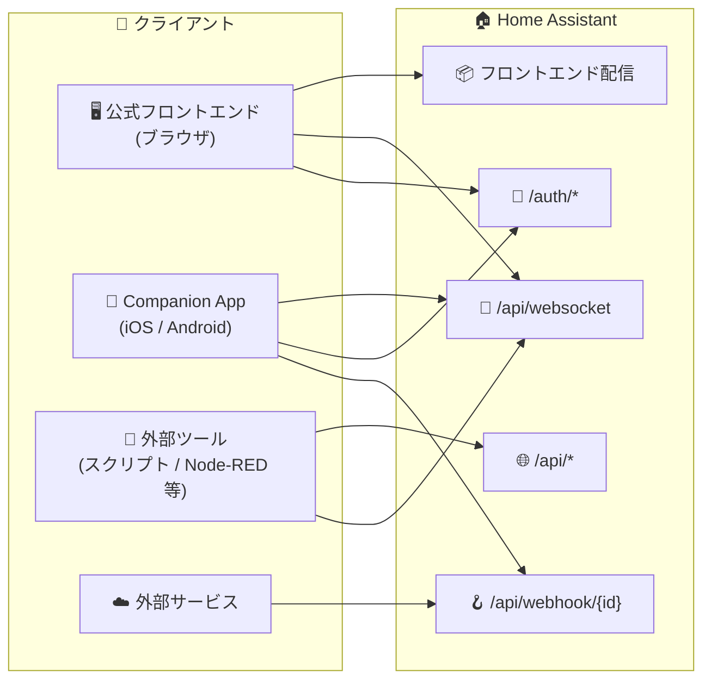
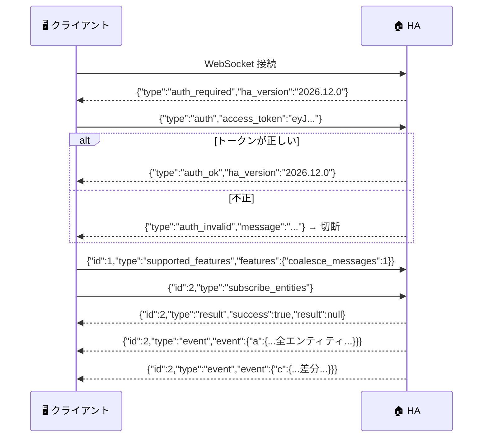
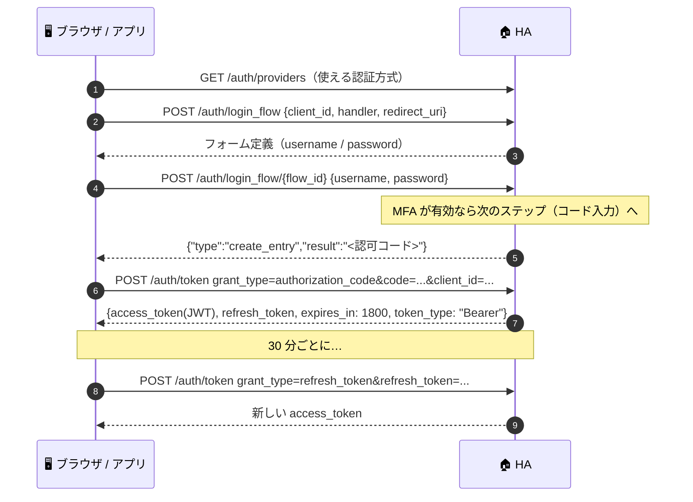
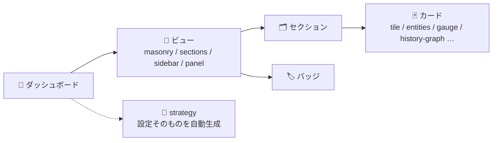
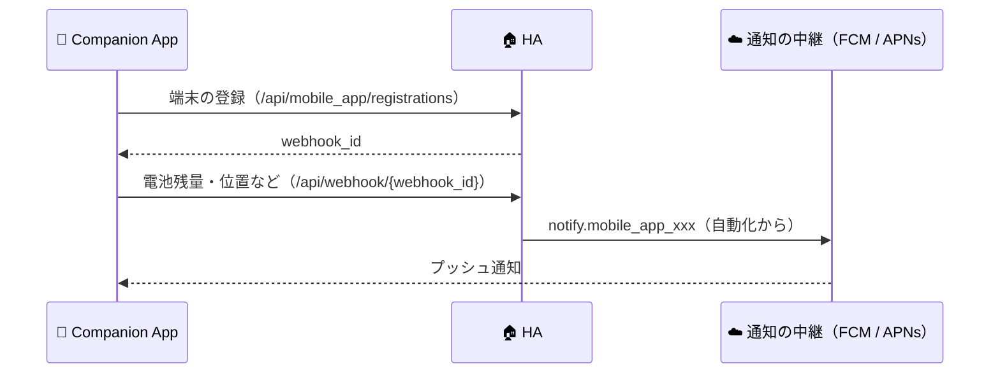

# 🔌 03. 外部 API とフロントエンド

> 🎯 **HA が外部とのつなぎ方で実現していること**: ブラウザの画面・スマホのアプリ・外部ツール・外部サービスが、**同じ WebSocket / REST の API と認証の仕組み**で本体につながる。
> 📌 出典: §1〜§3 は `home-assistant/core` `abbe09a`（2026-10-31）の `components/websocket_api` / `components/api` / `components/auth`。§4〜§5 はエコシステム調査（確度: ✅ 確認 ／ 📝 要約経由 ／ ❓ 未確認）

---

## 🧭 全体像



> 💡 **UI はほぼ 100% WebSocket**。REST は外部ツール向けの補助的な位置づけ。

---

## 🔄 1. WebSocket API（`/api/websocket`）

### 1-1. 接続と認証



### 1-2. メッセージの形

| 種類 | 例 |
|---|---|
| 📤 コマンド | `{"id": 5, "type": "call_service", "domain": "light", "service": "turn_on", "target": {"entity_id": "light.kitchen"}}` |
| ✅ 成功 | `{"id": 5, "type": "result", "success": true, "result": {...}}` |
| ❌ 失敗 | `{"id": 5, "type": "result", "success": false, "error": {"code": "not_found", "message": "..."}}` |
| 📣 購読イベント | `{"id": 2, "type": "event", "event": {...}}`（`id` は購読を開始したコマンドの id） |

- 🔢 `id` は**接続ごとに増えていく整数**。使い回すと `id_reuse` エラー
- 🧯 エラーコード: `id_reuse` / `invalid_format` / `not_allowed` / `not_found` / `not_supported` / `unknown_command` / `unauthorized` / `timeout` / `template_error` / `service_validation_error` / `home_assistant_error` / `unknown_error`

### 1-3. 🗜️ `subscribe_entities` の差分圧縮

状態の変化を**最小限の JSON**で送るための独自形式（`messages.py:195`）。

```jsonc
// ① 購読直後: 全エンティティを "a"（add）で送る
{"a": {"light.kitchen": {"s": "on", "a": {"brightness": 180}, "c": "01JB...", "lc": 1761868800.12}}}

// ② 変化: "c"（change）に差分だけ。"+" が追加・変更分、"-" が消えた属性
{"c": {"light.kitchen": {"+": {"s": "off", "lc": 1761868900.5, "c": "01JC..."}, "-": {"a": ["brightness"]}}}}

// ③ 削除: "r"（remove）
{"r": ["light.kitchen"]}
```

| キー | 意味 |
|:-:|---|
| `s` | state（状態の文字列） |
| `a` | attributes（属性） |
| `c` | context（id だけなら文字列、parent_id / user_id が変わったときは辞書） |
| `lc` / `lu` | last_changed / last_updated（UNIX 秒） |

> 💡 状態が変わらず属性だけ変わったときは `lc` ではなく `lu` が入る。**1 つの JSON を全購読者で使い回す**（`cached_event_message`）ので、購読者が増えてもシリアライズは 1 回だけ。

### 1-4. 主なコマンド（全 353 種のうち代表的なもの）

| 分類 | コマンド |
|---|---|
| 🗃️ 状態・イベント | `get_states` / `subscribe_entities` / `subscribe_events` / `unsubscribe_events` / `fire_event` |
| 🛎️ サービス | `get_services` / `call_service` / `execute_script` |
| 🌍 設定・情報 | `get_config` / `manifest/list` / `manifest/get` / `integration/setup_info` / `entity/source` |
| 🤖 自動化 | `render_template` / `subscribe_trigger` / `test_condition` / `validate_config` / `get_triggers_for_target` |
| 🗂️ レジストリ | `config/entity_registry/*` / `config/device_registry/*` / `config/area_registry/*` / `config/floor_registry/*` / `config/label_registry/*` / `config/category_registry/*` |
| 🔐 認証 | `auth/current_user` / `auth/long_lived_access_token` / `auth/refresh_tokens` / `auth/delete_refresh_token` / `auth/setup_mfa` / `config/auth/*` |
| 📈 履歴・統計 | `history/history_during_period` / `history/stream` / `logbook/event_stream` / `recorder/statistics_during_period` / `recorder/list_statistic_ids` |
| 🏓 その他 | `ping`（→ `pong`）/ `supported_features` |

### 1-5. 🛡️ 安定運用のための仕組み

| 仕組み | 値 | 内容 |
|---|---|---|
| 💓 ハートビート | 55 秒 | WebSocket の ping で死活監視 |
| 📦 メッセージの束ね（coalesce） | 機能フラグ | 1 フレームに複数メッセージを JSON 配列で詰めて送る |
| 🚰 送信待ちの上限 | 1,024 件 × 10 秒 | 溜まった状態が 10 秒続いたら遅いクライアントとみなして切断 |
| 🧱 送信待ちの絶対上限 | 4,096 件 | 超えたら即切断 |

> 💡 「遅いクライアントのせいでサーバー全体が詰まる」のを防ぐ**背圧（バックプレッシャー）**の設計。自作版でも SignalR / WebSocket で同じ考え方が必要。

---

## 🌐 2. REST API（`/api/*`）

ヘッダー `Authorization: Bearer <アクセストークン>` で認証。

| メソッド | パス | 内容 |
|---|---|---|
| GET | `/api/` | 動作確認（`{"message": "API running."}`） |
| GET | `/api/config` | 全体設定（位置・単位・バージョン …） |
| GET | `/api/core/state` | コアの状態（起動中・稼働中 …） |
| GET | `/api/states` | 全エンティティの状態 |
| GET / POST / DELETE | `/api/states/{entity_id}` | 1 エンティティの状態の取得・**上書き**・削除 |
| GET | `/api/events` | イベントの種類と購読者数 |
| POST | `/api/events/{event_type}` | イベントの発火 |
| GET | `/api/services` | サービスの一覧 |
| POST | `/api/services/{domain}/{service}` | サービスの呼び出し（`?return_response` で戻り値） |
| POST | `/api/template` | テンプレートの描画 |
| GET | `/api/history/period[/{開始時刻}]` | 履歴 |
| GET | `/api/logbook[/{開始時刻}]` | ログブック |
| GET | `/api/error_log` | エラーログ |
| GET | `/api/stream` | イベントのストリーム |
| POST | `/api/webhook/{webhook_id}` | Webhook の受信（認証なし。ID 自体が秘密） |

> ⚠️ `POST /api/states/{entity_id}` は**実機に何も送らず**ステートマシンの表示だけを書き換える。実機を操作するのはサービス呼び出し。この区別（**状態 ≠ 操作**）は HA の重要な設計。

---

## 🔐 3. 認証フロー（OAuth2 + IndieAuth 風）



- 🧙 ログイン画面そのものが **Config Flow と同じ `data_entry_flow`** で作られている（ステップ式フォームの再利用）
- 🆔 `client_id` は **URL**（IndieAuth の考え方。アプリ登録が不要）
- 🗝️ 長期アクセストークンは WebSocket の `auth/long_lived_access_token`（名前と有効日数を指定）で発行
- 🚪 ログアウト・失効は `POST /auth/revoke` や `auth/delete_refresh_token`

---

## 🖥️ 4. フロントエンド

| 項目 | 内容 | 確度 |
|---|---|:-:|
| 📦 配布 | 別リポジトリの `frontend`（TypeScript）でビルドし、PyPI パッケージ `home-assistant-frontend`（現在 `20261028.2`）として本体の `frontend` インテグレーションが配信 | ✅ |
| 🧱 作り | Lit ベースの Web Components。2025.5 で古い Polymer の部品と `paper-*` の CSS 変数を削除 | ❓ / 📝 |
| 🔄 通信 | 別リポジトリの `home-assistant-js-websocket`（TypeScript）で WebSocket API を使う | ✅ |

### 🧱 4-1. ダッシュボードの構造



- 🏠 既定の **Overview** はエリア・フロアから**自動生成**（2026.2〜）。以前のものは「Overview (legacy)」として残る（📝）
- 🗂️ 用途別のダッシュボード: 照明・空調・セキュリティ（2025.11）、メンテナンス（2026.5）、地図（2026.10）（📝）
- 🧠 2026.5 から、カスタムのインテグレーションやモジュールが **strategy**（ダッシュボードを自動生成するロジック）を登録できる（📝）
- 🔍 クイック検索（Ctrl / ⌘ + K。2026.2）、新しいカードピッカー（2026.6）（📝）

### 🃏 4-2. カスタムカード（❓ 一般知識）

- `customElements.define` でカスタム要素を作り、`setConfig`（設定を受け取る）・`hass`（全状態が入ったオブジェクト）・`getCardSize` / `getGridOptions`（大きさ）・`getConfigElement` / `getStubConfig`（エディタ）を実装して、`window.customCards` に登録する
- 📦 配布はコミュニティの **HACS** が中心。core にも GitHub からダッシュボードのリソースやテーマを入れる `marketplace` インテグレーションが入りつつある（✅ [02](02-ha-core-architecture.md) §12）

---

## 📱 5. モバイルアプリ・通知・リモートアクセス

| 項目 | 内容 | 確度 |
|---|---|:-:|
| 📱 アプリ | Android（Kotlin）・iOS / iPadOS / macOS（Swift）。文書は `companion.home-assistant.io` | ✅ |
| 🔗 連携の流れ | アプリが `/api/mobile_app/registrations` に登録 → `webhook_id` を受け取る → 以後は `/api/webhook/<id>` で電池残量・位置・イベントなどを送る | ❓ |
| 🔔 通知 | `notify.mobile_app_<端末>` → 公式の中継（`mobile-apps-fcm-push`）経由で FCM / APNs へ。WebSocket 経由のローカルの通知もある | ✅ 中継のリポジトリ / ❓ 仕組み |
| 📷 端末の機能 | Z-Wave の SmartStart の QR 読み取り（2025.5）、Android の端末内でのウェイクワード検出（2026.3・実験的） | 📝 |
| ☁️ リモートアクセス | 有料の Home Assistant Cloud（Nabu Casa）の中継。**2026-12 に「Home Assistant Link」へ改称予定**。クラウドバックアップ・音声合成 / 認識も提供 | 📝 |



> ❓ 上の流れは一般知識による。使う前に `contributors.home-assistant.io` のモバイルアプリの文書で確認する。

---

## 🎓 6. 自作版への示唆

| # | HA の設計 | 自作版でどうするか |
|:-:|---|---|
| 1 | 🔄 UI はほぼ WebSocket だけで動く | Blazor Server なら UI はプロセス内で直接コアを呼べる。**外部向け**には SignalR か WebSocket を別に用意 |
| 2 | 🗜️ 差分圧縮 + シリアライズ 1 回で全員に配信 | 購読者ごとに JSON を作らない設計を最初から意識する |
| 3 | 🚰 遅いクライアントは切断（背圧） | 購読者ごとに上限付きのキュー（`Channel<T>` の `BoundedChannelOptions`） |
| 4 | 🧙 ログインも Config Flow も同じステップ式フォーム | 「ステップ式フォームのエンジン」を 1 つ作って使い回す |
| 5 | ⚠️ 状態の上書き ≠ 実機の操作 | API でも「状態」と「サービス（操作）」をはっきり分ける |
| 6 | 🔐 OAuth2 風（認可コード + リフレッシュ）+ 長期トークン | ブラウザは Cookie 認証、外部 API はトークン、と使い分けると .NET では素直 |
| 7 | 🧱 ダッシュボードは「ビュー → セクション → カード」+ 自動生成（strategy） | `Dashboard.Config` を同じ構造にし（[09](09-db-design.md)）、概要（SCR-101）は「自動生成」の考え方で作る |
| 8 | 📱 アプリは登録後、Webhook で端末の値を送る | HomeManager でも Webhook（[08](08-api-design.md) API-070）+ 長期トークンで、MAUI のアプリから端末の値を送れる |
