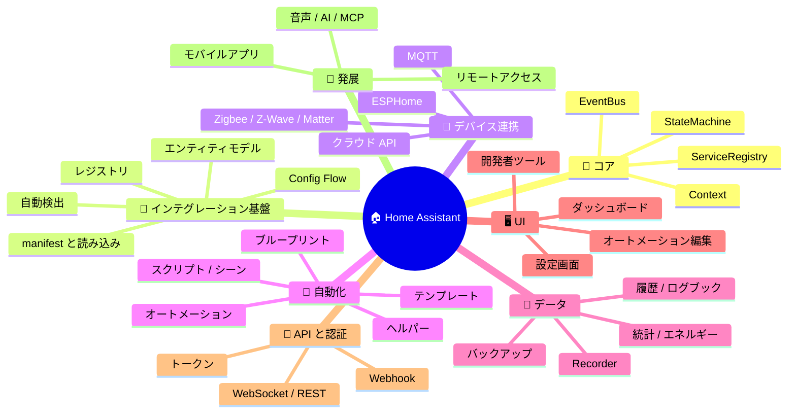
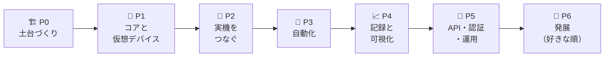

# 🧩 05. 実装機能の洗い出し

> 🎯 **方針**: HA の「**小さなコア + 拡張**」という骨格はそのまま学び、量（1,563 のインテグレーション）や運用基盤（OS・Supervisor・クラウド）は割り切る。
> 📚 根拠となる分析は [02 core ソース分析](02-ha-core-architecture.md)、使う技術は [06 .NET 技術スタック構成案](06-dotnet-architecture.md) を参照。
> 🗄️ DB は **SQLite**（アプリの中・ファイル 1 つ）。当初は PostgreSQL を別途用意する前提だったが、2026-11-02 の見直しで変更（[12](12-db-review.md)）。
> 🎯 **ユーザーから見た機能の一覧と採用の判断は [00 実現する機能](00-system-features.md)**。この章はそれを実装の単位（ID）に分けたもの。🆕 は [10 Prometheus Exporter](10-prometheus-exporter.md) の検討で追加した項目、🔁 は同じ検討で変えた項目（**2026-10-31 に [00](00-system-features.md) で決定**）。

---

## 🗺️ 1. HA の機能マップ

---

## 🏷️ 2. 凡例

| 記号 | 意味 |
|:-:|---|
| ⭐⭐⭐ | **Must** — これが無いと「HA っぽいもの」にならない |
| ⭐⭐ | **Should** — 実用・学習の両面で価値が高い |
| ⭐ | **Could** — 余力があれば。発展課題 |
| ❌ | **Won't** — 作らない（理由を併記） |
| P0〜P6 | 実装フェーズ（[§4](#-4-フェーズ分け) を参照） |

---

## 📋 3. 機能一覧（作る／作らない）

### 🧠 3-1. コア

| ID | 機能 | HA での実体 | 自作版でのスコープ | 優先 | Phase |
|---|---|---|---|:-:|:-:|
| CORE-01 | 📣 イベントバス | `core.EventBus` | 型付きイベント・購読／解除・フィルタ・全イベント購読 | ⭐⭐⭐ | P1 |
| CORE-02 | 🗃️ ステートマシン | `core.StateMachine` | `entity_id` → State（文字列 + 属性 JSON + 時刻 3 種）、`state_changed` の発火 | ⭐⭐⭐ | P1 |
| CORE-03 | 🛎️ サービス（アクション） | `core.ServiceRegistry` | `domain.service` の登録・入力検証・応答あり／なし | ⭐⭐⭐ | P1 |
| CORE-04 | 🎯 ターゲット解決 | `helpers/target.py` | entity / device / area / label 指定を実エンティティに展開 | ⭐⭐ | P2 |
| CORE-05 | 🧵 Context | `core.Context` | id / user_id / parent_id で「誰が・何が」変えたかを追跡 | ⭐⭐ | P1 |
| CORE-06 | 🌍 全体設定 | `core_config.Config` | 位置（緯度経度）・タイムゾーン・単位系・言語 | ⭐⭐ | P1 |
| CORE-07 | 🥾 起動／停止の段取り | `bootstrap.py` | 段階的な起動・優雅な停止（状態の保存を待つ） | ⭐⭐ | P1 |

### 🧩 3-2. インテグレーション基盤

| ID | 機能 | HA での実体 | 自作版でのスコープ | 優先 | Phase |
|---|---|---|---|:-:|:-:|
| INT-01 | 📄 インテグレーションの定義と読み込み | `manifest.json` + `loader.py` | **コンパイル時に組み込む**プラグイン（1 インテグレーション = 1 プロジェクト、属性でメタ情報、DI で登録。将来は生成器で自動登録） | ⭐⭐⭐ | P1 |
| INT-02 | 💡 エンティティモデル（基本） | `helpers/entity.py` | 基底クラス + `sensor` / `binary_sensor` / `switch` / `light` / `button` / `number` / `select` | ⭐⭐⭐ | P1 |
| INT-03 | 💡 エンティティモデル（拡張） | 45 種 | `climate` / `cover` / `fan` / `lock` / `media_player` / `event` / `update` など | ⭐ | P6 |
| INT-04 | 🔄 ポーリング／コーディネーター | `DataUpdateCoordinator` | 取得の集約・間隔・失敗時の unavailable 化・push 型との両立 | ⭐⭐⭐ | P2 |
| INT-05 | 🧙 Config Entry + Config Flow | `config_entries.py` + `data_entry_flow.py` | ステップ式ウィザード、スキーマからフォームを自動生成、再設定・オプション | ⭐⭐⭐ | P2 |
| INT-06 | 🗂️ エンティティ／デバイスのレジストリ | `entity_registry` / `device_registry` | unique_id ↔ entity_id、ユーザーによる名前・アイコン・無効化 | ⭐⭐⭐ | P2 |
| INT-07 | 🛋️ エリア／フロア／ラベル | `area_registry` ほか | 部屋・階・タグでの整理とターゲット指定 | ⭐⭐ | P2 |
| INT-08 | ♻️ 状態の復元 | `RestoreEntity` | 再起動の前後で値を引き継ぐ（ヘルパー等） | ⭐⭐ | P3 |
| INT-09 | 🔍 自動検出 | zeroconf / ssdp / dhcp | mDNS・SSDP で見つけて「追加しますか？」を出す | ⭐ | P6 |
| INT-10 | 🩺 診断・修復・システムヘルス | diagnostics / repairs / system_health | 要対応事項の一覧と診断情報の出力 | ⭐ | P6 |
| INT-11 | 📦 外部プラグインの動的読み込み | `custom_components` / `marketplace` | `AssemblyLoadContext` で DLL を後から読み込む（Exporter の読み込み方式が手本） | ⭐ | P6 |
| INT-12 | 🔵 Bluetooth の共通基盤 🆕 | `bluetooth` | スキャンを 1 つにまとめ、インテグレーションはメーカー ID などの条件で購読する（BlueZ / WinRT。Exporter の実装を移植） | ⭐⭐⭐ | P2 |
| — | ❌ 実行時のパッケージインストール | `requirements.py`（pip / uv） | **作らない**: .NET ではビルド時に依存を解決するのが自然 | ❌ | — |

### 🔌 3-3. デバイス連携（個別インテグレーション）

| ID | 機能 | HA での実体 | 自作版でのスコープ | 優先 | Phase |
|---|---|---|---|:-:|:-:|
| DEV-01 | 🧪 デモ（仮想デバイス） | `demo` / `kitchen_sink` | 実機なしで動作確認・テストができる仮想の照明・センサー | ⭐⭐⭐ | P1 |
| DEV-02 | 📡 **MQTT** | `mqtt`（約 2.5 万行） | ブローカー接続 + **HA 互換の MQTT Discovery** → Zigbee2MQTT・Tasmota・ESPHome（MQTT モード）・Shelly がつながる | ⭐⭐⭐ | P2 |
| DEV-03 | ☀️ 太陽・時刻・天気 | `sun` / `met` など | 日の出・日の入りの計算（オートメーション用）、天気 API | ⭐⭐ | P3 |
| DEV-04 | 🌐 汎用 HTTP | `rest` / `command_line` | URL を定期取得してセンサー化、HTTP でスイッチ操作 | ⭐⭐ | P3 |
| DEV-05 | 🇯🇵 日本でよく使う機器 | `nature_remo`・`switchbot` / `switchbot_cloud`（core にある）、ECHONET Lite（core に無い） | 手持ちの機器から 1〜2 個。ECHONET Lite はエアコン・太陽光・スマートメーターの国内標準 | ⭐⭐ | P6 |
| DEV-06 | 🏠 LAN 内の機器 | `shelly` / `wled` / `hue` | HTTP・WebSocket・SSE で直接通信 | ⭐ | P6 |
| DEV-07 | 🌊 Z-Wave / 🧩 Matter | `zwave_js` / `matter` | 外部の Z-Wave JS Server・Matter Server に **WebSocket** で接続 | ⭐ | P6 |
| DEV-08 | 🔌 ESPHome ネイティブ API | `esphome` | TCP + protobuf でデバイスと直接通信 | ⭐ | P6 |
| DEV-09 | 🌡️ SwitchBot（BLE）🆕 | `switchbot` | 温湿度計・CO2 センサー・プラグミニのアドバタイズを受けて即時に更新（Exporter の解析を移植） | ⭐⭐⭐ | P2 |
| DEV-10 | ⚡ ワットチェッカー（BLE / Wi-Fi）🆕 | — | BLE はアドバタイズ、Wi-Fi は `DeviceLib.WFWattch2` で定期取得。電力・電流・電圧 | ⭐⭐⭐ | P2 |
| DEV-11 | 🌫️ オムロン 2JCIE-BU（シリアル）🆕 | — | `DeviceLib.SensorOmron` で 10 項目を定期取得 | ⭐⭐ | P2 |
| DEV-12 | 📶 Ping 🆕 | `ping` | 接続状態（binary_sensor）と応答時間 | ⭐⭐ | P2 |
| DEV-13 | 🍓 システム監視 🆕 | `systemmonitor` | Raspberry Pi・Linux・SMART（自作の `RaspberryDotNet` / `LinuxDotNet`） | ⭐ | P6 |
| DEV-14 | 🏃 BLE の在宅判定 🆕 | `bluetooth_le_tracker` | 電波の強さのしきい値で在宅／外出 | ⭐ | P6 |
| DEV-15 | 🔁 Prometheus の取り込み 🆕 | — | 他の PC の Exporter の `/metrics` を定期取得してセンサーにする | ⭐ | P6 |
| — | ❌ Zigbee 無線スタックの自前実装 | `zha`（zigpy） | **作らない**: Zigbee2MQTT を MQTT 経由で使えば十分 | ❌ | — |

### 🤖 3-4. 自動化

| ID | 機能 | HA での実体 | 自作版でのスコープ | 優先 | Phase |
|---|---|---|---|:-:|:-:|
| AUTO-01 | 🎯 トリガー | `trigger.py` 群 | state / numeric_state / time / time_pattern / event / 起動時 / 日の出・日の入り | ⭐⭐⭐ | P3 |
| AUTO-02 | ✅ 条件 | `condition.py` 群 | state / numeric_state / time / sun / and・or・not | ⭐⭐⭐ | P3 |
| AUTO-03 | 🎬 アクション | `helpers/script.py` | サービス呼び出し / delay / wait / choose・if / repeat / parallel / variables / stop | ⭐⭐⭐ | P3 |
| AUTO-04 | 🔀 実行モード | single / restart / queued / parallel | 実行中に再トリガーされたときの扱い | ⭐⭐ | P3 |
| AUTO-05 | 🔍 トレース | `trace` | 実行経路・変数・結果を記録して UI で再生 | ⭐⭐ | P3 |
| AUTO-06 | 📜 スクリプト | `script` | 名前付きのアクション列（サービスとして呼べる） | ⭐⭐ | P3 |
| AUTO-07 | 🎬 シーン | `scene` | 複数エンティティの状態を保存・一括適用 | ⭐⭐ | P3 |
| AUTO-08 | 🎛️ ヘルパー | `input_*` / `timer` / `counter` / `schedule` | 仮想スイッチ・数値・選択肢・タイマー・週間スケジュール | ⭐⭐ | P3 |
| AUTO-09 | 🧮 テンプレート（式） | Jinja2 + 独自関数 | 文字列テンプレートで状態を参照（Scriban / Fluid などで代替） | ⭐⭐ | P4 |
| AUTO-10 | 📘 ブループリント | `blueprint` | 入力パラメータ付きの雛形 | ⭐ | P6 |
| AUTO-11 | ⚡ 電力量の計算ヘルパー 🆕 | `integration`（リーマン和） | W を時間で積分して kWh のセンサーを作る（エネルギーの材料） | ⭐⭐ | P4 |

### 💾 3-5. データ

| ID | 機能 | HA での実体 | 自作版でのスコープ | 優先 | Phase |
|---|---|---|---|:-:|:-:|
| DATA-01 | 💾 Recorder | `recorder` | `state_changed` を非同期でまとめて DB へ（正規化テーブル。古い履歴は少しずつ消すか、日ごとのファイルにする） | ⭐⭐⭐ | P4 |
| DATA-02 | 📈 履歴グラフ | `history` | 期間指定で状態の推移を取得・描画 | ⭐⭐⭐ | P4 |
| DATA-03 | 📒 ログブック | `logbook` | 「いつ・何が・誰によって」の時系列 | ⭐⭐ | P4 |
| DATA-04 | 📊 統計 | `recorder/statistics.py` | 5 分・1 時間ごとの平均／最小／最大／積算（`state_class`） | ⭐⭐ | P4 |
| DATA-05 | 🧹 保持期間と削除 | `purge_keep_days` | 古い履歴の自動削除（パーティションごと DROP。統計は残す） | ⭐⭐ | P4 |
| DATA-06 | 🗄️ バックアップ／リストア | `backup` | DB と設定の書き出し・復元 | ⭐⭐ | P5 |
| DATA-07 | ⚡ エネルギーダッシュボード 🔁 | `energy` | 家電ごとの電力量の集計・比較（ワットチェッカーがあるので価値が高い。P6 から前倒し） | ⭐⭐ | P4 |
| DATA-08 | 📤 Prometheus への出力 🆕 | `prometheus` | エンティティの状態を `/api/v1/prometheus` で出す。Exporter と同じ名前の**互換モード**で、今の Grafana を使い続けられる | ⭐⭐ | P4 |

### 🖥️ 3-6. UI

| ID | 機能 | HA での実体 | 自作版でのスコープ | 優先 | Phase |
|---|---|---|---|:-:|:-:|
| UI-01 | 🧱 ダッシュボード（基本） | Lovelace | エリアごとのカード一覧（自動生成）、リアルタイム反映 | ⭐⭐⭐ | P1 |
| UI-02 | 🎨 ダッシュボード（編集） | views / sections / cards | カードの種類（エンティティ・タイル・ゲージ・グラフ）、配置の編集・保存 | ⭐⭐ | P4 |
| UI-03 | 🛠️ 開発者ツール | Developer tools | 状態一覧・サービス呼び出し・イベント監視・テンプレート試験 | ⭐⭐ | P1 |
| UI-04 | 🗂️ エンティティ／デバイス／エリア管理 | 設定 > デバイスとサービス | 一覧・検索・名前変更・エリア割り当て・無効化 | ⭐⭐⭐ | P2 |
| UI-05 | 🧙 インテグレーション追加画面 | Config Flow の描画 | スキーマから動的にフォームを描画するウィザード | ⭐⭐⭐ | P2 |
| UI-06 | ✏️ オートメーション編集 | ビジュアルエディタ + YAML | フォーム型の編集 + YAML / JSON 直接編集、トレース表示 | ⭐⭐⭐ | P3 |
| UI-07 | 📈 履歴・ログブック画面 | History / Logbook | グラフと時系列リスト | ⭐⭐ | P4 |
| UI-08 | 🌙 ダークモード・レスポンシブ・PWA | テーマ / モバイル表示 | スマホでも快適に、ホーム画面に追加 | ⭐⭐ | P4 |
| UI-09 | 👥 ユーザー・全体設定画面 | 設定 > ユーザー / 全般 | ユーザー管理・トークン発行・位置／単位 | ⭐⭐ | P5 |
| UI-10 | 🌐 多言語（日本語／英語） | translations | リソースの切り替え | ⭐ | P6 |
| UI-11 | 📶 Bluetooth 診断 🆕 | Bluetooth の可視化 | 受信中の BLE 機器（MAC・名前・電波・メーカー ID）の一覧。機器の登録で MAC を調べる | ⭐⭐ | P2 |

### 🔐 3-7. API と認証

| ID | 機能 | HA での実体 | 自作版でのスコープ | 優先 | Phase |
|---|---|---|---|:-:|:-:|
| SEC-01 | 🔑 ログイン | `auth` / `homeassistant` プロバイダ | テンプレートの **Cookie 認証**（決定）。初期ユーザーのパスワード変更を必須にする | ⭐⭐⭐ | P1 |
| SEC-02 | 👥 ロール | system-admin / users / read-only | 管理者・一般・閲覧のみ | ⭐⭐ | P5 |
| SEC-03 | 🗝️ 長期アクセストークン | `long_lived_access_token` | 外部スクリプトやモバイルアプリ用の API トークン | ⭐⭐⭐ | P5 |
| SEC-04 | 📱 MFA | TOTP | ワンタイムパスワード | ⭐ | P6 |
| API-01 | 🌐 REST API | `components/api` | 状態取得・サービス呼び出し・イベント発火・履歴 | ⭐⭐⭐ | P5 |
| API-02 | 🔄 リアルタイム API | `websocket_api` | 外部クライアント向けの購読（SignalR か素の WebSocket） | ⭐⭐ | P5 |
| API-03 | 🪝 Webhook（受信） | `webhook` | 外部サービスからの通知をイベント化 | ⭐⭐ | P5 |
| API-04 | 🔔 通知 | `persistent_notification` / `notify` | UI 内の通知（P3）、スマホ・LINE などへの送信（P6） | ⭐⭐ | P3 / P6 |
| API-05 | 🤝 HA 互換 WebSocket API（一部） | `websocket_api` のプロトコル | HA 用の既存ツール（JS ライブラリ等）から接続できるか試す | ⭐ | P6 |

### 🛠️ 3-8. 運用

| ID | 機能 | HA での実体 | 自作版でのスコープ | 優先 | Phase |
|---|---|---|---|:-:|:-:|
| OPS-01 | 🐧 常駐化と周辺の起動 | HA Container | アプリは **systemd**（テンプレート標準・DB は SQLite でアプリの中）、Mosquitto は MQTT の機器を使うときだけ **Docker Compose**、開発時は **Aspire** | ⭐⭐⭐ | P0 |
| OPS-02 | 🔭 ログ・可観測性 | `logger` / `system_log` | 構造化ログ・メトリクス・トレース（OpenTelemetry） | ⭐⭐ | P0 |
| OPS-03 | ❤️ ヘルスチェック | `system_health` | `/health` と内部状態の可視化 | ⭐⭐ | P1 |
| OPS-04 | 🍓 Raspberry Pi での常駐 | HA OS / Container | linux-arm64 で発行して systemd で 24 時間稼働 | ⭐⭐ | P5 |
| — | ❌ 専用 OS・Supervisor・アドオンストア | HA OS / Supervisor | **作らない**: systemd + Docker Compose で代替できる | ❌ | — |

### 🚀 3-9. 発展

| ID | 機能 | HA での実体 | 自作版でのスコープ | 優先 | Phase |
|---|---|---|---|:-:|:-:|
| ADV-01 | 🤖 AI 連携（MCP サーバー） | `mcp_server` / `anthropic` / `ai_task` | エンティティとサービスを MCP で LLM に公開し、自然言語で操作 | ⭐ | P6 |
| ADV-02 | 💬 会話・インテント | `conversation` / `intent` | 「リビングの電気を消して」→ サービス呼び出し | ⭐ | P6 |
| ADV-03 | 📱 モバイルアプリ／壁掛けパネル | Companion App | 既存の MAUI / Avalonia テンプレートでクライアントを作る | ⭐ | P6 |
| ADV-04 | 🌍 外出先からのアクセス | Nabu Casa | **作らない**: Tailscale や Cloudflare Tunnel を使う | ❌ | — |
| ADV-05 | 🎙️ 音声（STT / TTS / ウェイクワード） | `assist_pipeline` / Wyoming | 大掛かりなので後回し | ❌ | — |

---

## 🪜 4. フェーズ分け

| Phase | 🎯 ゴール | 📦 主な機能 | ✅ 完了の目安 | 🎓 学べること |
|:-:|---|---|---|---|
| 🏗️ **P0** | テンプレートから器を作る | OPS-01, OPS-02 | 改名した空のアプリが Aspire から PostgreSQL・Mosquitto と一緒に起動し、ログとヘルスチェックが見える | テンプレートの派生、Aspire、PostgreSQL、OpenTelemetry |
| 🌱 **P1** | **コアが動く MVP** | CORE-01〜03, 05〜07 / INT-01, 02 / DEV-01 / UI-01, 03 / SEC-01 / OPS-03 | ブラウザを 2 つ開き、片方で仮想ライトを切り替えると**もう片方に即座に反映**される | イベント駆動、DI、`Channel<T>`、リアルタイム UI |
| 🔌 **P2** 🔁 | **手持ちの機器がつながる** | CORE-04 / INT-04〜07・12 / DEV-09〜12（+ MQTT 機器があれば DEV-02）/ UI-04, 05, 11 | **SwitchBot・ワットチェッカー・オムロン・Ping が自動で登録**され、部屋に割り当てて見られる | BLE（BlueZ）・シリアル・TCP、SQLite、動的フォーム、プラグイン設計 |
| 🤖 **P3** | **家が自動で動く** | AUTO-01〜08 / INT-08 / DEV-03, 04 / UI-06 / API-04 | 「日没後に人感センサーが反応したら照明 ON、5 分後に OFF」を UI で作れて、**トレース**で経路が見える | インタプリタ設計、タイマー（`TimeProvider`）、YAML |
| 📈 **P4** 🔁 | **過去が見える** | DATA-01〜05・07・08 / AUTO-09・11 / UI-02, 07, 08 | 温度の 1 週間グラフ・長期統計・**家電ごとの電力量**が見られ、**今の Grafana も続けて使える**。ダッシュボードを編集できる | 時系列データ、バッチ書き込み、グラフ描画、Prometheus の形式 |
| 🔐 **P5** | **外から安全に使える** | SEC-02, 03 / API-01〜03 / DATA-06 / UI-09 / OPS-04 | `curl` から長期トークンで状態の取得・サービス呼び出しができる。Raspberry Pi で常駐 | JWT、認可ポリシー、OpenAPI、ARM64 デプロイ |
| 🚀 **P6** | **好きな方向に伸ばす** | INT-03, 09〜11 / DEV-05〜08・13〜15 / AUTO-10 / UI-10 / SEC-04 / API-05 / ADV-01〜03 | — | UDP マルチキャスト、protobuf、MCP、`AssemblyLoadContext` |

> 💡 **P1 → P2 の順番が大事**: 先に「仮想デバイス + リアルタイム UI」でコアを固めてから実機をつなぐと、通信まわりの不具合とコアの不具合を切り分けやすい。

---

## ❌ 5. 作らないもの（と、その代わり）

| 作らないもの | 理由 | 代わりにどうするか |
|---|---|---|
| 🖥️ HA OS・Supervisor・アドオンストア | OS ごと管理する仕組みは学習の主題から外れる | アプリは **systemd**、ブローカー・DB は **Docker Compose** |
| 📦 1,563 のインテグレーション | 量は学びにならない | **MQTT + Zigbee2MQTT** で多数の機器を一気にカバーし、個別実装は手持ちの機器だけ |
| 🐝 Zigbee / Thread の無線スタック | 専門的で巨大 | Zigbee2MQTT・Matter Server・Z-Wave JS Server を外部サーバーとして使う |
| 📥 実行時のパッケージインストール | .NET の流儀に合わない | ビルド時に組み込む。どうしても必要なら DLL の動的読み込み（INT-11） |
| ☁️ Nabu Casa 相当のクラウド | 自前で運用するのは負担が大きい | Tailscale / Cloudflare Tunnel |
| 🎙️ 音声パイプライン | 依存が多く大掛かり | テキストの会話・MCP 連携（ADV-01, 02）から始める |
| 🔁 HA との完全互換 | 互換性の維持が目的化してしまう | 概念とデータモデルは HA に寄せ、API の互換は一部だけ試す（API-05） |
