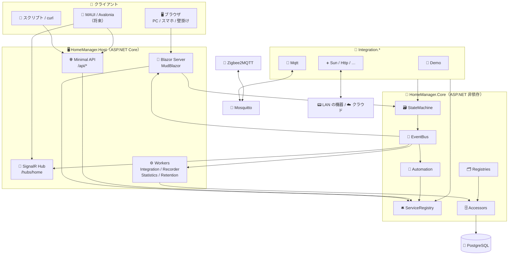
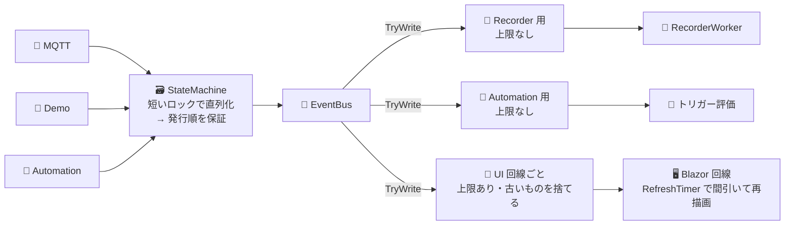
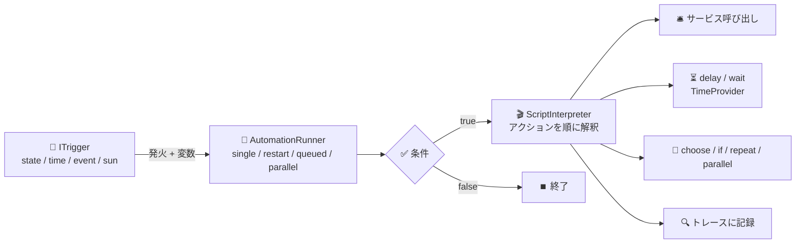
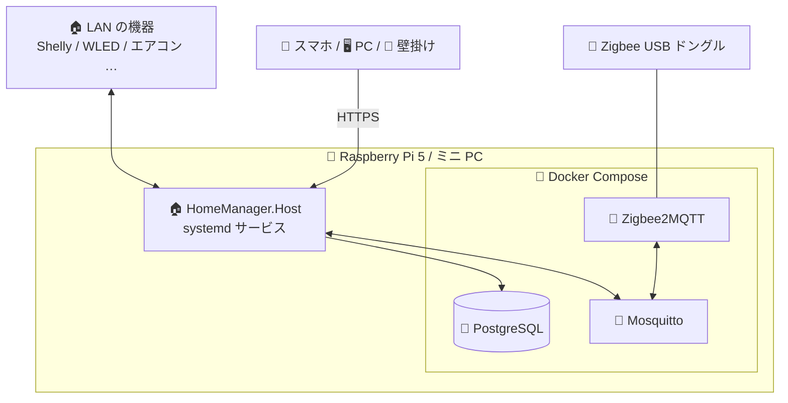

# 🏗️ 06. .NET 技術スタック構成案

> 📌 **前提**: [04 テンプレート調査](04-template-survey.md) の規約に乗る ＋ 利用者の方針「**DB は SQLite 以外を別途用意してよい**」
> 📌 **バージョン**: 2026-10-31 時点（**.NET 10 = 現行 LTS（10.0.14）**、.NET 11 は RC3）。テンプレートが固定している版はそれに合わせる
> 🏷️ **決定済み**: アプリ名 **HomeManager**／置き場所はこのリポジトリ／画面の認証は **Cookie**（§10）

---

## ⚡ TL;DR（結論）

| 項目 | 提案 |
|---|---|
| 🏁 **ベース** | `template-blazor-server` を複製・改名。足りない部品は maui-server / web-api / blazor-wasm / web-fullstack から移植 |
| 🖥️ **Web 構成** | **Blazor Server（InteractiveServer）+ 同じプロセスに外部向け API（Minimal API + SignalR Hub）** のモジュラーモノリス |
| 🧠 **コア** | `Core` に HA の 3 本柱（EventBus / StateMachine / ServiceRegistry）・エンティティモデル・レジストリ・オートメーションエンジン。ASP.NET には依存しない |
| 🧩 **インテグレーション** | **1 インテグレーション = 1 プロジェクト**（`Integration.Demo` / `Integration.Mqtt` …）。DI の多重登録で組み込み、将来は生成器で自動登録 |
| 🗄️ **DB** | **PostgreSQL**（別途用意）。アクセスはテンプレート標準の **Smart.Data.Accessor + Npgsql**。履歴は**時間で分割したテーブル**、必要になったら TimescaleDB |
| 📡 **デバイス連携** | **手持ちの機器**（SwitchBot・ワットチェッカー・オムロン・Ping）から始める。Prometheus Exporter の実装と自作ライブラリを流用し、BLE は**共通の Bluetooth 基盤**にまとめる（[10](10-prometheus-exporter.md)）。MQTT（MQTTnet + HA 互換の Discovery）は機器があれば |
| 🔐 **認証** | 画面は **Cookie**（テンプレート標準）、外部 API は **JWT + API キー + 長期トークン**（ハッシュで保存） |
| 🚢 **配置** | アプリは **systemd サービス**（テンプレート標準）、PostgreSQL / Mosquitto / Zigbee2MQTT は **Docker Compose**。開発時は **Aspire** でまとめて起動 |

---

## 🧭 1. 全体アーキテクチャ



- 🏠 **1 プロセスに全部載せる**（HA と同じ）。UI はプロセス内のコアを直接呼び、外部クライアントだけが API / Hub を通る
- 📣 状態が変わると `StateChanged` が EventBus に流れ、**画面・Hub・オートメーション・Recorder が一斉に反応**する

---

## ⚖️ 2. Web の構成: Blazor Server か、WASM + API か

| 観点 | 🟢 Blazor Server | 🟣 WASM + API |
|---|---|---|
| ⚡ リアルタイム | **回線がそのまま WebSocket**。バス → `InvokeAsync(StateHasChanged)` だけ（テンプレートに型あり） | Hub と WASM 側の `HubConnection` を**全部作る**（テンプレートに無し） |
| 🧱 実装量 | UI はコアの Service を直接呼ぶ。**DTO も API も不要** | UI 用の API・DTO・型付きクライアントの生成が必要 |
| 🧰 テンプレートの資産 | blazor-server + maui-server の部品が**同じ構造**で揃う | blazor-wasm と web-api の 2 ソリューションを手で合体 |
| 🍓 機器の負荷 | 家族数人なら RPi で十分。**タブレット側は軽い** | サーバーは軽いが、**古いタブレットで初回の読み込みが重い**（AOT 既定 off） |
| 📶 回線切れ | スマホのスリープ等で切れる → 再接続の工夫が必要 | 切れても画面は残る |
| 📴 オフライン / PWA | 不可 | 可能（ただしテンプレートは PWA を変種で予定） |
| 🔐 トークン | Cookie だけで済む | sessionStorage に JWT（XSS 対策が課題） |

### 🏁 判断: **Blazor Server + 外部向け API**

1. 🏠 HA のフロントエンドも「プロセス内のコアと WebSocket で話す」作り。**Blazor Server の回線はその構図にそのまま一致する**
2. 🚀 P1〜P4 は **API を作らずに画面からコアを直接触れる** → 学習のループが速い
3. 🔌 外部クライアント（スクリプト・モバイル・キオスク）向けの API と Hub は **P5 で別に作る**。それがあれば、後から WASM や MAUI のフロントも足せる
4. 🛟 弱点の回線切れは、テンプレートの `reconnect.js` を「失敗したら自動で再読み込み」に寄せ、壁掛けは自動リロードで対処

> 💡 **乗り換えの余地を残す工夫**: 画面は `IStateMachine` / `IServiceRegistry` などの**インターフェース越し**にコアを使う。WASM に移るときは、同じインターフェースを HTTP + SignalR で実装し直せばよい。

---

## 🧱 3. HA の概念 ↔ .NET 技術の対応表

| 領域 | 🏠 HA（Python） | 🟣 自作版（.NET） | 📝 メモ |
|---|---|---|---|
| 🧵 実行モデル | asyncio の単一イベントループ | `async`/`await` + スレッドプール。順序が要る所は短いロック + `Channel<T>` | [§6-1](#-6-1-並行性のモデル) |
| 📣 イベントバス | `EventBus` | 自作の `IEventBus`（イベントは `record`）、購読者ごとの `Channel<T>` | テンプレートの `NotificationBus` / `TelemetryBus` を発展させる |
| 🗃️ ステートマシン | `StateMachine` + `State` | `ConcurrentDictionary<string, EntityState>` + イミュータブルな `record` | 書き込み時に `StateChanged` を発行 |
| 🛎️ サービス | `ServiceRegistry` + probatio | `IServiceRegistry` + 型付きのリクエスト `record` + `System.Text.Json` + FluentValidation | FluentValidation はテンプレート標準 |
| 📄 manifest / 読み込み | `manifest.json` + `loader.py` | `[Integration("mqtt")]` 属性 + `IIntegration` + DI 登録 | 生成器で登録コードを生成（library-with-generator の手法） |
| 🧱 規約ベースの拡張 | `diagnostics.py` などのファイル名 | `IDiagnosticsProvider` などのインターフェース + `IEnumerable<T>` | worker / command-server の DI 多重登録と同じ発想 |
| 💡 エンティティ | `Entity` + `_attr_*` | 抽象クラス `Entity` → `LightEntity` など | `EntityDescription` は `record` |
| 🔄 コーディネーター | `DataUpdateCoordinator` | `PeriodicTimer` + `Microsoft.Extensions.Http.Resilience` | テンプレートは Resilience 不採用だが、**機器との通信には採用** |
| 🧙 Config Flow | `data_entry_flow` | ステップ式ウィザードの状態機械 + フォーム定義 → `DynamicComponent` で描画 | ログイン画面にも流用できる |
| 💾 `.storage` の JSON | `helpers/storage.Store` | PostgreSQL のテーブル（設定値は `jsonb`） | |
| 🗄️ Recorder | 専用スレッド + キュー + SQLAlchemy | `Workers/RecorderWorker` + `Channel<StateChanged>` + まとめて INSERT（Npgsql の COPY も可） | maui-server の時系列保存の型を流用 |
| 📊 統計 | 5 分 / 1 時間の集計 | `Workers/StatisticsWorker` + 集計 SQL（TimescaleDB なら連続集計） | |
| 🧹 削除（purge） | `purge_keep_days` | **パーティションごと DROP**（速い）、または `TelemetryRetentionWorker` 型 | |
| 🧮 テンプレート | Jinja2（サンドボックス） | Scriban または Fluid + 独自関数 `states()` など | 参照したエンティティを記録して再評価 |
| 📝 YAML | `automations.yaml` | YamlDotNet で入出力（保存の正は DB） | |
| ⏰ 時間 | `async_track_*` / astral / cronsim | **`TimeProvider`** + Cronos（cron 式）+ CoordinateSharp（日の出・日の入り） | 定期ジョブは Mofucat.JobScheduler（worker テンプレート）も可 |
| 🌐 HTTP | aiohttp + ミドルウェア | ASP.NET Core（テンプレートの ForwardedHeaders / SecurityHeaders / RateLimiter） | |
| 🔄 WebSocket API | `websocket_api` | UI は Blazor の回線、外部は **SignalR Hub**（maui-server の `MonitorHub` 型） | HA 互換の素の WebSocket は発展課題 |
| 🌐 REST API | `components/api` | **Minimal API** + OpenAPI（テンプレートは NSwag の UI） | web-api の版の管理・RateLimiter を流用 |
| 🔐 認証 | 独自の AuthManager + JWT | 画面は **Cookie**（テンプレート）／API は **JWT + API キー**（web-api）／長期トークンは**ハッシュ保存**（blazor-wasm の方式） | パスキーが欲しければ bs-identity |
| 🖥️ フロントエンド | Lit（Web Components） | Blazor + **MudBlazor**（テンプレート標準） | `@if` の代わりに Smart.Blazor の `Condition` など |
| 📈 グラフ | フロントの独自チャート | maui-server の**依存ゼロの SVG チャート** | 足りなければ Blazor-ApexCharts |
| 📡 MQTT | paho-mqtt | **MQTTnet 5** | テストでは同じプロセスでサーバーも起動できる |
| 🤖 AI / MCP | `mcp_server` / `anthropic` | ModelContextProtocol + Microsoft.Extensions.AI | P6 |
| 🔭 ログ・監視 | logger / system_log | **Serilog + `[LoggerMessage]` + OpenTelemetry + Prometheus**（テンプレート標準） | |
| 🚢 配布 | HA OS / Container | **systemd**（テンプレート標準）+ ミドルウェアは Docker Compose | |

---

## 📦 4. ライブラリ

### 4-1. テンプレートから引き継ぐもの（版はテンプレートの固定値）

| 用途 | パッケージ | 版 |
|---|---|---|
| 🎨 UI | MudBlazor / Usa.Smart.Blazor | 9.11.0 / 2.5.0 |
| ✅ 検証 | FluentValidation | 12.2.0 |
| 🗄️ データアクセス | Usa.Smart.Data.Accessor（+ DI 拡張） | 3.0.0-beta16 |
| 💉 DI の自動登録 | BunnyTail.ServiceRegistration | 1.22.0 |
| 📝 ログ | Serilog.AspNetCore | 10.0.0 |
| 🔭 テレメトリ | OpenTelemetry.* | 1.20.0 |
| 🚀 開発時の起動 | Aspire.AppHost.Sdk | 13.6.1 |
| 🧪 テスト | xunit.v3 / bUnit / NSubstitute / Playwright.Xunit.v3 | 4.0.2 / 2.11.3 / 6.2.0 / 1.63.0 |

### 4-2. 追加するもの（2026-10-31 時点の最新安定版）

| 用途 | パッケージ | 版 | Phase |
|---|---|---|:-:|
| 🐘 PostgreSQL | `Npgsql` | 10.0.3 | P0 |
| 🚀 Aspire（DB / ブローカー） | `Aspire.Hosting.PostgreSQL` / `CommunityToolkit.Aspire.Hosting.Mosquitto` | 13.6.4 / 13.6.1 | P0 |
| 🧪 テストの DB | `Testcontainers.PostgreSql` | 4.16.0 | P0 |
| ⏰ テストの時間 | `Microsoft.Extensions.TimeProvider.Testing` | 10.11.0 | P1 |
| 📡 MQTT | `MQTTnet` | 5.2.0 | P2 |
| 🔁 回復性 | `Microsoft.Extensions.Http.Resilience` | 10.11.0 | P2 |
| 📝 YAML | `YamlDotNet` | 18.1.0 | P3 |
| ⏰ cron 式 | `Cronos`（または worker の `Mofucat.JobScheduler` 2.7.0） | 0.13.0 | P3 |
| ☀️ 日の出・日の入り | `CoordinateSharp` | 3.5.1.1 | P3 |
| 🧮 テンプレート | `Scriban` または `Fluid.Core` | 7.5.3 / 2.40.0 | P4 |
| 📈 グラフ（必要なら） | `Blazor-ApexCharts` | 7.1.0 | P4 |
| 🔍 mDNS | `Makaretu.Dns.Multicast.New` / `Zeroconf` | 0.38.0 / 3.7.16 | P6 |
| 🧬 protobuf（ESPHome） | `Google.Protobuf` | 3.36.2 | P6 |
| 🔵 BLE | Linux: `Tmds.DBus`（BlueZ。Exporter の `BleScanSession` を移植）／ Windows: WinRT の `BluetoothLEAdvertisementWatcher` | 0.95.1 / OS 標準 | P2 |
| ⚡ ワットチェッカー（Wi-Fi） | `DeviceLib.WFWattch2`（自作・Exporter で使用中） | 1.9.0 | P2 |
| 🌫️ オムロン 2JCIE-BU | `DeviceLib.SensorOmron`（自作・Exporter で使用中） | 1.9.0 | P2 |
| 🍓 Raspberry Pi・Linux の監視 | `RaspberryDotNet.SystemInfo` / `LinuxDotNet.SystemInfo` / `LinuxDotNet.Disk`（自作） | 2.0.1 / 2.0.0 / 2.0.0 | P6 |
| 🤖 MCP / LLM | `ModelContextProtocol` / `Microsoft.Extensions.AI` | 2.3.0 / 10.11.0 | P6 |

---

## 🗂️ 5. ソリューション構成

```text
incubator-home/
├── HomeManager.slnx
├── Directory.Build.props / .editorconfig / Analyzers.ruleset   ← テンプレートのまま
├── docs/                                  📚 この調査ドキュメント
├── deploy/                                🆕 compose.yaml（PostgreSQL / Mosquitto / Zigbee2MQTT）・systemd ユニット
├── src/
│   ├── HomeManager.AppHost/             🚀 Aspire: Host + PostgreSQL（+pgweb）+ Mosquitto
│   ├── HomeManager.Core/                🧠 HA のコアに当たる部分（ASP.NET 非依存）
│   │   ├── Domain/          EntityState / EventContext / StateChanged / 各レジストリの項目（BCL だけ）
│   │   ├── Platforms/       🆕 Entity 基底・LightEntity / SensorEntity / SwitchEntity …（HA の components/light 等）
│   │   ├── Integrations/    🆕 IIntegration・ConfigFlow・拡張ポイントのインターフェース・IntegrationManager
│   │   ├── Services/        StateMachine / EventBus / ServiceRegistry / 各 Registry / Automation / Recorder のロジック
│   │   ├── Accessors/       Smart.Data.Accessor + Sql/*.sql（レジストリ・設定・履歴・統計）
│   │   ├── Models/          画面・API 向けのビュー
│   │   └── Infrastructure/  持ち出せる部品
│   ├── HomeManager.Integration.Demo/    🧪 仮想デバイス（P1）
│   ├── HomeManager.Integration.Bluetooth/       🔵 共通の BLE 基盤（BlueZ / WinRT。Exporter から移植・P2）
│   ├── HomeManager.Integration.SwitchBot/       🌡️ SwitchBot（BLE・P2）
│   ├── HomeManager.Integration.Wattchecker/     ⚡ ワットチェッカー（BLE / Wi-Fi・P2）
│   ├── HomeManager.Integration.OmronEnvSensor/  🌫️ オムロン 2JCIE-BU（シリアル・P2）
│   ├── HomeManager.Integration.Ping/            📶 Ping（P2）
│   ├── HomeManager.Integration.Mqtt/    📡 MQTTnet + MQTT Discovery（P2・機器があれば）
│   └── HomeManager.Host/                🖥️ Blazor Server + API + Hub
│       ├── Application/     ApplicationExtensions / Authentication / Circuits / Context / HealthChecks / Telemetry
│       ├── Components/      Pages（Dashboard / Entities / Devices / Areas / Integrations / Automations / History / DevTools）/ Cards / Forms
│       ├── Endpoints/       /api/states・/api/services・/api/events・/api/history（P5）
│       ├── Hubs/            HomeHub（P5）
│       ├── Workers/         IntegrationWorker / RecorderWorker / StatisticsWorker / RetentionWorker
│       ├── Settings/  Infrastructure/  Assets/Data/Migrations/*.sql（番号付きの SQL。[09](09-db-design.md) §7）
└── tests/
    ├── HomeManager.UnitTests/           🧪 Core（FakeTimeProvider）+ bUnit
    ├── HomeManager.IntegrationTests/    🔌 WebApplicationFactory + Testcontainers（PostgreSQL）+ MQTTnet サーバー
    └── HomeManager.E2ETests/            🎭 Playwright
```

- 🆕 は**テンプレートの規約に足す**もの。`Core/Platforms` と `Core/Integrations` はインテグレーションから見た「SDK」に当たる
- 🧩 インテグレーションを別プロジェクトにするのは、**使ってよい API の境界をコンパイラに守らせる**ため（HA の `components/` の独立性を再現）。外部ライブラリ（MQTTnet など）もそのプロジェクトだけが参照する
- ⚙️ 長く動く処理（MQTT の接続など）は**インテグレーションが自分でタスクを持たず**、`IntegrationManager` から渡される `CancellationToken` の範囲で動く。起動と停止は Host の `IntegrationWorker` が担う（HA の Config Entry のライフサイクルと同じ）

### 📏 テンプレートの流儀から**あえて外れる**点

| 点 | テンプレート | 自作版 | 理由 |
|---|---|---|---|
| 🗄️ DB | SQLite | **PostgreSQL** | 利用者の方針。時系列・`jsonb`・パーティション |
| 🧩 プロジェクト | Core + Host | + `Integration.*` | プラグインの境界を強制 |
| 🗃️ アプリ全体の状態 | UI の状態ストアは持たない | Core に StateMachine を持つ | HA の本質（UI の状態ストアではなく**ドメインの中心**） |
| ⏹️ CancellationToken | 一覧と出力の読み取りだけ | **全面的に伝播** | 停止・オートメーションの restart モード・タイムアウト |
| 🔁 Http.Resilience | 不採用 | **採用** | 機器・クラウド API の一時的な失敗 |
| 🐳 Docker | 対象外 | **ミドルウェアだけ** Compose | PostgreSQL / Mosquitto / Zigbee2MQTT |

---

## 🧠 6. コアの設計スケッチ

### 🔀 6-1. 並行性のモデル

HA は単一スレッドなのでロックが要らない。.NET はマルチスレッドなので、**「書き込みは直列、配信は購読者ごとに非同期」** にする。



- 🔒 `StateMachine.Set` は「辞書の更新 → 全購読者の Channel に `TryWrite`」を短いロックの中で行う → **全購読者が同じ順序**でイベントを受け取る
- 📮 購読者ごとに専用の `Channel<T>` と処理タスク → **遅い購読者が他を巻き込まない**（grpc-server の `BroadcastSubscription` と同じ考え方）
- 🚰 UI と外部クライアントは上限付き（あふれたら古いものを捨てる）、Recorder と Automation は取りこぼし不可（上限なし + 滞留を監視）
- 🧪 時間は必ず **`TimeProvider`** 経由 → テストで `FakeTimeProvider` を使い「5 分後に OFF」を一瞬で検証できる

### 🧩 6-2. 中核の型（イメージ）

```csharp
// 🧵 因果関係の追跡（HA の Context）
public sealed record EventContext(string Id, string? UserId = null, string? ParentId = null);

// 🗃️ 状態のスナップショット（イミュータブル）
public sealed record EntityState(
    string EntityId,                                   // "light.living_room"
    string State,                                      // "on" / "off" / "23.5" / "unavailable"
    IReadOnlyDictionary<string, object?> Attributes,
    DateTimeOffset LastChanged,
    DateTimeOffset LastUpdated,
    DateTimeOffset LastReported,
    EventContext Context);

// 📣 イベント
public interface IHomeEvent
{
    EventContext Context { get; }

    DateTimeOffset TimeFired { get; }
}

public sealed record StateChanged(
    string EntityId,
    EntityState? OldState,
    EntityState? NewState,
    EventContext Context,
    DateTimeOffset TimeFired) : IHomeEvent;

public interface IEventBus
{
    void Publish<TEvent>(TEvent value)
        where TEvent : IHomeEvent;

    IDisposable Subscribe<TEvent>(
        Func<TEvent, CancellationToken, ValueTask> handler,
        Func<TEvent, bool>? filter = null,
        SubscriptionOptions? options = null)
        where TEvent : IHomeEvent;
}

// 🛎️ サービス（HA の domain.service）
public interface IServiceRegistry
{
    void Register<TRequest>(
        string domain,
        string service,
        Func<ServiceCall<TRequest>, CancellationToken, Task<object?>> handler,
        SupportsResponse supportsResponse = SupportsResponse.None);

    Task<object?> CallAsync(
        string domain,
        string service,
        JsonObject? data,
        ServiceTarget? target,
        EventContext context,
        bool blocking = true,
        CancellationToken cancel = default);
}
```

### 💡 6-3. エンティティとインテグレーション（イメージ）

```csharp
// 💡 エンティティの基底（HA の Entity）
public abstract class Entity
{
    private static readonly IReadOnlyDictionary<string, object?> EmptyAttributes = new Dictionary<string, object?>();

    public string EntityId { get; internal set; } = string.Empty;

    public virtual string? UniqueId => null;

    public virtual string? Name => null;

    public virtual bool Available => true;

    public virtual DeviceInfo? DeviceInfo => null;

    public abstract string State { get; }

    public virtual IReadOnlyDictionary<string, object?> ExtraAttributes => EmptyAttributes;

    internal IEntityHost Host { get; set; } = default!;

    // HA の async_write_ha_state()
    protected void WriteState() => Host.WriteState(this);
}

public abstract class ToggleEntity : Entity
{
    public abstract bool? IsOn { get; }

    public override string State => IsOn switch { true => "on", false => "off", null => "unknown" };

    public abstract Task TurnOnAsync(IReadOnlyDictionary<string, object?> args, CancellationToken cancel);

    public abstract Task TurnOffAsync(CancellationToken cancel);
}

// 🧩 インテグレーション（HA の __init__.py + manifest.json）
[Integration("demo", Name = "Demo", IotClass = IotClass.Calculated, HasConfigFlow = true)]
public sealed class DemoIntegration : IIntegration
{
    public Task SetupEntryAsync(ConfigEntry entry, IEntrySetupContext context, CancellationToken cancel)
    {
        context.AddEntities([new DemoLight("ceiling", "天井照明"), new DemoTemperatureSensor("room", "室温")]);
        return Task.CompletedTask;
    }

    public Task UnloadEntryAsync(ConfigEntry entry, CancellationToken cancel) => Task.CompletedTask;
}

// 🧱 規約ベースの拡張ポイント（HA の diagnostics.py / trigger.py に相当）
public interface IDiagnosticsProvider
{
    string Domain { get; }

    Task<object> GetDiagnosticsAsync(ConfigEntry entry, CancellationToken cancel);
}

public interface ITriggerPlatform
{
    string Name { get; }

    ITrigger Create(JsonObject config);
}
```

> 📏 テンプレートの流儀（プライマリコンストラクターを使わない・Singleton 既定・`[LoggerMessage]`・Result 型なし）に合わせて書く。

### 🤖 6-4. オートメーションの実行エンジン（イメージ）



- 📄 設定は **System.Text.Json のポリモーフィズム**（`[JsonPolymorphic]` + 判別子）でトリガー・条件・アクションの各型に復元。YAML は YamlDotNet で読み、同じ経路へ
- 🏃 アクション列は**インタプリタ**として実行（アクションの型ごとに処理を分ける）。restart モードは `CancellationToken` で前の実行を止める
- 🔍 各ステップを `action/0/choose/1/sequence/0` のようなパスで記録 → UI でトレースを再生

### 🐘 6-5. PostgreSQL での保存設計

> 🗄️ 詳しい表定義は [09 DB 設計](09-db-design.md)。ここでは要点だけ。

| 種類 | テーブル | ポイント |
|---|---|---|
| 🗂️ レジストリ | `core.Entity` / `Device` / `Area` / `Floor` / `Label` | 普通のテーブル。可変の設定は `JSONB` |
| ⚙️ 接続設定 | `core.ConfigEntry` | `Data` / `Options` は `JSONB`、秘密は暗号化して `SecretData`。設定の版を持ち、読み込み時に移行 |
| 🤖 自動化 | `core.Automation` / `Script` / `Scene` / `RunTrace` | 定義は `JSONB`。トレースは直近 N 件だけ |
| 🏷️ 履歴のメタ | `recorder.EntityMeta`（entity_id → 数値 ID） | HA の `states_meta` と同じ正規化 |
| 🎨 属性 | `recorder.AttributeSet`（ハッシュ + `JSONB`） | 同じ属性は 1 行を共有（HA の `state_attributes` と同じ重複排除） |
| 📜 状態の履歴 | `recorder.StateLog`（`PARTITION BY RANGE (LastUpdated)`） | **日ごとのパーティション** → 古い日は **DROP で一瞬で削除** |
| 📊 統計 | `recorder.StatisticMeta` / `StatisticShortTerm`（5 分）/ `StatisticHourly`（1 時間） | 集計ジョブで作る。1 時間の統計は削除しない |

- ✍️ 書き込みは `RecorderWorker` が **5 秒または N 件でまとめて** INSERT（さらに速くしたければ Npgsql のバイナリ COPY）
- 🧮 アクセスはテンプレート標準の **Smart.Data.Accessor（SQL ファイル）**。時系列の集計 SQL を自分で書けるので、maui-server の区間集計 SQL の型がそのまま使える
- 🧬 スキーマの変更はテンプレートに仕組みが無い → **版番号のテーブル + 順番に流す SQL** の小さな仕組みを作る（HA の `SCHEMA_VERSION` 方式。学習ポイント）
- ⏱️ 発展: **TimescaleDB** 拡張を入れると、ハイパーテーブル（自動パーティション）・保持ポリシー（purge）・連続集計（統計）が HA の Recorder の機能にほぼそのまま対応する

---

## 🧪 7. テスト戦略

| レベル | 道具 | 対象 |
|---|---|---|
| 🧩 単体 | xunit.v3 + MTP（`dotnet run --project`）+ **`FakeTimeProvider`** + NSubstitute | StateMachine・EventBus・オートメーション（時間を進めて検証） |
| 🎨 コンポーネント | bUnit（MudBlazor の基底クラスはテンプレートにある） | カード・フォーム・Config Flow の画面 |
| 🔌 結合 | WebApplicationFactory + **Testcontainers（PostgreSQL）** + MQTTnet のインプロセスサーバー | インテグレーション・API・Recorder（コンテナが無ければスキップ: fullstack の `ContainerFact`） |
| 🎭 E2E | Playwright | ログイン・ダッシュボードの即時反映 |

---

## 🚢 8. デプロイ



- 🐧 アプリは **`linux-arm64` / `linux-x64` で発行して systemd で常駐**（テンプレートは `AddSystemd()` 済み）。ホストのネットワークで動くので **mDNS・SSDP・ECHONET Lite のマルチキャストも素直に届く**
- 🐳 ミドルウェアだけ Docker Compose（`deploy/compose.yaml`）。Zigbee2MQTT には USB を渡す
- 🗄️ PostgreSQL は同じ箱でも NAS などの別の箱でもよい。RPi なら **SSD に置く**（SD カードは書き込みで傷む）
- 🧑‍💻 開発時は **Aspire AppHost** で Host + PostgreSQL（+pgweb）+ Mosquitto を一発起動（web-fullstack の `AppHost.cs` が手本）。PostgreSQL のイメージは結合テスト・本番と同じ `18-alpine` に固定（Aspire の既定は Debian 系の `18.3` で、文字列の照合順序が環境ごとに変わるため）
- 🔒 外出先からは Tailscale か Cloudflare Tunnel。ポートは開けない。Prometheus（既定 `0.0.0.0:9464`）は LAN 内に絞る

---

## ⚠️ 9. リスクと検討事項

| リスク | 内容 | 対策 |
|---|---|---|
| 📶 Blazor Server の回線切れ | スマホのスリープ・Wi-Fi の切り替え・無人のタブレット | `reconnect.js` を「失敗したら再読み込み」に、壁掛けは定期リロード |
| 🧠 Raspberry Pi の資源 | .NET + PostgreSQL + Mosquitto を 1 台で | RPi 5（8GB）か ミニ PC。PostgreSQL のメモリ設定を控えめに |
| 🗄️ 履歴の肥大化 | センサーが多いと `states` が急増 | パーティション + 保持期間、属性の重複排除、記録対象のフィルタ（HA の include / exclude） |
| 🌊 イベントの洪水 | MQTT センサーが大量に値を送る | 上限付き Channel、`RefreshTimer` で描画を間引く、Recorder はまとめて書く |
| 💥 インテグレーションの例外 | 1 つの例外でホストが止まる（`BackgroundService` の既定） | インテグレーションごとに捕まえて**再試行（HA の setup_retry）**。状態を画面に出す |
| 🕐 時刻 | 日の出の計算・cron・再起動をまたぐタイマー | 内部は UTC、トリガーだけローカル時刻。`TimeProvider` に統一 |
| 🔐 セキュリティ | LAN 内でも IoT 機器を操作できる | ログイン必須、API はトークン、外部公開はトンネルだけ、API キーの比較は FixedTimeEquals。テンプレートの初期ユーザー（admin/admin）は**初回起動時に変更を必須**にする（HA のオンボーディング相当） |
| 🧬 スキーマの変更 | テンプレートは `CREATE TABLE IF NOT EXISTS` だけ | 版番号 + 移行 SQL の仕組みを P1 で用意 |
| 🎯 スコープの膨張 | HA は巨大。全部作りたくなる | [05](05-feature-scope.md) のフェーズを守る。P1 の完了の目安を最優先 |

---

## 🗓️ 10. 次のアクション

### ✅ 決定事項（2026-10-31）

| 項目 | 決定 |
|---|---|
| 🏷️ アプリ名 | **HomeManager**（プロジェクトは `HomeManager.Host` / `HomeManager.Core` / `HomeManager.Integration.*` …） |
| 📁 置き場所 | **`D:\GitHubService\incubator-home`**（このリポジトリ。空の `template-web-home` は使わない） |
| 🔐 画面の認証 | **Cookie 認証**（`template-blazor-server` 標準。Identity・パスキーは使わない） |
| 🗄️ DB | **PostgreSQL**（SQLite 以外を別途用意） |
| 🧩 採用する機能 | **[00](00-system-features.md) の提案どおり**（⭐ 採用・🟡 保留・⛔ 見送り） |
| 🔌 P2 でつなぐ機器 | **SwitchBot → ワットチェッカー → オムロン → Ping**（MQTT は機器があれば） |
| 📡 Prometheus Exporter | **段階的に役割分担**（家の機器は HomeManager に移し、PC の監視は Exporter に残す） |
| ⚡ エネルギー | **P4 に前倒し** |
| 📤 Prometheus 出力 | **Exporter 互換モードも作る**（移行の間だけ使う） |

### 🏃 これからやること

> 📐 画面・API・DB の設計は [07](07-screen-design.md)・[08](08-api-design.md)・[09](09-db-design.md) にまとめ済み。

| # | やること | 内容 |
|:-:|---|---|
| 1 | ✅ 🏗️ **P0: 器を作る**（2026-10-31 完了） | `template-blazor-server` をここへ複製 → `Template.BlazorServer` を `HomeManager` に改名（112 ファイル + フォルダー名・csproj 名・AppHost の `Projects.Template_BlazorServer_Host`・ログのファイル名）→ `UserSecretsId` を作り直す → 見本の機能（帳票・ファイルなど）を外す → 警告 0・テスト成功を確認 |
| 2 | ✅ 🐘 **P0: DB を差し替える**（2026-10-31 完了。2026-11-01 に PostgreSQL 18 での結合テストと Aspire での起動・再起動を確認） | Microsoft.Data.Sqlite → Npgsql（web-fullstack を参照。Cookie 認証の Account テーブルも PostgreSQL へ）、マイグレーションの仕組みと `0001_core_initial.sql`（[09](09-db-design.md) §7）、AppHost に PostgreSQL と Mosquitto、`deploy/compose.yaml` と systemd ユニット、[09](09-db-design.md) §10 の確認事項（JSONB などの型・列名の対応） |
| 3 | 🌱 **P1 に着手** | Core に EventBus / StateMachine / ServiceRegistry → `Integration.Demo` → ダッシュボード（ブラウザ 2 枚で即時反映を確認） |
