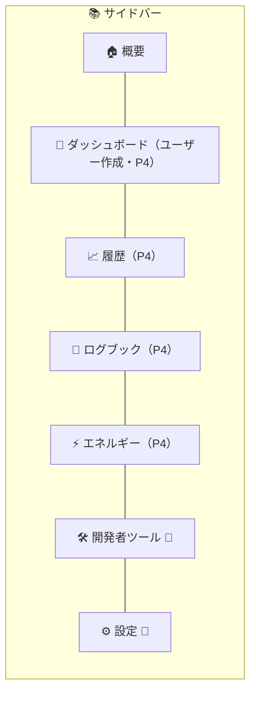
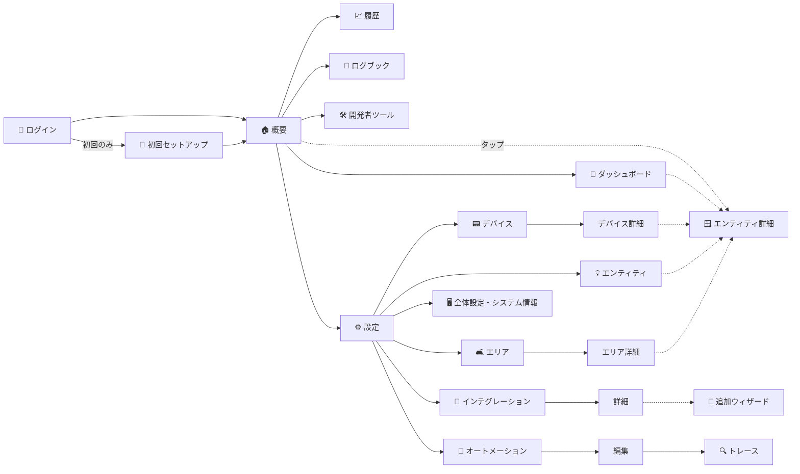
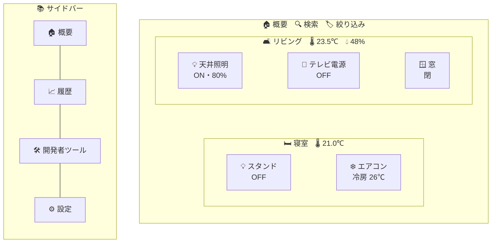
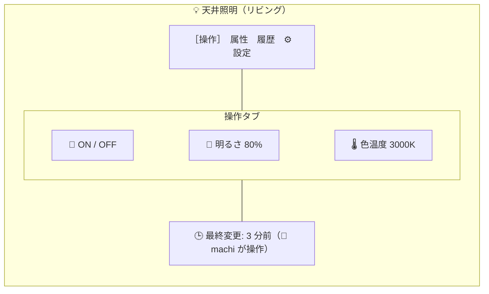
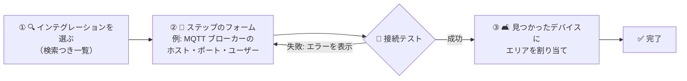
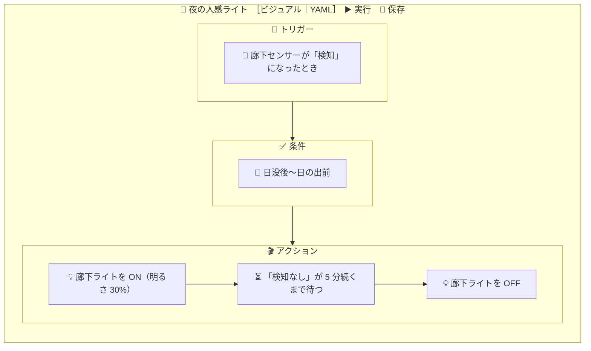

# 🖥️ 07. 画面設計（画面一覧）

> 📌 **前提**: Blazor Server（InteractiveServer・`prerender:false`）+ **MudBlazor**、画面はコアの Service を**直接**呼ぶ（API を経由しない）。詳しくは [06](06-dotnet-architecture.md)
> 🧭 **お手本**: HA の画面構成（概要・ダッシュボード・履歴・ログブック・開発者ツール・設定）を、[05](05-feature-scope.md) のフェーズに合わせて取捨選択
> 📏 **テンプレートの決まり**: ページは `XxxPage.razor` + `.razor.cs`、`@if` / `@foreach` の代わりに Smart.Blazor の `Condition` / `ListItem`、`*.razor.css` と `style=` は使わない（`app.css` に集める）、日本語固定

---

## ⚡ 要点

| # | ポイント |
|:-:|---|
| 🗂️ | 画面は **42**（P1: 12 / P2: 10 / P3: 8 / P4: 6 / P5: 3 / P6: 3）、ダイアログは **15**、ダッシュボードのカードは **13 種** |
| 🧭 | サイドバーは HA と同じ並び: **概要 → ダッシュボード → 履歴 → ログブック → 開発者ツール → 設定** |
| ⚡ | 状態を表示する画面は**リアルタイム更新**（コアの EventBus を購読し、間引いて再描画） |
| 🪟 | エンティティをタップすると、どの画面からでも同じ**エンティティ詳細ダイアログ**が開く |
| 👑 | P1〜P4 は**管理者だけ**（テンプレートのロールは Administrator のみ）。P5 で一般・閲覧のみを追加 |

---

## 🧭 1. 画面構成の全体像

### 1-1. レイアウト

| レイアウト | 使う画面 | 構成 |
|---|---|---|
| 🖼️ `MainLayout`（テンプレート） | ほぼすべて | 上部バー（☰・タイトル・🔔 通知・👤 プロフィール）+ 左のサイドバー（`NavMenu`）+ 本文 |
| 📄 `PlainLayout`（テンプレート） | ログイン・初回セットアップ・エラー | 本文だけ |
| 🧱 `KioskLayout`（P4 で追加） | 壁掛けタブレット用のダッシュボード | 上部バーもサイドバーも出さない（`?kiosk=1` で切り替え） |

- 📱 幅が狭いとサイドバーは折りたたみ（MudBlazor の Drawer）
- 🔔 通知は右から出る**通知ドロワー**（HA の永続通知）
- 🔌 回線が切れたらテンプレートの `ReconnectModal`。キオスクでは失敗時に自動で再読み込み

### 1-2. サイドバー（ナビゲーション）

> 👑 = 管理者だけに表示。🔔 通知と 👤 プロフィールは上部バーに置く。
> 🔁 HA では 2025.10 にログブックが「Activity」、2026.8 に開発者ツールが「Tools」へ改称された（[01](01-ha-overview.md) §7）。HomeManager は日本語の名前（ログブック・開発者ツール）のままにする。

---

## 👥 2. ロールと権限

| ロール | できること | 導入 |
|---|---|:-:|
| 👑 **管理者**（Administrator） | すべて | P1（テンプレート） |
| 👤 **一般**（User） | 閲覧 + 機器の操作（サービス呼び出し）・自分のプロフィール | P5 |
| 👀 **閲覧のみ**（ReadOnly） | 閲覧だけ（操作ボタンは無効） | P5 |

| 画面の分類 | 👑 | 👤 | 👀 |
|---|:-:|:-:|:-:|
| 概要・ダッシュボード・履歴・ログブック・エネルギー | ✅ | ✅ | ✅（操作不可） |
| プロフィール | ✅ | ✅ | ✅ |
| 開発者ツール・設定 | ✅ | — | — |

---

## 📋 3. 画面一覧

> ⚡ = リアルタイムで表示が変わる画面　／　🔒 = 管理者だけ

### 🔑 3-1. 認証・共通

| ID | 画面名 | URL | コンポーネント | Phase | 権限 | ⚡ | 概要 |
|---|---|---|---|:-:|:-:|:-:|---|
| SCR-001 | 🔑 ログイン | `/login` | `Login`（テンプレート） | P1 | 誰でも | | 静的 SSR のフォームから `POST /auth/login`（Cookie） |
| SCR-002 | 🚀 初回セットアップ | `/onboarding` | `OnboardingPage` | P1 | 🔒 | | ① 初期パスワードの変更 ② 家の名前・位置・タイムゾーン・単位 ③ 完了。終わるまで他の画面に進めない |
| SCR-003 | 👤 プロフィール | `/profile` | `ProfilePage` | P1 | 全員 | | 表示名・パスワード・テーマ（ライト／ダーク／自動）、P4: 既定のダッシュボード、P5: **長期アクセストークン**の発行・失効 |
| SCR-091 | ⚠️ エラー | `/error` | `Error`（テンプレート） | P1 | 誰でも | | 想定外のエラー |
| SCR-092 | 🔍 見つからない | `/not-found` | `NotFound`（テンプレート） | P1 | 誰でも | | 404 |

### 🏠 3-2. メイン

| ID | 画面名 | URL | コンポーネント | Phase | 権限 | ⚡ | 概要 |
|---|---|---|---|:-:|:-:|:-:|---|
| SCR-101 | 🏠 **概要** | `/` | `OverviewPage` | P1 | 全員 | ⚡ | **自動生成のダッシュボード**。P1 はドメインごと、P2 から**エリアごと**にカードを並べる。検索・絞り込み（エリア・種類） |
| SCR-102 | 🧱 ダッシュボード | `/dashboard/{dashboardId}/{viewPath?}` | `DashboardPage` | P4 | 全員 | ⚡ | ユーザーが作るダッシュボード。ビューをタブで切り替え、**編集モード**でカードの追加・並べ替え |
| SCR-103 | 📈 履歴 | `/history` | `HistoryPage` | P4 | 全員 | | エンティティ・エリアと期間を選び、数値は折れ線、状態は帯（タイムライン）で表示 |
| SCR-104 | 📒 ログブック | `/logbook` | `LogbookPage` | P4 | 全員 | ⚡ | 「いつ・何が・誰（何）によって」の時系列。期間・エンティティで絞り込み |
| SCR-105 | ⚡ エネルギー 🔁 | `/energy` | `EnergyPage` | P4 | 全員 | | 家電ごとの電力量の日・週・月の集計と比較（ワットチェッカー。[00](00-system-features.md) の決定で P6 から前倒し） |

### 🛠️ 3-3. 開発者ツール（🔒 管理者）

| ID | 画面名 | URL | コンポーネント | Phase | ⚡ | 概要 |
|---|---|---|---|:-:|:-:|---|
| SCR-201 | 🗃️ 状態 | `/developer-tools/state` | `StateToolPage` | P1 | ⚡ | 全エンティティの状態と属性の一覧・絞り込み。デバッグ用に状態の上書きもできる |
| SCR-202 | 🛎️ アクション | `/developer-tools/action` | `ActionToolPage` | P1 | | サービスを選び、ターゲットとデータ（フォーム／YAML）を入れて実行。応答を表示 |
| SCR-203 | 📣 イベント | `/developer-tools/event` | `EventToolPage` | P1 | ⚡ | イベント種別を購読して流れを見る・カスタムイベントを発火 |
| SCR-204 | 🧮 テンプレート | `/developer-tools/template` | `TemplateToolPage` | P4 | ⚡ | テンプレートを入力すると即座に結果を表示。参照しているエンティティも表示 |
| SCR-205 | 📊 統計 | `/developer-tools/statistics` | `StatisticsToolPage` | P6 | | 統計の一覧・単位の不整合などの問題の修正 |

### ⚙️ 3-4. 設定（🔒 管理者）

| ID | 画面名 | URL | コンポーネント | Phase | ⚡ | 概要 |
|---|---|---|---|:-:|:-:|---|
| SCR-301 | ⚙️ 設定トップ | `/config` | `ConfigHomePage` | P1 | ⚡ | 各設定へのメニュー（カード）と、修復・更新・通知の件数 |
| **🧩 デバイスとサービス** | | | | | | |
| SCR-311 | 🧩 インテグレーション一覧 | `/config/integrations` | `IntegrationListPage` | P2 | ⚡ | 追加済みのインテグレーション（状態: 読み込み済み／再試行中／エラー）。**＋追加**でウィザード |
| SCR-312 | 🧩 インテグレーション詳細 | `/config/integrations/{domain}` | `IntegrationDetailPage` | P2 | ⚡ | 接続設定（Config Entry）ごとの状態・デバイス数・エンティティ数。再設定・オプション・再読み込み・無効化・削除 |
| SCR-313 | 📡 MQTT 設定・診断 | `/config/mqtt` | `MqttToolPage` | P2 | ⚡ | トピックを購読して流れを見る・テスト送信（HA の「MQTT 設定」画面） |
| SCR-314 | 📟 デバイス一覧 | `/config/devices` | `DeviceListPage` | P2 | | 名前・メーカー・型番・エリア・インテグレーション。絞り込みと一括操作 |
| SCR-315 | 📟 デバイス詳細 | `/config/devices/{deviceId}` | `DeviceDetailPage` | P2 | ⚡ | 情報・**操作／センサー／設定／診断**に分けたエンティティ・エリアとラベル、P3: 関連する自動化、P4: ログブック |
| SCR-316 | 💡 エンティティ一覧 | `/config/entities` | `EntityListPage` | P2 | ⚡ | entity_id・名前・インテグレーション・エリア・状態（有効／無効／非表示／利用不可）。一括で有効化・ラベル付け |
| SCR-317 | 🎛️ ヘルパー一覧 | `/config/helpers` | `HelperListPage` | P3 | ⚡ | 仮想スイッチ・数値・選択肢・テキスト・日時・ボタン・カウンター・タイマー・スケジュール |
| SCR-318 | 📶 Bluetooth 診断 🆕 | `/config/bluetooth` | `BluetoothToolPage` | P2 | ⚡ | 受信中の BLE 機器（MAC・名前・電波の強さ・メーカー ID）の一覧。SwitchBot などを登録するときに MAC を調べる（HA の Bluetooth の可視化に相当。[10](10-prometheus-exporter.md)） |
| **🛋️ エリア・ラベル** | | | | | | |
| SCR-321 | 🛋️ エリア・フロア | `/config/areas` | `AreaListPage` | P2 | | 階ごとに部屋を並べる。追加・編集・並べ替え |
| SCR-322 | 🛋️ エリア詳細 | `/config/areas/{areaId}` | `AreaDetailPage` | P2 | ⚡ | 部屋のデバイスとエンティティ、P3: 関連する自動化、P4: 履歴 |
| SCR-323 | 🏷️ ラベル | `/config/labels` | `LabelListPage` | P2 | | ラベル（色・アイコン）の一覧と編集 |
| **🤖 自動化とシーン** | | | | | | |
| SCR-331 | 🤖 オートメーション一覧 | `/config/automations` | `AutomationListPage` | P3 | ⚡ | 有効／無効の切り替え・最後に動いた時刻・手動実行・複製・削除 |
| SCR-332 | ✏️ オートメーション編集 | `/config/automations/{id}`（新規は `new`） | `AutomationEditPage` | P3 | | **ビジュアル編集**（トリガー・条件・アクションのブロック）と **YAML 編集**の切り替え |
| SCR-333 | 🔍 トレース | `/config/traces/{itemType}/{itemId}/{runId?}` | `TracePage` | P3 | ⚡ | 実行の経路（どのステップを通ったか）・変数・結果・エラー。直近 5 回分 |
| SCR-334 | 📜 スクリプト一覧 | `/config/scripts` | `ScriptListPage` | P3 | ⚡ | 実行中の表示・手動実行 |
| SCR-335 | ✏️ スクリプト編集 | `/config/scripts/{id}` | `ScriptEditPage` | P3 | | アクション列と入力項目（fields）の編集 |
| SCR-336 | 🎬 シーン一覧 | `/config/scenes` | `SceneListPage` | P3 | | 適用・複製・削除 |
| SCR-337 | ✏️ シーン編集 | `/config/scenes/{id}` | `SceneEditPage` | P3 | ⚡ | エンティティを選び「**今の状態を取り込む**」→ 保存 |
| SCR-338 | 📘 ブループリント | `/config/blueprints` | `BlueprintListPage` | P6 | | 雛形の一覧・取り込み（URL）・そこからオートメーションを作成 |
| **🧱 ダッシュボード** | | | | | | |
| SCR-341 | 🧱 ダッシュボード管理 | `/config/dashboards` | `DashboardListPage` | P4 | | 追加・削除・サイドバーへの表示・既定の設定 |
| **👥 ユーザー** | | | | | | |
| SCR-351 | 👥 ユーザー | `/config/users` | `UserListPage` | P5 | | 追加・ロール・有効／無効・パスワードの再設定 |
| **🖥️ システム** | | | | | | |
| SCR-361 | 🌍 全体設定 | `/config/general` | `GeneralSettingsPage` | P1 | | 家の名前・位置（緯度経度）・タイムゾーン・単位系・通貨、P4: 履歴の保持日数 |
| SCR-362 | ℹ️ システム情報 | `/config/info` | `SystemInfoPage` | P1 | ⚡ | バージョン・稼働時間・DB の大きさ・各インテグレーションの状態・接続中の回線 |
| SCR-363 | 📜 ログ | `/config/logs` | `LogViewerPage` | P5 | ⚡ | 直近のエラー・警告（重要度で絞り込み） |
| SCR-364 | 💾 バックアップ | `/config/backups` | `BackupListPage` | P5 | | 作成・ダウンロード・削除・復元 |
| SCR-365 | 🩹 修復 | `/config/repairs` | `RepairListPage` | P6 | ⚡ | 要対応事項（設定の不整合・非推奨など）と修正の案内 |

### 📊 3-5. フェーズごとの画面数

| Phase | 画面 |
|:-:|---|
| 🌱 P1（12） | SCR-001・002・003・091・092・101・201・202・203・301・361・362 |
| 🔌 P2（10） | SCR-311・312・313・314・315・316・318・321・322・323 |
| 🤖 P3（8） | SCR-317・331・332・333・334・335・336・337 |
| 📈 P4（6） | SCR-102・103・104・105・204・341 |
| 🔐 P5（3） | SCR-351・363・364 |
| 🚀 P6（3） | SCR-205・338・365 |

---

## 🪟 4. ダイアログ一覧

| ID | ダイアログ | コンポーネント | Phase | 開く場所 | 内容 |
|---|---|---|:-:|---|---|
| DLG-01 | 🪟 **エンティティ詳細** | `EntityDetailDialog` | P1 | エンティティを表示する全画面 | タブ: **操作**（種類ごとの操作部品）／属性／履歴（P4）／設定（P2 → DLG-02）。最終変更と「誰による操作か」 |
| DLG-02 | ⚙️ エンティティ設定 | `EntitySettingsDialog` | P2 | DLG-01・SCR-316 | 名前・アイコン・entity_id・エリア・ラベル・有効／表示・表示の精度 |
| DLG-03 | 🧙 **インテグレーション追加**（Config Flow） | `ConfigFlowDialog` | P2 | SCR-311・312 | ステップごとのフォームを**スキーマから自動生成**。中断・完了・エラー表示 |
| DLG-04 | 🔧 オプション（Options Flow） | `OptionsFlowDialog` | P2 | SCR-312 | 追加後の設定変更（ポーリング間隔など） |
| DLG-05 | 📟 デバイス設定 | `DeviceSettingsDialog` | P2 | SCR-314・315 | 表示名・エリア・ラベル・無効化 |
| DLG-06 | 🛋️ エリア／🏢 フロアの編集 | `AreaEditDialog` / `FloorEditDialog` | P2 | SCR-321・322 | 名前・アイコン・階・別名・代表の温度／湿度センサー |
| DLG-07 | 🏷️ ラベルの編集 | `LabelEditDialog` | P2 | SCR-323 ほか | 名前・色・アイコン・説明 |
| DLG-08 | 🎛️ ヘルパーの作成・編集 | `HelperEditDialog` | P3 | SCR-317 | 種類を選び、種類ごとのフォーム（最小・最大・選択肢 …） |
| DLG-09 | ➕ トリガー／条件／アクションの追加 | `AutomationBlockPickerDialog` | P3 | SCR-332・335 | 種類の一覧（検索つき）から選ぶ |
| DLG-10 | 📥 YAML の取り込み・書き出し | `YamlImportDialog` | P3 | SCR-331・334 | YAML を貼り付けて取り込み／表示してコピー |
| DLG-11 | 🧱 カードの追加・編集 | `CardEditDialog` | P4 | SCR-102 | カードの種類 → 設定フォーム + **プレビュー** |
| DLG-12 | 🗝️ 長期アクセストークンの作成 | `TokenCreateDialog` | P5 | SCR-003 | 名前・有効日数 → **トークンは 1 回だけ表示**（コピーを促す） |
| DLG-13 | 👥 ユーザーの作成・編集 | `UserEditDialog` | P5 | SCR-351 | ログイン ID・表示名・ロール・初期パスワード |
| DLG-14 | ❓ 確認 | `MessageBox`（テンプレート） | P1 | 全画面 | 削除などの確認 |
| DLG-15 | 🔔 通知ドロワー | `NotificationDrawer` | P3 | 上部バーの 🔔 | 永続通知の一覧・既読（削除）・すべて既読 |

---

## 🧩 5. 共通部品

| 部品 | 使う場所 | 内容 |
|---|---|---|
| 🎯 `TargetPicker` | 開発者ツール・自動化の編集・シーン | エンティティ／デバイス／エリア／フロア／ラベルを混ぜて選ぶ（HA のターゲット指定） |
| 💡 `EntityPicker` | 各所 | 検索つきのエンティティ選択（アイコン・名前・entity_id・エリア） |
| 🛎️ `ServicePicker` | 開発者ツール・自動化の編集 | `domain.service` の選択と説明 |
| 🧾 `SchemaForm` | Config Flow・ヘルパー・サービスのデータ・カード設定 | **フォーム定義（項目 + selector の種類）から入力欄を自動生成**。HA の selector に相当 |
| 🔣 `StateIcon` / `StateText` | 全画面 | 種類（device_class）と状態に応じたアイコンと表示（単位・精度・「開」「閉」などの日本語化） |
| 🕒 `RelativeTime` | 全画面 | 「3 分前」を自動で更新 |
| 📈 `TimeSeriesChart` / `Sparkline` | 履歴・カード・ダイアログ | maui-server の**依存ゼロの SVG チャート**を移植 |
| ▬ `StateTimeline` | 履歴・ダイアログ | on / off などの状態を色の帯で表示 |
| 📅 `TimeRangeSelector` | 履歴・ログブック・統計 | 今日・昨日・直近 24 時間・期間指定 |
| 📝 `CodeEditor` | YAML・テンプレート | 等幅のテキスト編集 + 検証結果の表示 |

---

## 🧱 6. ダッシュボードのカード一覧

| ID | カード | Phase | 内容 |
|---|---|:-:|---|
| CARD-01 | 🔲 タイル（tile） | P1 | アイコン・名前・状態。タップで ON / OFF、長押し（または ⋯）で詳細 |
| CARD-02 | 📋 エンティティ一覧（entities） | P1 | 複数エンティティを行で並べ、行ごとにスイッチや値 |
| CARD-03 | 🔘 ボタン（button） | P4 | 大きなボタン（ON / OFF・シーン・スクリプトの実行） |
| CARD-04 | 🎚️ ゲージ（gauge） | P4 | 数値を半円のメーターで（しきい値で色分け） |
| CARD-05 | 🌡️ センサー（sensor） | P4 | 値 + 直近 24 時間のスパークライン |
| CARD-06 | 📈 履歴グラフ（history-graph） | P4 | 複数エンティティの推移 |
| CARD-07 | 📊 統計グラフ（statistics-graph） | P4 | 時間・日・週の集計（平均・最小・最大・合計） |
| CARD-08 | 🛋️ エリア（area） | P4 | 部屋の温度・湿度、点いている照明の数、まとめて OFF |
| CARD-09 | 📝 マークダウン（markdown） | P4 | 文章。テンプレートで状態を差し込める |
| CARD-10 | 🧱 グリッド／スタック | P4 | 他のカードを縦・横・格子に並べる |
| CARD-11 | 🌦️ 天気（weather） | P6 | 現在と予報 |
| CARD-12 | 🔥 サーモスタット（thermostat） | P6 | エアコンの目標温度・モード |
| CARD-13 | 👁️ 条件付き（conditional） | P6 | 条件を満たすときだけ表示 |

> 💡 概要（SCR-101）は**カード設定を保存しない自動生成**。ダッシュボード（SCR-102）は**カード設定を DB に保存**する（[09](09-db-design.md) の `Dashboard`）。

---

## 🔀 7. 画面遷移図

---

## 🔍 8. 主な画面のイメージ

### 🏠 8-1. 概要（SCR-101・P2 以降のエリア表示）

- ⚡ どこかで照明が点くと、**開いている全員の画面のタイルが即座に変わる**（P1 の完了の目安）
- 🗂️ エリア → 種類（照明・スイッチ・センサー …）の順に並べる。エリア未設定は「その他」

### 🪟 8-2. エンティティ詳細（DLG-01・照明の例）

- 🧩 「操作」タブの中身はエンティティの種類ごとの部品（light = スイッチ + 明るさ + 色温度、number = スライダー、select = 選択肢 …）
- 🧵 「誰が・何が変えたか」は状態の **Context**（[02](02-ha-core-architecture.md) §2-4）から表示

### 🧙 8-3. インテグレーション追加ウィザード（DLG-03）

- 🧾 フォームはインテグレーションが返す**フォーム定義**から `SchemaForm` が描画する（画面側にインテグレーション固有のコードを書かない）

### ✏️ 8-4. オートメーション編集（SCR-332）

- ➕ 各ブロックの「追加」で DLG-09、ブロックの中身は `SchemaForm`
- 🔁 ビジュアルと YAML は同じ設定（JSON）を編集する 2 つの見え方

---

## ⚙️ 9. 画面共通の仕様

| 項目 | 仕様 |
|---|---|
| ⚡ リアルタイム更新 | 画面が表示中のエンティティだけを購読する。購読は Host 側の回線ごとの部品 `IStateSubscription`（中身はコアの `IEventBus` の購読）。通知は **RefreshTimer で間引いて**（例: 250ms）`InvokeAsync(StateHasChanged)`。画面を離れたら Dispose で購読を解除 |
| 🧭 操作コンテキスト | テンプレートの `AppPageBase` で操作者を設定 → サービス呼び出しの **Context.UserId** になる（ログブックの「誰が」） |
| ⏳ 読み込み中・エラー | MudBlazor の進捗表示と Snackbar（テンプレートの `SnackbarExtensions`） |
| ❓ 確認 | 削除・無効化は `MessageBox` で確認 |
| 🔗 URL | 一覧の絞り込み条件はクエリ文字列に載せる（共有・再読み込みで復元） |
| 📱 レスポンシブ | スマホ幅ではカードを 1 列、表は重要な列だけ |
| 🌙 テーマ | ライト／ダーク／自動（プロフィールで切り替え） |
| 🧱 キオスク | `?kiosk=1` で上部バーとサイドバーを隠す（P4） |
| 🇯🇵 言語 | 日本語固定（テンプレートの方針） |

---

## 🔗 10. 画面と内部 API（コアのサービス）の対応

> 画面は HTTP API を通さず、コアのサービスを直接呼ぶ。サービスの一覧は [08](08-api-design.md) §9。

| 画面 | 主に使うサービス |
|---|---|
| SCR-002 初回セットアップ / SCR-361 全体設定 | `IAccountService` / `ICoreConfigService` |
| SCR-101 概要 / SCR-102 ダッシュボード | `IStateMachine` / `IServiceRegistry` / `IAreaRegistry` / `IEntityRegistry` / `IDashboardService` |
| SCR-103 履歴 / SCR-104 ログブック / SCR-105 エネルギー | `IHistoryService` / `ILogbookService` / `IStatisticsService` |
| SCR-201〜205 開発者ツール | `IStateMachine` / `IServiceRegistry` / `IEventBus` / `ITemplateRenderer` / `IStatisticsService` |
| SCR-311・312 インテグレーション / DLG-03・04 | `IIntegrationCatalog` / `IConfigEntryManager` / `IConfigFlowManager` |
| SCR-313 MQTT 設定・診断 | `IMqttDiagnostics`（`Integration.Mqtt` が提供） |
| SCR-318 Bluetooth 診断 | `IBluetoothScanner`（`Integration.Bluetooth` が提供） |
| SCR-314〜316 デバイス・エンティティ | `IDeviceRegistry` / `IEntityRegistry` / `IStateMachine` / `IReferenceService` |
| SCR-317 ヘルパー | `IHelperService` |
| SCR-321〜323 エリア・フロア・ラベル | `IAreaRegistry` / `IFloorRegistry` / `ILabelRegistry` |
| SCR-331〜337 自動化・スクリプト・シーン | `IAutomationService` / `IScriptService` / `ISceneService` / `ITraceService` |
| SCR-341 ダッシュボード管理 | `IDashboardService` |
| SCR-351 ユーザー / SCR-003 プロフィール | `IAccountService` / `IAccessTokenService` |
| SCR-362〜365 システム | `ISystemInfoService` / `ILogService` / `IBackupService` / `IIssueRegistry` |
| DLG-15 通知 | `INotificationService` |
