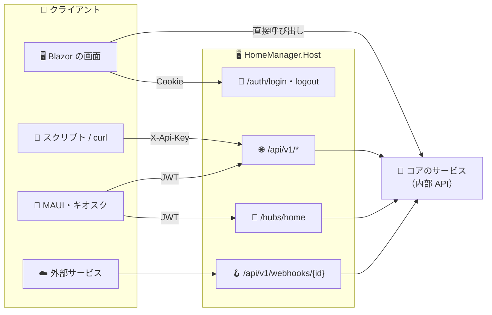
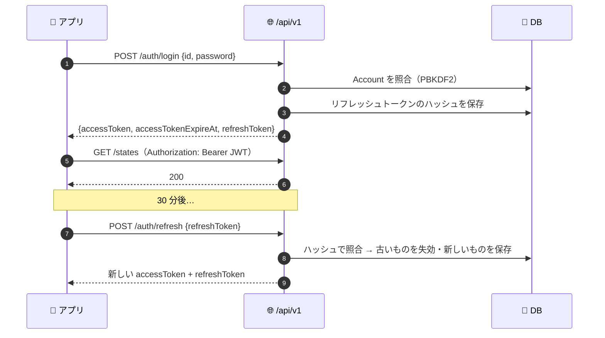
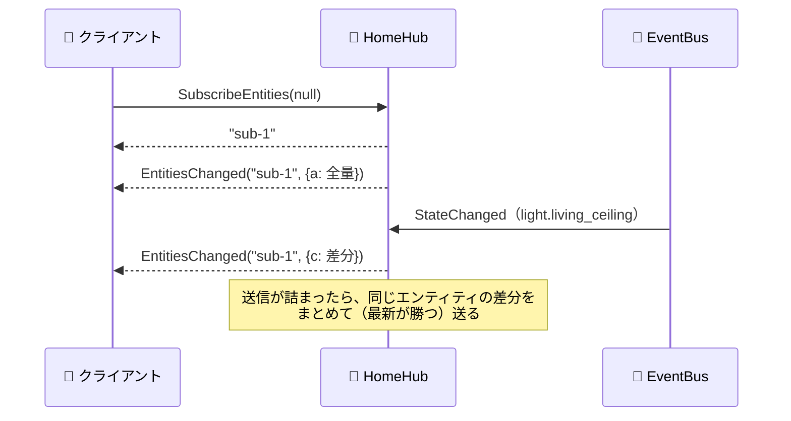

# 🌐 08. API 設計（API 一覧）

> 📌 **前提**: 画面（Blazor Server）は API を通さず、コアのサービスを直接呼ぶ。HTTP API は**外部クライアント**（スクリプト・モバイル・キオスク・他システム）向けで、P5 が中心
> 📏 **テンプレートの決まり**: web-api の流儀（URL に版 `/api/v1`、Minimal API、DTO はエンドポイントのファイルの先頭、ProblemDetails、ETag、RateLimiter、JWT + `X-Api-Key` の 2 スキーム）
> 🔗 関連: [03 HA の API](03-ha-interfaces.md)・[07 画面設計](07-screen-design.md)・[09 DB 設計](09-db-design.md)

---

## ⚡ 要点

| # | ポイント |
|:-:|---|
| 🗂️ | API は 4 種類: ① **内部 API**（コアのサービス。画面が使う）② **REST API** ③ **リアルタイム API**（SignalR）④ **Webhook**。これに加えて、機器の操作の語彙として「**サービス（アクション）**」のカタログを持つ |
| 🔐 | 画面は **Cookie**。外部は **JWT（30 分）+ リフレッシュトークン** か **長期アクセストークン（`X-Api-Key`）** |
| ⚠️ | 状態の**上書き**（`PUT /states`）と機器の**操作**（`POST /services`）をはっきり分ける（HA と同じ） |
| ⚡ | リアルタイムは SignalR の `/hubs/home`。HA と同じ**差分圧縮（a / c / r）**で送る |
| 📊 | REST 約 40 本・Hub メソッド 7・サービス約 80・イベント約 20・内部 API 34 インターフェース |

---

## 🧭 1. 全体像



---

## 📏 2. 共通の約束

| 項目 | 決まり |
|---|---|
| 🔢 版 | URL に入れる: `/api/v1/...`（テンプレート web-api の `ApiRoutes`）。Webhook の URL も版つきで固定し、v2 を出しても v1 を残す |
| 🔐 認証 | `Authorization: Bearer <JWT>` または `X-Api-Key: <長期アクセストークン>`。既定のポリシーが両方を受け付ける。**画面の Cookie は `/api` では使わない**（CSRF を避ける）。例外はブラウザからのダウンロード（バックアップ・診断）だけ |
| 🛡️ 権限 | 👑 管理者 / 👤 一般 / 👀 閲覧のみ（[07](07-screen-design.md) §2）。機器の操作（サービス呼び出し）は 👤 以上 |
| 📦 形式 | JSON（プロパティ名は camelCase）。ただし `light.kitchen`・`turn_on` などの**値**と、エンティティの**属性のキー**（`brightness` など）は HA と同じ snake_case のまま |
| 🕒 時刻 | ISO 8601 の UTC（例 `2026-10-31T09:00:00Z`）。クエリでも同じ |
| ❌ エラー | **ProblemDetails**（RFC 9457）+ 拡張の `code`（§2-1） |
| 🔁 楽観ロック | 取得時に `ETag: "<Version>"`、更新時に `If-Match` → 不一致は **412**（テンプレート web-api の方式） |
| 🚦 流量制限 | IP ごとの固定窓（全体）+ ログイン専用のポリシー → 超えたら **429 + Retry-After** |
| 📃 OpenAPI | 組み込みの OpenAPI 文書（版ごと）+ NSwag の UI（開発時だけ） |
| 🌍 CORS | 既定は無効（同一オリジンだけ）。必要なら設定で許可リスト |

### ❌ 2-1. エラーコード

| `code` | HTTP | 意味 | HA での名前 |
|---|:-:|---|---|
| `invalid_format` | 400 | 入力の形式が不正 | invalid_format |
| `validation_error` | 400 | 入力の値が不正（`errors` に項目ごとの内容） | — |
| `service_validation_error` | 400 | サービスの入力が不正 | service_validation_error |
| `template_error` | 400 | テンプレートの誤り | template_error |
| `unauthorized` | 401 | 未認証・トークンが無効 | unauthorized |
| `forbidden` | 403 | 権限が足りない | unauthorized |
| `not_found` | 404 | 対象が無い（エンティティ・サービスなど） | not_found |
| `conflict` | 409 | 一意制約の違反（名前の重複など） | — |
| `precondition_failed` | 412 | `If-Match` が一致しない（他で更新された） | — |
| `rate_limited` | 429 | 流量制限 | — |
| `integration_error` | 502 | 機器・外部サービスとの通信の失敗 | home_assistant_error |
| `timeout` | 504 | サービスの実行がタイムアウト | timeout |
| `unknown_error` | 500 | 想定外 | unknown_error |

```json
{
  "title": "Not Found",
  "status": 404,
  "detail": "エンティティ light.kitchen が見つかりません。",
  "code": "not_found",
  "traceId": "00-4bf92f3577b34da6a3ce929d0e0e4736-00f067aa0ba902b7-01"
}
```

---

## 🔐 3. 認証

### 3-1. 方式

| 方式 | 使う人 | 取得方法 | 有効期限 | サーバー側の保存 |
|---|---|---|---|---|
| 🍪 Cookie | Blazor の画面 | `POST /auth/login`（フォーム） | スライド式・1 日（テンプレートの既定） | —（テンプレートのまま） |
| 🎫 JWT アクセストークン | モバイル・キオスクのアプリ | `POST /api/v1/auth/login`・`refresh` | **30 分** | 保存しない（署名で検証） |
| 🔁 リフレッシュトークン | 同上 | 同上 | 30 日・**使うたびに入れ替え** | **SHA-256 のハッシュだけ**（`AccessToken`） |
| 🗝️ 長期アクセストークン | スクリプト・外部システム | プロフィール画面（DLG-12）または API-017 | 発行時に指定（既定 365 日） | **SHA-256 のハッシュだけ**（`AccessToken`） |

- 🔑 長期アクセストークンの形は `hm_` + 乱数 32 バイトの Base64URL。接頭辞があると、漏れたときに検索で見つけやすい
- 🧪 リフレッシュトークンの「ハッシュだけ保存・1 回使ったら入れ替え」は blazor-wasm の `RefreshTokenService` の方式を流用
- 💡 HA は JWT の署名鍵を**リフレッシュトークンごとに**持つ（[02](02-ha-core-architecture.md) §9）。まずはテンプレートどおり 1 つの鍵で始め、発展課題にする

### 3-2. アプリのログインと更新



### 3-3. スクリプトから使う（長期アクセストークン）

```bash
curl -H "X-Api-Key: hm_q3Z9...." https://home.local:8080/api/v1/states/sensor.living_temperature
```

---

## 🌐 4. REST API 一覧

> 👑 管理者 / 👤 一般以上 / 👀 閲覧のみ以上（ログインしていれば全員）

### 🖥️ 4-1. システム

| ID | メソッド | パス | 概要 | 権限 | Phase |
|---|:-:|---|---|:-:|:-:|
| API-001 | GET | `/health` | 稼働確認（DB・MQTT の接続も含む）※テンプレート | 誰でも | P0 |
| API-002 | GET | `/alive` | 生存確認 ※テンプレート | 誰でも | P0 |
| API-003 | GET | `/api/v1` | API の稼働確認とバージョン（P0 で先に実装。結合テストの対象） | 👀 | P0 |
| API-004 | GET | `/api/v1/config` | 全体設定（家の名前・位置・単位・タイムゾーン・バージョン） | 👀 | P5 |
| API-005 | GET | `/api/v1/system/info` | 稼働時間・DB の大きさ・インテグレーションの状態 | 👑 | P5 |

> 📊 メトリクスはテンプレートの Prometheus（既定 `:9464/metrics`）。LAN 内に絞って公開する。

### 🔐 4-2. 認証

| ID | メソッド | パス | 概要 | 権限 | Phase |
|---|:-:|---|---|:-:|:-:|
| API-010 | POST | `/auth/login` | 画面のログイン（フォーム → Cookie）※テンプレート | 誰でも | P1 |
| API-011 | POST | `/auth/logout` | 画面のログアウト ※テンプレート | ログイン中 | P1 |
| API-012 | POST | `/api/v1/auth/login` | ID とパスワード → JWT + リフレッシュトークン | 誰でも（流量制限） | P5 |
| API-013 | POST | `/api/v1/auth/refresh` | リフレッシュトークン → 新しい組（入れ替え） | 誰でも（流量制限） | P5 |
| API-014 | POST | `/api/v1/auth/revoke` | リフレッシュトークンの失効（アプリのログアウト） | 👀 | P5 |
| API-015 | GET | `/api/v1/auth/me` | 自分の情報（ID・表示名・ロール） | 👀 | P5 |
| API-016 | GET | `/api/v1/auth/tokens` | 自分の長期アクセストークンの一覧（値は返さない） | 👀 | P5 |
| API-017 | POST | `/api/v1/auth/tokens` | 長期アクセストークンの発行（**値は 1 回だけ返す**） | 👀 | P5 |
| API-018 | DELETE | `/api/v1/auth/tokens/{tokenId}` | 長期アクセストークンの失効 | 👀 | P5 |

### 🗃️ 4-3. 状態

| ID | メソッド | パス | 概要 | 権限 | Phase |
|---|:-:|---|---|:-:|:-:|
| API-020 | GET | `/api/v1/states` | 全エンティティの状態（`?domain=` `?areaId=` `?labelId=` で絞り込み） | 👀 | P5 |
| API-021 | GET | `/api/v1/states/{entityId}` | 1 つの状態 | 👀 | P5 |
| API-022 | PUT | `/api/v1/states/{entityId}` | 状態の**上書き**（外部から値を入れる仮想エンティティ用。**機器は動かない**） | 👑 | P5 |
| API-023 | DELETE | `/api/v1/states/{entityId}` | API で作った状態の削除 | 👑 | P5 |

### 🛎️ 4-4. サービス（アクション）

| ID | メソッド | パス | 概要 | 権限 | Phase |
|---|:-:|---|---|:-:|:-:|
| API-030 | GET | `/api/v1/services` | ドメインごとのサービスと入力項目の定義 | 👀 | P5 |
| API-031 | POST | `/api/v1/services/{domain}/{service}` | サービスの呼び出し（`?returnResponse=true` で応答を返す） | 👤 | P5 |

### 📣 4-5. イベント

| ID | メソッド | パス | 概要 | 権限 | Phase |
|---|:-:|---|---|:-:|:-:|
| API-040 | GET | `/api/v1/events` | イベント種別と購読者数 | 👑 | P5 |
| API-041 | POST | `/api/v1/events/{eventType}` | カスタムイベントの発火（`state_changed` などコアのイベントは不可） | 👑 | P5 |

### 📈 4-6. 履歴・ログブック・統計

| ID | メソッド | パス | 概要 | 権限 | Phase |
|---|:-:|---|---|:-:|:-:|
| API-050 | GET | `/api/v1/history` | 状態の推移（`?entityIds=a,b&start=&end=&minimal=true`） | 👀 | P5 |
| API-051 | GET | `/api/v1/logbook` | 出来事の一覧（`?start=&end=&entityIds=&limit=`） | 👀 | P5 |
| API-052 | GET | `/api/v1/statistics` | 統計（`?statisticIds=&start=&end=&period=5minute\|hour\|day\|week\|month&types=mean,min,max,sum`） | 👀 | P5 |
| API-053 | GET | `/api/v1/statistics/metadata` | 統計の対象と単位の一覧 | 👀 | P6 |
| API-054 | GET | `/api/v1/prometheus` | 🆕 エンティティの状態を **Prometheus の形式**で出力（`?format=exporter` で Prometheus Exporter と同じ名前・ラベルの**互換モード** → 今の Grafana をそのまま使える。[10](10-prometheus-exporter.md)） | 👀（Prometheus は長期アクセストークンで取得） | P4 |

### 🧮 4-7. テンプレート・🔔 通知

| ID | メソッド | パス | 概要 | 権限 | Phase |
|---|:-:|---|---|:-:|:-:|
| API-060 | POST | `/api/v1/template` | テンプレートの描画（`{template, variables}` → 文字列） | 👑 | P5 |
| API-065 | GET | `/api/v1/notifications` | 永続通知の一覧（作成はサービス `persistent_notification.create`） | 👀 | P5 |
| API-066 | DELETE | `/api/v1/notifications/{notificationId}` | 既読にする（削除） | 👤 | P5 |

### 🪝 4-8. Webhook

| ID | メソッド | パス | 概要 | 権限 | Phase |
|---|:-:|---|---|:-:|:-:|
| API-070 | POST / PUT | `/api/v1/webhooks/{webhookId}` | 外部からの通知を受けて **webhook トリガー**を発火（§6） | 誰でも（**ID が秘密**） | P5 |

### 💾 4-9. ファイル

| ID | メソッド | パス | 概要 | 権限 | Phase |
|---|:-:|---|---|:-:|:-:|
| API-080 | GET | `/api/v1/backups` | バックアップの一覧 | 👑 | P5 |
| API-081 | POST | `/api/v1/backups` | バックアップの作成（非同期・**202 Accepted**） | 👑 | P5 |
| API-082 | GET | `/api/v1/backups/{backupId}/download` | ダウンロード（**Cookie も可**） | 👑 | P5 |
| API-083 | DELETE | `/api/v1/backups/{backupId}` | 削除 | 👑 | P5 |
| API-084 | GET | `/api/v1/diagnostics/config-entries/{entryId}` | 診断情報（機密は伏せる。**Cookie も可**） | 👑 | P6 |

### 🗂️ 4-10. 管理系（P6・任意）

外部の管理ツールやネイティブの管理アプリを作るときだけ公開する。画面は内部 API を使うので不要。

| ID | メソッド | パス | 概要 | 権限 | Phase |
|---|:-:|---|---|:-:|:-:|
| API-090 | GET | `/api/v1/entities`・`/{entityId}` | エンティティレジストリ | 👑 | P6 |
| API-091 | PATCH | `/api/v1/entities/{entityId}` | 名前・エリア・ラベル・有効など（`If-Match`） | 👑 | P6 |
| API-092 | GET / PATCH | `/api/v1/devices`・`/{deviceId}` | デバイスレジストリ | 👑 | P6 |
| API-093 | GET / POST / PATCH / DELETE | `/api/v1/areas`・`/floors`・`/labels` | エリア・フロア・ラベル | 👑 | P6 |
| API-094 | GET / PUT / DELETE | `/api/v1/automations/{id}`（`/scripts`・`/scenes` も同じ形） | 自動化の定義（`Accept: application/yaml` で YAML） | 👑 | P6 |
| API-095 | GET | `/api/v1/traces/{itemType}/{itemId}`・`/{runId}` | トレース | 👑 | P6 |

### 🤝 4-11. HA 互換（P6・挑戦課題）

- `/api/websocket` の一部（`auth` / `get_states` / `subscribe_entities` / `call_service`）と、`/api/states`・`/api/services/...` を **HA と同じ形**で出す
- HA 用の既存ツール（JS ライブラリ・スマホのウィジェットなど）がつながるかを試す

### 📦 4-12. 主なリクエストとレスポンス

**🗃️ 状態（API-020・021）**

```json
{
  "entityId": "light.living_ceiling",
  "state": "on",
  "attributes": {
    "friendly_name": "天井照明",
    "brightness": 204,
    "color_mode": "color_temp",
    "color_temp_kelvin": 3000
  },
  "lastChanged": "2026-10-31T09:00:00Z",
  "lastUpdated": "2026-10-31T09:00:05Z",
  "context": { "id": "0192f3a0-7c4e-7b1a-9d2e-5f1c3a2b4d6e", "userId": 1, "parentId": null }
}
```

**🛎️ サービスの呼び出し（API-031）**

```http
POST /api/v1/services/light/turn_on
X-Api-Key: hm_q3Z9....
Content-Type: application/json

{
  "target": { "areaIds": ["living_room"] },
  "data": { "brightness_pct": 50, "transition": 2 }
}
```

```json
{
  "changedStates": [
    { "entityId": "light.living_ceiling", "state": "on", "attributes": { "brightness": 128 }, "lastChanged": "2026-10-31T09:10:00Z", "lastUpdated": "2026-10-31T09:10:00Z", "context": { "id": "0192f3b1-...", "userId": 1, "parentId": null } }
  ],
  "response": null
}
```

- 🎯 `target` は `entityIds` / `deviceIds` / `areaIds` / `floorIds` / `labelIds` を混ぜて指定できる（HA のターゲット指定）
- 🔁 `changedStates` は「呼び出しの間に変わった状態」（HA の REST と同じ考え方）

**📈 履歴（API-050）**

```json
{
  "sensor.living_temperature": [
    { "state": "23.4", "lastChanged": "2026-10-31T08:00:00Z", "attributes": { "unit_of_measurement": "°C" } },
    { "state": "23.6", "lastChanged": "2026-10-31T08:05:00Z" }
  ]
}
```

- 🪶 `minimal=true` のときは、最初の 1 件だけ属性を付け、残りは状態と時刻だけ（HA の `minimal_response`）

---

## 📡 5. リアルタイム API（SignalR `/hubs/home`）

- 🧱 型付きの Hub（`Hub<IHomeClient>`）。maui-server の `MonitorHub` に倣い、KeepAlive 15 秒・ClientTimeout 30 秒
- 🔐 認証: JWT は `access_token` クエリ（ブラウザの WebSocket はヘッダーを付けられないため）。.NET のクライアントは `X-Api-Key` ヘッダーも可
- 🛡️ 権限: 接続は 👀 以上。`CallService` は 👤 以上、`SubscribeEvents` は 👑

### 5-1. クライアント → サーバー

| ID | メソッド | 戻り値 | 概要 | Phase |
|---|---|---|---|:-:|
| HUB-01 | `GetStates()` | `EntityState[]` | 全状態 | P5 |
| HUB-02 | `SubscribeEntities(string[]? entityIds)` | `subscriptionId` | 状態の購読。直後に全量（`a`）、以後は差分 | P5 |
| HUB-03 | `SubscribeEvents(string? eventType)` | `subscriptionId` | イベントの購読（`null` で全部） | P5 |
| HUB-04 | `Unsubscribe(string subscriptionId)` | — | 購読の解除 | P5 |
| HUB-05 | `CallService(domain, service, target, data, returnResponse)` | `ServiceCallResult` | サービスの呼び出し | P5 |
| HUB-06 | `SubscribeTrigger(JsonObject trigger)` | `subscriptionId` | トリガーが発火したら通知（HA の `subscribe_trigger`） | P6 |
| HUB-07 | `SubscribeTemplate(string template)` | `subscriptionId` | テンプレートの結果が変わるたびに通知 | P6 |

### 5-2. サーバー → クライアント

| メソッド | 内容 |
|---|---|
| `EntitiesChanged(subscriptionId, diff)` | 状態の差分（§5-3） |
| `EventReceived(subscriptionId, event)` | 購読中のイベント |
| `NotificationsChanged(notifications)` | 永続通知の変化 |
| `TriggerFired(subscriptionId, variables)` / `TemplateRendered(subscriptionId, result)` | P6 |

### 5-3. 差分の形（HA の `subscribe_entities` と同じ構造）

```jsonc
// ① 購読直後: 全量を "a"（add）
{ "a": { "light.living_ceiling": { "s": "on", "a": { "brightness": 204 }, "c": "0192f3a0-...", "lc": "2026-10-31T09:00:00Z" } } }

// ② 変化: "c"（change）に差分だけ。"+" が追加・変更、"-" が消えた属性
{ "c": { "light.living_ceiling": { "+": { "s": "off", "lc": "2026-10-31T09:30:00Z", "c": "0192f3c2-..." }, "-": { "a": ["brightness"] } } } }

// ③ 削除: "r"（remove）
{ "r": ["light.living_ceiling"] }
```

### 5-4. 流れと背圧



- 🚰 接続ごとに上限付きの送信キュー（1,024 件）。詰まったら**同じエンティティの差分をまとめる**（最新の値が勝つ）。それでも 10 秒あふれ続けたら切断（HA の考え方）
- 🧠 1 つのイベントのシリアライズは 1 回だけにし、全購読者で使い回す（HA の `cached_event_message`）

---

## 🪝 6. Webhook

| 項目 | 仕様 |
|---|---|
| 🔗 URL | `/api/v1/webhooks/{webhookId}`。ID は 32 文字以上の乱数（オートメーションの webhook トリガーで作る） |
| 📨 メソッド | 既定は POST / PUT。トリガーごとに GET も許可できる |
| 📦 本文 | JSON またはフォーム → トリガーの変数 `trigger.json` / `trigger.data` / `trigger.query` |
| ↩️ 応答 | 常に **200**（ID の存在を外に漏らさない） |
| 🏠 LAN 限定 | 既定は**LAN 内からだけ受け付ける**（HA の `local_only`）。外部サービスから受けるときだけ外す |

---

## 🛎️ 7. サービス（アクション）カタログ

> 機器の操作の「語彙」。画面・オートメーション・REST・Hub のどこから呼んでも同じ。HA と同じ名前にしておくと、HA の知識や YAML をそのまま流用できる。

| ドメイン | サービス | 主な入力 | Phase |
|---|---|---|:-:|
| 🏠 `homemanager` | `turn_on` / `turn_off` / `toggle` | target（種類を問わず ON / OFF） | P1 |
| | `reload_core_config` | — | P1 |
| | `update_entity` | target（今すぐ取得し直す） | P2 |
| | `reload_config_entry` | entry_id | P2 |
| 💡 `light` | `turn_on` | brightness / brightness_pct / transition（P1）、color_temp_kelvin / rgb_color / hs_color / effect（P2） | P1 |
| | `turn_off` / `toggle` | transition | P1 |
| 🔌 `switch` | `turn_on` / `turn_off` / `toggle` | — | P1 |
| 🔘 `button` | `press` | — | P1 |
| 🔢 `number` | `set_value` | value | P1 |
| 📋 `select` | `select_option` / `select_next` / `select_previous` / `select_first` / `select_last` | option / cycle | P1 |
| 📡 `mqtt` | `publish` / `reload` | topic / payload / qos / retain | P2 |
| 🎛️ `input_boolean` | `turn_on` / `turn_off` / `toggle` / `reload` | — | P3 |
| 🎛️ `input_number` | `set_value` / `increment` / `decrement` / `reload` | value | P3 |
| 🎛️ `input_select` | `select_option` / `select_next` / `select_previous` / `set_options` / `reload` | option / options | P3 |
| 🎛️ `input_text` | `set_value` / `reload` | value | P3 |
| 🎛️ `input_datetime` | `set_datetime` / `reload` | date / time / datetime | P3 |
| 🎛️ `input_button` | `press` / `reload` | — | P3 |
| 🔢 `counter` | `increment` / `decrement` / `reset` / `set_value` | value | P3 |
| ⏲️ `timer` | `start` / `pause` / `cancel` / `finish` / `change` | duration | P3 |
| 🤖 `automation` | `trigger` / `turn_on` / `turn_off` / `toggle` / `reload` | skip_condition | P3 |
| 📜 `script` | `turn_on` / `turn_off` / `toggle` / `reload` / `<スクリプト ID>` | variables | P3 |
| 🎬 `scene` | `turn_on` / `apply` / `create` / `reload` | transition / entities / snapshot_entities | P3 |
| 🔔 `persistent_notification` | `create` / `dismiss` / `dismiss_all` | title / message / notification_id | P3 |
| 📒 `logbook` | `log` | name / message / entity_id | P4 |
| 💾 `recorder` | `purge` / `purge_entities` / `enable` / `disable` | keep_days / entity_id | P4 |
| 📣 `notify` | `send_message` | message / title / target（スマホ・LINE など） | P6 |
| ❄️ `climate` | `turn_on` / `turn_off` / `set_temperature` / `set_hvac_mode` / `set_fan_mode` | temperature / hvac_mode / fan_mode | P6 |
| 🪟 `cover` | `open_cover` / `close_cover` / `stop_cover` / `set_cover_position` | position | P6 |
| 🌀 `fan`・🔒 `lock`・📺 `media_player` | HA と同じ | | P6 |

- 📮 **応答を返すサービス**（`SupportsResponse`）は P6 で追加（例: 天気予報の取得 `weather.get_forecasts`）
- 🧾 各サービスの入力項目は**フォーム定義**として公開し（API-030）、画面の `SchemaForm` もそれを使って入力欄を作る

---

## 📣 8. イベント種別カタログ

| イベント | いつ | 主なデータ | 📒 記録 | Phase |
|---|---|---|:-:|:-:|
| `state_changed` | 状態が変わった | entityId / oldState / newState | 📜 状態の履歴に | P1 |
| `state_reported` | 値は同じで報告だけ来た | entityId / lastReported | — | P1 |
| `call_service` | サービスが呼ばれた | domain / service / serviceData | ✅ | P1 |
| `service_registered` / `service_removed` | サービスの登録・削除 | domain / service | — | P1 |
| `homemanager_start` / `homemanager_started` / `homemanager_stop` | 起動の開始・完了・停止 | — | ✅ | P1 |
| `core_config_updated` | 全体設定の変更 | 変更内容 | ✅ | P1 |
| `component_loaded` | インテグレーションの読み込み | domain | — | P1 |
| `config_entry_state_changed` | 接続設定の状態の変化 | entryId / state / reason | ✅ | P2 |
| `entity_registry_updated` / `device_registry_updated` | レジストリの変更 | action / id / changes | — | P2 |
| `area_registry_updated` / `floor_registry_updated` / `label_registry_updated` | 同上 | action / id | — | P2 |
| `automation_triggered` | オートメーションの発火 | name / entityId / source | ✅ | P3 |
| `automation_reloaded` | 定義の再読み込み | — | — | P3 |
| `script_started` | スクリプトの開始 | name / entityId | ✅ | P3 |
| `persistent_notifications_updated` | 通知の変化 | — | — | P3 |
| `logbook_entry` | `logbook.log` が呼ばれた | name / message / entityId | ✅ | P4 |
| `dashboard_updated` | ダッシュボードの保存 | dashboardId | — | P4 |
| `user_added` / `user_removed` | ユーザーの追加・削除 | userId | ✅ | P5 |
| （任意の名前） | 開発者ツール・API-041 で発火 | 自由 | ✅ | P1 |

> 📒「記録」が ✅ のイベントは `EventLog`（[09](09-db-design.md)）に保存し、ログブックの材料になる。記録する種別は設定で変えられる。

---

## 🧠 9. 内部 API（コアのサービス）一覧

画面と REST / Hub はすべてここを通る。Core に置き、ASP.NET には依存しない（[06](06-dotnet-architecture.md) §5）。

> ✅ = P1 で実装済み（2026-11-01）。
> 📏 **名前の決まり**: インターフェースのメソッドに `Get` / `Set` / `Select` / `Option` などの **VB の予約語**は使えない（コード分析 CA1716）ため、`IStateMachine` は `GetState` / `SetState` のように名詞を付ける。引数なしの `GetXxx()` も使えない（CA1024）ため、一覧は `ListXxx()` にする。
> 🧩 概要（SCR-101）の組み立ては P1 では画面の中で行う（ドメインごとに並べるだけのため）。エリアで並べる P2 で `IDashboardService.GenerateOverview` に移す。
> 🛎️ P1 のサービス: `homemanager.turn_on / turn_off / toggle`・`light.turn_on / turn_off / toggle`・`switch.turn_on / turn_off / toggle`・`button.press`・`number.set_value`・`select.select_option / select_next / select_previous / select_first / select_last`・`homemanager.reload_core_config`（全体設定を DB から読み直す。2026-11-02）。
> 📣 P1 のイベント: `state_changed`・`state_reported`・`call_service`・`service_registered`・`service_removed`・`component_loaded`・`homemanager_start / started / stop`・`core_config_updated`（変わった項目だけを snake_case のキーで。2026-11-02）・任意の名前（開発者ツールから発火）。

| インターフェース | 主なメソッド | 使う画面・API | Phase |
|---|---|---|:-:|
| 📣 `IEventBus` ✅ | `Publish` / `Subscribe<TEvent>(handler, filter, options)` | 全体 | P1 |
| 🗃️ `IStateMachine` ✅ | `GetState` / `GetStates(domain)` / `SetState` / `RemoveState` | 概要・開発者ツール・API-020〜023 | P1 |
| 🛎️ `IServiceRegistry` ✅ | `Register` / `Remove` / `Contains` / `FindDefinition` / `ListServices` / `CallAsync` | 全画面の操作・API-030〜031・HUB-05 | P1 |
| 💡 `EntityManager` ✅ | `AddEntities` / `RemoveEntity` / `RemovePlatform` / `CallEntitiesAsync` | インテグレーション・ドメインのサービス | P1 |
| 🧩 `IntegrationManager` ✅ | `StartAsync` / `StopAsync` / `ListIntegrations` | `IntegrationWorker`・SCR-362 | P1 |
| 🌍 `ICoreConfigService` ✅ | `Config`（版つき）/ `TimeZone` / `LoadAsync` / `UpdateAsync(value, context)`（版が合わなければ `Conflict`） | SCR-002・361・API-004 | P1 |
| 🚀 `IOnboardingService` ✅ 🆕 | `IsDone(step)` / `LoadAsync` / `CompleteAsync(step)`（`core.Setting` の `core.onboarding`） | SCR-002 | P1 |
| ℹ️ `ISystemInfoService` ✅ | `GetInfoAsync`（DB につながらなくても返す） | SCR-362・API-005 | P1 |
| 👤 `IAccountService` ✅（P1 の分） | `AuthenticateAsync` / `FindProfileAsync` / `UpdateProfileAsync`（版が合わなければ `Conflict`）/ `ChangePasswordAsync`（P1）、`List` / `Create` / `SetEnabled`（P5） | SCR-001〜003・351 | P1 / P5 |
| 🧱 `IDashboardService` | `GenerateOverview`（P2）/ `List` / `Get` / `Save` / `Delete`（P4） | SCR-101・102・341 | P2 / P4 |
| 🎯 `ITargetResolver` | `Resolve(target)` → entityIds | サービス呼び出し | P2 |
| 🧩 `IIntegrationCatalog` | `List` / `Get(domain)`（属性のメタ情報） | SCR-311 | P2 |
| ⚙️ `IConfigEntryManager` | `List` / `Get` / `Update` / `Reload` / `SetDisabled` / `Remove` / `GetState` | SCR-311・312 | P2 |
| 🧙 `IConfigFlowManager` | `StartAsync(domain, source)` / `ContinueAsync(flowId, input)` / `Abort` / `ListInProgress` | DLG-03・04 | P2 |
| 💡 `IEntityRegistry` | `List` / `Get` / `Update(..., version)` / `Remove` / `GenerateEntityId` | SCR-316・DLG-02 | P2 |
| 📟 `IDeviceRegistry` | `List` / `Get` / `Update` / `Remove` | SCR-314・315 | P2 |
| 🛋️ `IAreaRegistry` / 🏢 `IFloorRegistry` / 🏷️ `ILabelRegistry` | `List` / `Create` / `Update` / `Delete` / `Reorder` | SCR-321〜323 | P2 |
| 📡 `IMqttDiagnostics` | `Publish` / `Listen(topic)` | SCR-313 | P2 |
| 📶 `IBluetoothScanner` 🆕 | `Subscribe(matcher)`（メーカー ID などの条件）/ `GetDevices()` | SwitchBot・ワットチェッカー（BLE）・SCR-318 | P2 |
| 📤 `IMetricsExporter` 🆕 | `WriteAsync(writer, format)`（標準 / Exporter 互換） | API-054 | P4 |
| 🔗 `IReferenceService` | `FindRelated(type, id)`（関連する自動化・デバイス・エンティティ） | SCR-315・322 | P3 |
| 🤖 `IAutomationService` | `List` / `Get` / `Save(config, version)` / `Delete` / `Trigger` / `SetEnabled` / `Reload` | SCR-331・332 | P3 |
| 📜 `IScriptService` | `List` / `Get` / `Save` / `Delete` / `Run` / `Stop` | SCR-334・335 | P3 |
| 🎬 `ISceneService` | `List` / `Get` / `Save` / `Delete` / `Apply` / `Capture` | SCR-336・337 | P3 |
| 🔍 `ITraceService` | `List(item)` / `Get(runId)` | SCR-333 | P3 |
| 🎛️ `IHelperService` | `List(type)` / `Create` / `Update` / `Delete` | SCR-317・DLG-08 | P3 |
| 🔔 `INotificationService` | `List` / `Create` / `Dismiss` / `DismissAll` | DLG-15・API-065・066 | P3 |
| 🧮 `ITemplateRenderer` | `Render` / `RenderWithInfo`（参照したエンティティ）/ `Validate` | SCR-204・API-060 | P4 |
| 📈 `IHistoryService` | `GetHistory(entityIds, range, minimal)` | SCR-103・API-050 | P4 |
| 📒 `ILogbookService` | `GetEntries(range, filter)` / `Subscribe` | SCR-104・API-051 | P4 |
| 📊 `IStatisticsService` | `GetStatistics(ids, range, period, types)` / `ListMetadata` | カード・API-052 | P4 |
| 🗝️ `IAccessTokenService` | `IssueJwt` / `Refresh` / `Revoke` / `CreateLongLived` / `ListLongLived` / `Validate` | DLG-12・API-012〜018 | P5 |
| 💾 `IBackupService` | `Create` / `List` / `Open` / `Delete` / `Restore` | SCR-364・API-080〜083 | P5 |
| 📜 `ILogService` | `GetRecent(level)` | SCR-363 | P5 |
| 🩹 `IIssueRegistry` | `List` / `Create` / `Dismiss` | SCR-365 | P6 |

---

## 🗺️ 10. HA の API との対応

| 🏠 HA | 🟣 HomeManager |
|---|---|
| WebSocket `/api/websocket`（UI も外部も） | 画面: Blazor の回線 + 内部 API ／ 外部: SignalR `/hubs/home` |
| `auth` → `auth_ok` | JWT（`access_token` クエリ）または `X-Api-Key` |
| `subscribe_entities`（a / c / r） | `SubscribeEntities` → `EntitiesChanged`（**同じ差分の構造**） |
| `call_service` | `CallService` / `POST /api/v1/services/{domain}/{service}` |
| `GET /api/states` | `GET /api/v1/states` |
| `POST /api/states/{entity_id}` | `PUT /api/v1/states/{entityId}` |
| `/api/history/period` / `/api/logbook` | `/api/v1/history` / `/api/v1/logbook` |
| `/auth/token`（OAuth2 風） | `/api/v1/auth/login`・`refresh`（シンプルな JSON） |
| 長期アクセストークン（JWT） | 長期アクセストークン（`hm_` 付きの不透明な文字列・ハッシュで保存） |
| `/api/webhook/{id}` | `/api/v1/webhooks/{id}` |
| `config/*_registry/*`（WebSocket） | 内部 API（画面）／ P6 で REST に公開（任意） |
