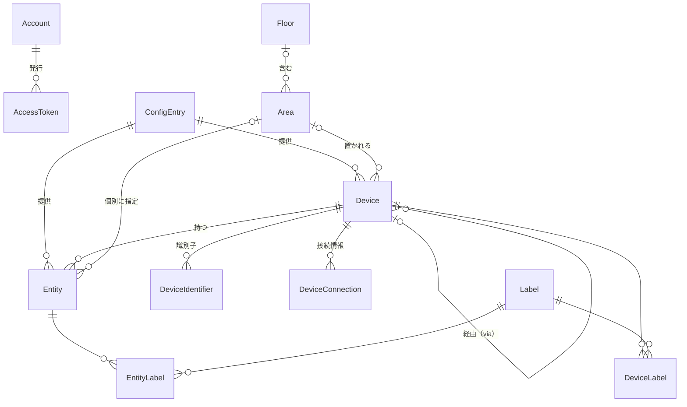
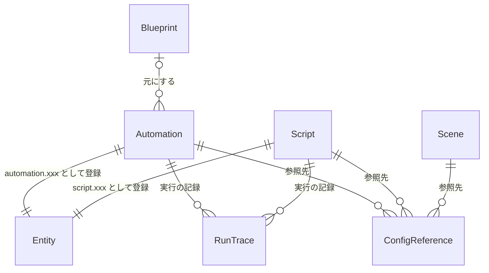
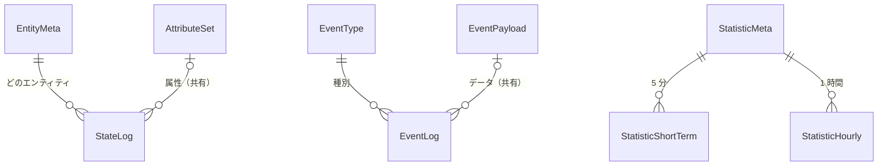
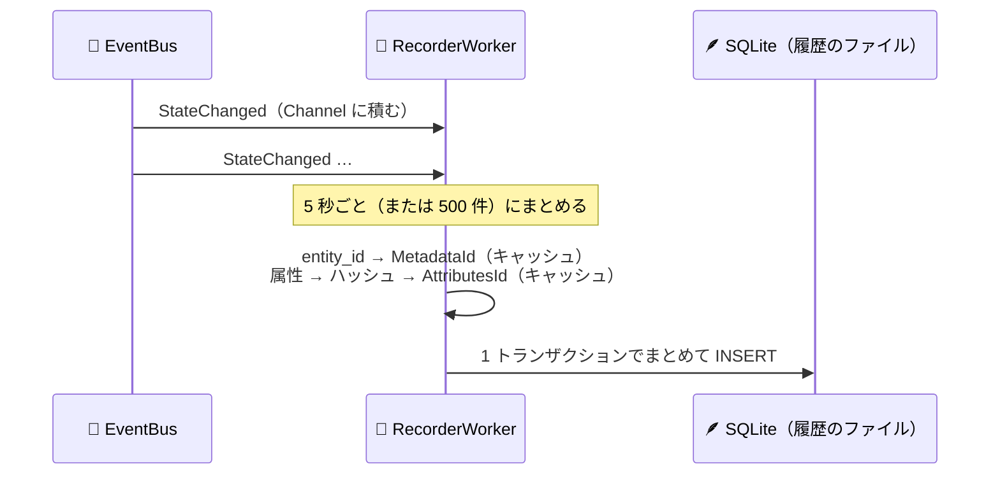
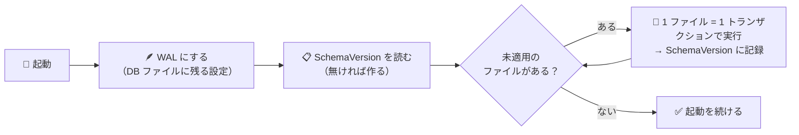

# 🗄️ 09. DB 設計

> 📌 **前提**: **SQLite**（アプリの中・WAL。2026-11-02 に PostgreSQL 18 から変更 → [12 DB の見直し](12-db-review.md)）／ アクセスはテンプレート標準の **Smart.Data.Accessor（SQL ファイル）+ Microsoft.Data.Sqlite** ／ 命名はテンプレートどおり **PascalCase・単数形**（`Account`・`Data` に倣う）
> 🪶 **SQLite に変えたときの読み方**: 表の定義の型は**論理的な型**（`TIMESTAMPTZ`・`JSONB` など）のまま書いてあり、SQLite では §2 の対応表のとおりに置き換える。`core.` / `recorder.` は**どのファイルに置くか**を表す（SQL では接頭辞を付けない）
> 🔗 関連: [02 §5・§8](02-ha-core-architecture.md)（HA のレジストリと Recorder）・[06 §6-5](06-dotnet-architecture.md)・[07 画面](07-screen-design.md)・[08 API](08-api-design.md)

---

## ⚡ 要点

| # | ポイント |
|:-:|---|
| 🗂️ | ファイルは 2 つ: **`core`** = `homemanager.db`（設定・レジストリ・自動化・認証 = 小さくて大事）と **`recorder`** = 履歴のファイル（履歴・統計 = 大きくて消えても致命的でない。P4） |
| 📊 | テーブルは **core 27**（P1: 3・P2: 10・P3: 8・P4: 1・P5: 2・P6: 3）、**recorder 11**（P4） |
| 🧠 | 「今の状態」は DB に置かない（メモリの StateMachine）。DB に入れるのは**設定（永続）**と**履歴（時系列）**だけ |
| 🆔 | ID は 3 種類: 人が読む **slug**（エリアなど）／ 内部の **UUIDv7**（デバイス・エンティティなど）／ 行の多い表の**連番**（履歴・トークン） |
| ⏱️ | 保持期間を過ぎた履歴（`StateLog`・`EventLog`）は**少しずつ DELETE + 時々 VACUUM**（HA の purge / repack と同じ）。**日ごとのファイルに分けてファイルごと消す案**も P4 で比べる（§6-7） |
| 🔐 | インテグレーションの秘密情報（パスワード・API トークン）は Data Protection で**暗号化**して保存 |

---

## 🧭 1. 何をどこに保存するか

| データ | 保存先 | HA では | Phase |
|---|---|---|:-:|
| 🗃️ 今の状態 | **メモリ**（StateMachine）。再起動したらインテグレーションが取り直す。ヘルパーなどは `RestoreState` から復元 | メモリ + `.storage/core.restore_state` | P1 |
| 🌍 全体設定 | `core.Setting`（キー `core.config`） | `.storage/core.config` | P1 |
| 👤 ユーザー・トークン | `core.Account` / `core.AccessToken` | `.storage/auth` | P1 / P5 |
| ⚙️ 接続設定 | `core.ConfigEntry` | `.storage/core.config_entries` | P2 |
| 🗂️ レジストリ | `core.Entity` / `Device` / `Area` / `Floor` / `Label` … | `.storage/core.*_registry` | P2 |
| 🤖 自動化・スクリプト・シーン | `core.Automation` / `Script` / `Scene` | `automations.yaml` / `scripts.yaml` / `scenes.yaml` | P3 |
| 🎛️ ヘルパー | `core.Helper` | `.storage/input_boolean` など種類ごと | P3 |
| 🔍 トレース | `core.RunTrace` | メモリ + `.storage/trace.saved_traces` | P3 |
| 🧱 ダッシュボード | `core.Dashboard` | `.storage/lovelace*` | P4 |
| 📜 状態の履歴 | `recorder.StateLog` ほか | DB の `states` ほか | P4 |
| 📒 イベントの履歴 | `recorder.EventLog` ほか | DB の `events` ほか | P4 |
| 📊 統計 | `recorder.StatisticShortTerm` / `StatisticHourly` | DB の `statistics*` | P4 |
| 🧙 入力中のウィザード（Config Flow） | **メモリ**（保存しない） | メモリ | P2 |
| 📡 MQTT Discovery の設定 | **ブローカーの retained メッセージ**（保存しない） | 同じ | P2 |
| 🔑 Data Protection の鍵 | **ファイル**（`/data/keys`）※**バックアップ必須** | — | P2 |
| 💾 バックアップ | **ファイル**（`/data/backups/*.tar.gz`）+ 管理情報は `core.Backup` | `backups/*.tar` | P5 |

---

## 📏 2. 設計の約束ごと

| 項目 | 決まり |
|---|---|
| 🏷️ 命名 | テーブル・列は **PascalCase**、テーブルは**単数形**（テンプレートの `Account`・`Data` に倣う）。引用符は付けない |
| 🗂️ ファイル | `core`（`homemanager.db`）と `recorder`（履歴のファイル）に分ける → 書き込みのロック・バックアップ・保持期間を別々に扱える |
| 🧱 表 | **`STRICT`** で作る（違う型の値を入れたらエラー）。外部キーは接続文字列の `Foreign Keys=True` で有効にする。ジャーナルは **WAL**（書き込み中も読める） |
| 🆔 ID | 下の表の 3 種類 |
| 🕒 時刻 | すべて **UTC** で書く（SQLite では ISO 8601 の文字列。並べ替えも比べるのも文字列のままでよい） |
| 🧾 JSON | 形が変わるもの（設定・属性・自動化の定義・ダッシュボード）は **JSON の文字列**（`CHECK (json_valid(列))` で確かめる） |
| 🔁 楽観ロック | 画面から編集する表は **`Version INTEGER`**（テンプレート web-api 方式）。API では ETag になる |
| 🧑‍💻 監査 | `CreatedAt` / `UpdatedAt`（テンプレートの操作コンテキストで設定） |
| 🗑️ 削除 | 基本は物理削除。**エンティティだけ論理削除**（`DeletedAt`）: 同じ機器が戻ってきたら entity_id と設定を復活させる（HA の deleted entities と同じ） |
| 🔗 外部キー | 親が消えたら子を「消す（CASCADE）」か「空にする（SET NULL）」かを表ごとに決める |
| 🔐 秘密 | インテグレーションの秘密は `ConfigEntry.SecretData` に **Data Protection で暗号化**。パスワードは PBKDF2（テンプレート）、トークンは **SHA-256 のハッシュだけ** |
| 🧬 マイグレーション | `SchemaVersion` の表 + 番号付きの SQL ファイル（§7） |

### 🪶 SQLite での型（論理的な型との対応）

| 表の定義の型 | SQLite（STRICT） | .NET | 備考 |
|---|---|---|---|
| `TEXT` | `TEXT` | `string` | |
| `BIGINT` / `INTEGER` / `SMALLINT` | `INTEGER` | `long` / `int` | |
| `BIGINT IDENTITY`（連番） | `INTEGER` + `PRIMARY KEY (Id AUTOINCREMENT)` | `long` | テンプレートと同じ書き方 |
| `BOOLEAN` | `INTEGER`（0 / 1） | `bool` | |
| `TIMESTAMPTZ` | `TEXT`（UTC の ISO 8601） | `DateTime`（UTC） | |
| `JSONB` | `TEXT` + `CHECK (json_valid(…))` | `string` → `System.Text.Json` | ✅ P1 で確認 |
| `UUID` | `TEXT` | `Guid` / `string` | UUIDv7 は .NET の `Guid.CreateVersion7()` で作る |
| `BYTEA` | `BLOB` | `byte[]` | |
| `DOUBLE PRECISION` | `REAL` | `double` | |
| `INET` / `TEXT[]` | `TEXT`（配列は JSON の配列） | `string` | |

### 🆔 ID の 3 種類

| 種類 | 型 | 使う表 | 例 | 理由 |
|---|---|---|---|---|
| 🏷️ slug | `TEXT` | Area / Floor / Label / Category / Script / Helper / Dashboard | `living_room` | 人が読む・URL や YAML に書く（HA と同じ） |
| 🧬 UUIDv7 | `TEXT`（.NET の `Guid.CreateVersion7()` で作る） | ConfigEntry / Device / Entity / Automation / Scene / Backup | `0192f3a0-7c4e-7b1a-…` | 推測されない・時刻順に並ぶ |
| 🔢 連番 | `INTEGER`（`AUTOINCREMENT`） | Account / AccessToken / RunTrace / recorder の全表 | `12345` | 行が多い・内部でしか使わない（テンプレートと同じ） |

---

## 📋 3. テーブル一覧

### 🗂️ 3-1. `core` = `homemanager.db`（27）

| # | テーブル | 内容 | Phase | HA では |
|:-:|---|---|:-:|---|
| 1 | `SchemaVersion` | マイグレーションの適用履歴 | P1 | `schema_changes` |
| 2 | `Setting` | 全体設定などのキーと値 | P1 | `.storage/core.config` など |
| 3 | `Account` | ユーザー（テンプレートの表を拡張） | P1 | `.storage/auth` |
| 4 | `ConfigEntry` | インテグレーションの接続設定 | P2 | `core.config_entries` |
| 5 | `Floor` | フロア（階） | P2 | `core.floor_registry` |
| 6 | `Area` | エリア（部屋） | P2 | `core.area_registry` |
| 7 | `Label` | ラベル | P2 | `core.label_registry` |
| 8 | `Device` | デバイス | P2 | `core.device_registry` |
| 9 | `DeviceIdentifier` | デバイスの識別子（同じ機器かの判定） | P2 | 同上の `identifiers` |
| 10 | `DeviceConnection` | デバイスの接続情報（MAC など） | P2 | 同上の `connections` |
| 11 | `DeviceLabel` | デバイス ↔ ラベル | P2 | 同上の `labels` |
| 12 | `Entity` | エンティティレジストリ | P2 | `core.entity_registry` |
| 13 | `EntityLabel` | エンティティ ↔ ラベル | P2 | 同上の `labels` |
| 14 | `Automation` | オートメーションの定義 | P3 | `automations.yaml` |
| 15 | `Script` | スクリプトの定義 | P3 | `scripts.yaml` |
| 16 | `Scene` | シーンの定義 | P3 | `scenes.yaml` |
| 17 | `Helper` | ヘルパーの定義（input_* など） | P3 | `.storage/input_*` など |
| 18 | `RunTrace` | 自動化・スクリプトの実行の記録 | P3 | `trace.saved_traces` |
| 19 | `ConfigReference` | 自動化などが参照するエンティティ・デバイス・エリア（「関連」の検索用） | P3 | `search` の索引 |
| 20 | `RestoreState` | 再起動の前後で引き継ぐ状態 | P3 | `core.restore_state` |
| 21 | `Notification` | 永続通知 | P3 | `persistent_notification` |
| 22 | `Dashboard` | ダッシュボードの設定 | P4 | `lovelace*` |
| 23 | `AccessToken` | リフレッシュトークン・長期アクセストークン | P5 | `.storage/auth` の refresh_tokens |
| 24 | `Backup` | バックアップの管理情報 | P5 | `backups/` |
| 25 | `Category` | 一覧画面の分類 | P6 | `core.category_registry` |
| 26 | `Blueprint` | ブループリント | P6 | `blueprints/` |
| 27 | `Issue` | 修復の要対応事項 | P6 | `repairs.issue_registry` |

### 💾 3-2. `recorder` = 履歴のファイル（11・すべて P4）

| # | テーブル | 内容 | HA では |
|:-:|---|---|---|
| 1 | `EntityMeta` | entity_id → 数値 ID | `states_meta` |
| 2 | `AttributeSet` | 属性 JSON の共有（重複排除） | `state_attributes` |
| 3 | `StateLog` | 状態の履歴（保持期間を過ぎたら少しずつ消す。日ごとのファイルも検討） | `states` |
| 4 | `EventType` | イベント種別 → 数値 ID | `event_types` |
| 5 | `EventPayload` | イベントのデータの共有（重複排除） | `event_data` |
| 6 | `EventLog` | イベントの履歴（同上） | `events` |
| 7 | `StatisticMeta` | 統計の対象と単位 | `statistics_meta` |
| 8 | `StatisticShortTerm` | 5 分ごとの統計 | `statistics_short_term` |
| 9 | `StatisticHourly` | 1 時間ごとの統計（**消さない**） | `statistics` |
| 10 | `StatisticRun` | 集計済みの区間 | `statistics_runs` |
| 11 | `RecorderRun` | アプリの稼働期間 | `recorder_runs` |

---

## 🗺️ 4. ER 図

### 🗂️ 4-1. レジストリと認証



### 🤖 4-2. 自動化（論理的な関連。`RunTrace` と `ConfigReference` は外部キーを張らない）



> 💡 オートメーション・スクリプト・シーン・ヘルパーは**それ自体がエンティティ**（`automation.night_light` など）でもある。エリア・ラベルは `Entity` の側で持つ（HA と同じ）。

---

## 📋 5. テーブル定義（`core`）

> 凡例: **NULL** 列の ✗ = NOT NULL、○ = NULL 可

### 🧬 5-1. システム（P1）

**`SchemaVersion`** — マイグレーションの適用履歴

| 列 | 型 | NULL | 説明 |
|---|---|:-:|---|
| Version | INTEGER | ✗ | **PK**。ファイルの番号（`0001` → 1） |
| Name | TEXT | ✗ | ファイル名 |
| Checksum | TEXT | ✗ | SQL の SHA-256（適用後の書き換えを検出） |
| AppliedAt | TIMESTAMPTZ | ✗ | |

**`Setting`** — キーと値（HA の `.storage/core.*` に相当）

| 列 | 型 | NULL | 説明 |
|---|---|:-:|---|
| Key | TEXT | ✗ | **PK**。`core.config` / `core.onboarding` / `recorder` / `ui` |
| Value | JSONB | ✗ | 値 |
| UpdatedAt | TIMESTAMPTZ | ✗ | |
| Version | INTEGER | ✗ | 楽観ロック |

```jsonc
// Key = "core.config"（SCR-361 全体設定）
{ "name": "我が家", "latitude": 35.68, "longitude": 139.76, "elevation": 40,
  "timeZone": "Asia/Tokyo", "unitSystem": "metric", "currency": "JPY", "country": "JP" }

// Key = "core.onboarding"（SCR-002 初回セットアップ。済んだ手順。初期パスワードの変更はユーザーごとの MustChangePassword）
{ "done": ["core_config"] }

// Key = "recorder"（P4）
{ "keepDays": 10, "commitIntervalSeconds": 5,
  "exclude": { "domains": ["button"], "entityGlobs": ["sensor.*_rssi"], "eventTypes": ["call_service"] } }
```

### 👤 5-2. 認証（P1 / P5）

**`Account`** — ユーザー（テンプレートの `Account` を拡張。🆕 が追加した列）

| 列 | 型 | NULL | 説明 |
|---|---|:-:|---|
| Id | BIGINT IDENTITY | ✗ | **PK** |
| Name | TEXT | ✗ | ログイン ID（**UNIQUE**） |
| DisplayName | TEXT | ✗ | 🆕 表示名（ログブックの「誰が」） |
| Password | BYTEA | ✗ | PBKDF2 のハッシュ（テンプレートの方式） |
| Role | TEXT | ✗ | `Administrator`（P1）/ `User`・`ReadOnly`（P5） |
| IsEnabled | BOOLEAN | ✗ | 🆕 無効化 |
| MustChangePassword | BOOLEAN | ✗ | 🆕 初期ユーザーは true → 初回セットアップ（SCR-002）へ |
| Preferences | JSONB | ✗ | 🆕 表示の設定。P1 はテーマ `{ "theme": "auto" }`（light・dark・auto）、P4 で既定のダッシュボード |
| LastLoginAt | TIMESTAMPTZ | ○ | 🆕 |
| CreatedAt / UpdatedAt | TIMESTAMPTZ | ✗ | |
| Version | INTEGER | ✗ | 🆕 楽観ロック |

**`AccessToken`**（P5）— リフレッシュトークンと長期アクセストークン

| 列 | 型 | NULL | 説明 |
|---|---|:-:|---|
| Id | BIGINT IDENTITY | ✗ | **PK** |
| AccountId | BIGINT | ✗ | FK → Account（CASCADE） |
| Kind | TEXT | ✗ | `Refresh` / `LongLived` |
| Name | TEXT | ○ | 長期トークンの名前（「温度ロガー用」など） |
| TokenHash | BYTEA | ✗ | SHA-256（**UNIQUE**。**値そのものは保存しない**） |
| ExpireAt | TIMESTAMPTZ | ✗ | 有効期限 |
| LastUsedAt | TIMESTAMPTZ | ○ | 最後に使った時刻 |
| LastUsedIp | INET | ○ | 最後に使った IP |
| RevokedAt | TIMESTAMPTZ | ○ | 失効（リフレッシュは入れ替え時にも設定） |
| ReplacedById | BIGINT | ○ | 入れ替え後のトークン。**失効済みのトークンがもう一度使われたら、つながる全部を失効**（盗用の検知） |
| CreatedAt | TIMESTAMPTZ | ✗ | |

### 🧩 5-3. インテグレーション（P2）

**`ConfigEntry`** — 接続設定（HA の Config Entry）

| 列 | 型 | NULL | 説明 |
|---|---|:-:|---|
| Id | UUID | ✗ | **PK**（`uuidv7()`）。HA の `entry_id` |
| Domain | TEXT | ✗ | インテグレーション（`mqtt` など） |
| Title | TEXT | ✗ | 表示名 |
| Source | TEXT | ✗ | `user` / `zeroconf` / `import` … |
| UniqueId | TEXT | ○ | 同じ機器の二重登録を防ぐ（**UNIQUE (Domain, UniqueId)**） |
| Data | JSONB | ✗ | 接続設定（ホスト・ポートなど） |
| SecretData | BYTEA | ○ | 🔐 パスワード・トークン（**Data Protection で暗号化した JSON**） |
| Options | JSONB | ✗ | オプション（ポーリング間隔など） |
| EntryVersion / EntryMinorVersion | INTEGER | ✗ | 設定の形の版（HA の `async_migrate_entry` に相当） |
| DisabledBy | TEXT | ○ | `user` |
| PrefDisableNewEntities | BOOLEAN | ✗ | 新しいエンティティを無効の状態で追加する |
| PrefDisablePolling | BOOLEAN | ✗ | ポーリングを止める |
| CreatedAt / UpdatedAt | TIMESTAMPTZ | ✗ | |
| Version | INTEGER | ✗ | 楽観ロック |

> 💡 状態（読み込み済み／再試行中／エラー）は実行時のものなので**保存しない**（HA も同じ）。

### 🛋️ 5-4. エリア・フロア・ラベル（P2 / P6）

**`Floor`**

| 列 | 型 | NULL | 説明 |
|---|---|:-:|---|
| Id | TEXT | ✗ | **PK**（slug: `first_floor`） |
| Name | TEXT | ✗ | **UNIQUE** |
| Level | INTEGER | ○ | 階（1・2・-1 …） |
| Icon | TEXT | ○ | |
| Aliases | TEXT[] | ✗ | 別名（音声・AI 用） |
| SortOrder | INTEGER | ✗ | 並び順 |
| CreatedAt / UpdatedAt / Version | | ✗ | |

**`Area`**

| 列 | 型 | NULL | 説明 |
|---|---|:-:|---|
| Id | TEXT | ✗ | **PK**（slug: `living_room`） |
| Name | TEXT | ✗ | **UNIQUE** |
| FloorId | TEXT | ○ | FK → Floor（SET NULL） |
| Icon / Picture | TEXT | ○ | |
| Aliases | TEXT[] | ✗ | 別名 |
| TemperatureEntityId / HumidityEntityId | TEXT | ○ | 部屋の代表の温度・湿度センサー（概要のエリア見出しに表示） |
| SortOrder | INTEGER | ✗ | 並び順 |
| CreatedAt / UpdatedAt / Version | | ✗ | |

**`Label`**: `Id` TEXT **PK**（slug）・`Name` TEXT **UNIQUE**・`Color` TEXT・`Icon` TEXT・`Description` TEXT・`CreatedAt` / `UpdatedAt` / `Version`

**`Category`**（P6）: `Id` TEXT **PK**・`Scope` TEXT（`automation` / `script` / `scene` / `helper`）・`Name` TEXT（**UNIQUE (Scope, Name)**）・`Icon` TEXT・`CreatedAt` / `UpdatedAt` / `Version`

### 📟 5-5. デバイス（P2）

**`Device`**

| 列 | 型 | NULL | 説明 |
|---|---|:-:|---|
| Id | UUID | ✗ | **PK**（`uuidv7()`） |
| ConfigEntryId | UUID | ✗ | FK → ConfigEntry（**CASCADE**: 接続設定を消したらデバイスも消す） |
| Name | TEXT | ○ | インテグレーションが付けた名前 |
| NameByUser | TEXT | ○ | ユーザーが付けた名前（こちらを優先して表示） |
| Manufacturer / Model / ModelId / SerialNumber | TEXT | ○ | メーカー・型番・シリアル |
| SwVersion / HwVersion | TEXT | ○ | ファームウェア・ハードウェアの版 |
| ConfigurationUrl | TEXT | ○ | 機器の設定画面の URL |
| EntryType | TEXT | ○ | `service`（クラウドサービスなど実体の無いもの） |
| ViaDeviceId | UUID | ○ | FK → Device（SET NULL）。ハブ経由の機器なら親のハブ |
| AreaId | TEXT | ○ | FK → Area（SET NULL） |
| DisabledBy | TEXT | ○ | `user` / `integration` / `config_entry` |
| CreatedAt / UpdatedAt / Version | | ✗ | |

**`DeviceIdentifier`**: `DeviceId` UUID（FK CASCADE）・`Domain` TEXT・`Value` TEXT・**PK (Domain, Value)** — 例: `('mqtt', '0x00158d0001a2b3c4')`

**`DeviceConnection`**: `DeviceId` UUID（FK CASCADE）・`Type` TEXT（`mac` / `zigbee` / `bluetooth` / `upnp`）・`Value` TEXT・**PK (Type, Value)**

**`DeviceLabel`**: `DeviceId` UUID（FK CASCADE）・`LabelId` TEXT（FK CASCADE）・**PK (DeviceId, LabelId)**

> 💡 HA は identifiers / connections を JSON の集合で持ち、メモリに索引を作って「同じ機器か」を判定する。DB では**別表にして主キーで一意にする**ほうが素直。

### 💡 5-6. エンティティ（P2）

**`Entity`** — エンティティレジストリ

| 列 | 型 | NULL | 説明 |
|---|---|:-:|---|
| Id | UUID | ✗ | **PK**（`uuidv7()`）。HA のレジストリの内部 ID |
| EntityId | TEXT | ✗ | `light.living_ceiling`（**削除されていない行で UNIQUE**） |
| Domain | TEXT | ✗ | `EntityId` の `.` より前（**生成列**） |
| Platform | TEXT | ✗ | 提供するインテグレーション（`mqtt` など） |
| UniqueId | TEXT | ✗ | インテグレーションの中で一意な ID（**UNIQUE (Domain, Platform, UniqueId)**） |
| ConfigEntryId | UUID | ○ | FK → ConfigEntry（SET NULL） |
| DeviceId | UUID | ○ | FK → Device（SET NULL） |
| AreaId | TEXT | ○ | FK → Area（SET NULL）。NULL ならデバイスのエリアを使う |
| Name / OriginalName | TEXT | ○ | ユーザーが付けた名前 / インテグレーションが付けた名前 |
| HasEntityName | BOOLEAN | ✗ | 名前をデバイス名と組み合わせて表示するか |
| Icon / OriginalIcon | TEXT | ○ | |
| DeviceClass / OriginalDeviceClass | TEXT | ○ | `temperature` / `motion` など |
| UnitOfMeasurement | TEXT | ○ | 単位 |
| EntityCategory | TEXT | ○ | `config` / `diagnostic` |
| TranslationKey | TEXT | ○ | 名前の翻訳キー |
| SupportedFeatures | INTEGER | ✗ | 対応機能のビットフラグ |
| Capabilities | JSONB | ○ | 対応する色モード・最小／最大など |
| Options | JSONB | ✗ | 表示の精度・記録しない など |
| Aliases | TEXT[] | ✗ | 別名（音声・AI 用） |
| Categories | JSONB | ✗ | 範囲ごとのカテゴリー（P6） |
| DisabledBy / HiddenBy | TEXT | ○ | `user` / `integration` / `device` / `config_entry` |
| CreatedAt / UpdatedAt | TIMESTAMPTZ | ✗ | |
| DeletedAt | TIMESTAMPTZ | ○ | **論理削除** |
| Version | INTEGER | ✗ | 楽観ロック |

**`EntityLabel`**: `EntityRowId` UUID（FK → Entity.Id CASCADE）・`LabelId` TEXT（FK CASCADE）・**PK (EntityRowId, LabelId)**

> 🆔 **entity_id の付け方**: 形は `<domain>.<object_id>`（`object_id` は `[a-z0-9_]`）。HA は名前をローマ字化して作るが、**日本語の名前はうまく変換できない** → インテグレーションが英語の候補を出すか、`<platform>_<短い ID>` で作り、ユーザーが DLG-02 で直す。名前を変えたら `recorder.EntityMeta.EntityId` も書き換え、**履歴を引き継ぐ**。

### 🤖 5-7. 自動化（P3）

**`Automation`**

| 列 | 型 | NULL | 説明 |
|---|---|:-:|---|
| Id | UUID | ✗ | **PK**（オートメーションのエンティティの `UniqueId` にもなる） |
| Alias | TEXT | ✗ | 名前 |
| Description | TEXT | ○ | 説明 |
| Mode | TEXT | ✗ | `single` / `restart` / `queued` / `parallel` |
| MaxRuns | INTEGER | ○ | queued / parallel の上限 |
| InitialState | BOOLEAN | ○ | 起動時の有効／無効（NULL = 前回の状態を復元） |
| Triggers / Conditions / Actions | JSONB | ✗ | 定義（下の例） |
| Variables | JSONB | ○ | 変数 |
| StoredTraces | INTEGER | ✗ | 残すトレースの数（既定 5） |
| BlueprintPath / BlueprintInputs | TEXT / JSONB | ○ | ブループリントから作った場合（P6） |
| CreatedAt / UpdatedAt / Version | | ✗ | |

```jsonc
// HA の YAML と同じ構造・同じキー（snake_case）で持つ → HA の知識や例をそのまま使える
{
  "triggers":   [ { "trigger": "state", "entity_id": "binary_sensor.hallway_motion", "to": "on" } ],
  "conditions": [ { "condition": "sun", "after": "sunset", "before": "sunrise" } ],
  "actions": [
    { "action": "light.turn_on", "target": { "entity_id": "light.hallway" }, "data": { "brightness_pct": 30 } },
    { "wait_for_trigger": [ { "trigger": "state", "entity_id": "binary_sensor.hallway_motion", "to": "off", "for": "00:05:00" } ] },
    { "action": "light.turn_off", "target": { "entity_id": "light.hallway" } }
  ]
}
```

**`Script`**: `Id` TEXT **PK**（slug。`script.<Id>` になる）・`Alias`・`Description`・`Icon`・`Mode`・`MaxRuns`・`Fields` JSONB（入力項目）・`Sequence` JSONB（アクション列）・`Variables` JSONB・`CreatedAt` / `UpdatedAt` / `Version`

**`Scene`**: `Id` UUID **PK**・`Name`・`Icon`・`Entities` JSONB（例 `{"light.living_ceiling": {"state": "on", "brightness": 128}}`）・`CreatedAt` / `UpdatedAt` / `Version`

**`Helper`**: `Type` TEXT（`input_boolean` / `input_number` / `input_select` / `input_text` / `input_datetime` / `input_button` / `counter` / `timer` / `schedule` / `integral`（W → kWh の積分。P4・電力量の計算））・`Id` TEXT（slug）・**PK (Type, Id)**・`Name`・`Icon`・`Config` JSONB（最小・最大・刻み・選択肢・初期値・時間など）・`CreatedAt` / `UpdatedAt` / `Version`

**`RunTrace`** — 実行の記録（項目ごとに直近 N 件だけ残す）

| 列 | 型 | NULL | 説明 |
|---|---|:-:|---|
| Id | BIGINT IDENTITY | ✗ | **PK** |
| ItemType / ItemId | TEXT | ✗ | `automation` / `script` と、その ID |
| RunId | UUID | ✗ | 実行の ID（**UNIQUE**） |
| StartedAt / FinishedAt | TIMESTAMPTZ | ✗ / ○ | |
| State | TEXT | ✗ | `running` / `stopped` |
| Result | TEXT | ○ | `finished` / `failed_conditions` / `failed_single` / `cancelled` / `error` |
| TriggerSummary | TEXT | ○ | 「廊下センサーが検知になった」など |
| ContextId | UUID | ✗ | この実行の Context（ログブック・状態の変化と結び付く） |
| ConfigSnapshot | JSONB | ✗ | 実行したときの定義（後で定義が変わっても再生できる） |
| Steps | JSONB | ✗ | ステップのパス（`action/0/choose/1/sequence/0`）→ 時刻・結果・エラー |
| Variables | JSONB | ○ | 変数の移り変わり |
| Error | TEXT | ○ | |

索引: `(ItemType, ItemId, StartedAt DESC)`

**`ConfigReference`** — 「関連」を探すための索引（保存のたびに作り直す）: `ItemType` TEXT・`ItemId` TEXT・`RefType` TEXT（`entity` / `device` / `area` / `floor` / `label` / `automation` / `script` / `scene`）・`RefId` TEXT・**PK (ItemType, ItemId, RefType, RefId)**・索引 `(RefType, RefId)`
→ デバイス詳細・エリア詳細の「関連する自動化」（`IReferenceService`）に使う

**`RestoreState`**: `EntityId` TEXT **PK**・`State` TEXT・`Attributes` JSONB・`ExtraData` JSONB・`LastChanged` / `LastUpdated` TIMESTAMPTZ・`SavedAt` TIMESTAMPTZ
→ 15 分ごとと停止時に保存、7 日間現れないエンティティの行は消す（HA と同じ）

**`Notification`**: `Id` TEXT **PK**（notification_id）・`Title` TEXT・`Message` TEXT（Markdown）・`CreatedAt` → 既読にしたら行を消す

**`Blueprint`**（P6）: `Path` TEXT **PK**・`Domain` TEXT・`Name`・`Description`・`SourceUrl`・`Inputs` JSONB・`Content` TEXT（YAML）・`CreatedAt` / `UpdatedAt`

### 🧱 5-8. UI・システム（P4〜P6）

**`Dashboard`**（P4）: `Id` TEXT **PK**（URL のパス）・`Title`・`Icon`・`RequireAdmin` BOOLEAN・`ShowInSidebar` BOOLEAN・`SortOrder`・`Config` JSONB・`CreatedAt` / `UpdatedAt` / `Version`

```jsonc
// Dashboard.Config（ビュー → セクション → カード）
{
  "views": [
    { "path": "home", "title": "ホーム", "icon": "home",
      "sections": [
        { "title": "リビング",
          "cards": [
            { "type": "tile", "entity": "light.living_ceiling" },
            { "type": "sensor", "entity": "sensor.living_temperature", "hoursToShow": 24 }
          ] }
      ] }
  ]
}
```

**`Backup`**（P5）: `Id` UUID **PK**・`Name`・`Kind`（`full` / `config`）・`FileName`・`SizeBytes` BIGINT・`Status`（`creating` / `completed` / `failed`）・`CreatedAt`・`CompletedAt`・`Note`

**`Issue`**（P6）: `Domain` TEXT・`IssueId` TEXT・**PK (Domain, IssueId)**・`Severity`（`warning` / `error` / `critical`）・`IsFixable` BOOLEAN・`TranslationKey`・`Placeholders` JSONB・`Data` JSONB・`CreatedAt`・`DismissedAt`

---

## 💾 6. Recorder（`recorder` スキーマ・P4）

### 🗺️ 6-1. ER 図



### 📋 6-2. テーブル定義

**`EntityMeta`**（HA: `states_meta`）: `Id` BIGINT IDENTITY **PK**・`EntityId` TEXT **UNIQUE**

**`AttributeSet`**（HA: `state_attributes`）: `Id` BIGINT IDENTITY **PK**・`Hash` BIGINT（正規化した JSON の FNV-1a 64 ビット）・`Attributes` JSONB・索引 `(Hash)`
→ アプリ側で「ハッシュ → Id」をキャッシュ。ハッシュが衝突したら JSON を比べる（HA と同じ）

**`StateLog`**（HA: `states`）

| 列 | 型 | NULL | 説明 |
|---|---|:-:|---|
| Id | BIGINT IDENTITY | ✗ | **PK** |
| MetadataId | BIGINT | ✗ | FK → EntityMeta |
| State | TEXT | ○ | 状態の文字列（最大 255） |
| AttributesId | BIGINT | ○ | FK → AttributeSet |
| LastUpdated | TIMESTAMPTZ | ✗ | 記録した時刻（保持期間の判定に使う） |
| LastChanged | TIMESTAMPTZ | ○ | NULL なら LastUpdated と同じ（**容量の節約**。HA と同じ工夫） |
| ContextId | UUID | ✗ | 変化の原因（Context） |
| ContextUserId | BIGINT | ○ | 操作したユーザー（Account.Id） |
| ContextParentId | UUID | ○ | 親の Context（どのオートメーションの結果か） |
| Origin | SMALLINT | ✗ | 0 = local / 1 = remote |

索引: `(MetadataId, LastUpdated)`（エンティティごとの履歴）・`(AttributesId)`（使われなくなった属性の掃除）

**`EventType`**（HA: `event_types`）: `Id` INTEGER IDENTITY **PK**・`EventType` TEXT **UNIQUE**

**`EventPayload`**（HA: `event_data`）: `Id` BIGINT IDENTITY **PK**・`Hash` BIGINT・`Data` JSONB・索引 `(Hash)`

**`EventLog`**（HA: `events`）: `Id` BIGINT IDENTITY **PK**・`EventTypeId` INTEGER（FK）・`PayloadId` BIGINT（FK・NULL 可）・`TimeFired` TIMESTAMPTZ・`ContextId` UUID・`ContextUserId` BIGINT・`ContextParentId` UUID・`Origin` SMALLINT・索引 `(EventTypeId, TimeFired)` / `(TimeFired)` / `(ContextId)`

**`StatisticMeta`**（HA: `statistics_meta`）: `Id` BIGINT IDENTITY **PK**・`StatisticId` TEXT **UNIQUE**（`sensor.house_power` / 外部の値は `external:電気料金`）・`Source` TEXT（`recorder`）・`Name` TEXT・`UnitOfMeasurement` TEXT・`HasMean` BOOLEAN・`HasSum` BOOLEAN

**`StatisticShortTerm`**（HA: `statistics_short_term`・5 分）/ **`StatisticHourly`**（HA: `statistics`・1 時間）— 同じ列

| 列 | 型 | NULL | 説明 |
|---|---|:-:|---|
| MetadataId | BIGINT | ✗ | FK → StatisticMeta。**PK (MetadataId, PeriodStart)** |
| PeriodStart | TIMESTAMPTZ | ✗ | 区間の開始 |
| Mean / Min / Max | DOUBLE PRECISION | ○ | 平均・最小・最大（`state_class: measurement`） |
| State / Sum | DOUBLE PRECISION | ○ | 最後の値・積算（`total` / `total_increasing`。電力量など） |
| LastReset | TIMESTAMPTZ | ○ | 積算がリセットされた時刻 |
| CreatedAt | TIMESTAMPTZ | ✗ | |

**`StatisticRun`**（HA: `statistics_runs`）: `Id` IDENTITY **PK**・`PeriodStart` TIMESTAMPTZ **UNIQUE** → 停止していた間の集計を、起動後に追いかけて作るため

**`RecorderRun`**（HA: `recorder_runs`）: `Id` IDENTITY **PK**・`StartedAt`・`EndedAt`・`ClosedIncorrectly` BOOLEAN → 停止していた期間を履歴で「不明」と表示するため

### ⏱️ 6-3. 保持期間（古い履歴を消す）

SQLite にはパーティションが無いので、HA と同じく**少しずつ消す**。

`RetentionWorker`（1 日 1 回）の仕事:

1. 🗑️ `keepDays`（既定 10 日）を過ぎた `StateLog` / `EventLog` を **1 回 1 万行ずつ** DELETE（長いトランザクションで書き込みを止めない。HA の purge と同じ）
2. 🧹 `StatisticShortTerm` の古い行を DELETE（`StatisticHourly` は消さない）
3. 🧽 どこからも参照されなくなった `AttributeSet` / `EventPayload` / `EntityMeta` の行を消す
4. 📦 消した分の空きを `PRAGMA incremental_vacuum` で少しずつファイルから返す（`auto_vacuum = INCREMENTAL`）。月 1 回くらい `VACUUM`（HA の `auto_repack`）

```sql
-- 保持期間を過ぎた行を少しずつ消す（消す行が無くなるまで RetentionWorker が繰り返す）
DELETE FROM StateLog
WHERE Id IN (
    SELECT Id FROM StateLog
    WHERE LastUpdated < /*@ purgeBefore */'2026-10-21T00:00:00Z'
    ORDER BY LastUpdated
    LIMIT 10000
);

-- 消した分の空きを少しずつファイルから返す
PRAGMA incremental_vacuum(1000);
```

> 📅 **日ごとのファイルに分ける案**（今後の検討事項）: `recorder/2026-11-02.db` のように 1 日 1 ファイルにすれば、古い日は**ファイルを消すだけ**（PostgreSQL のパーティションの DROP と同じ）。比べ方は §6-7 と [12 §5](12-db-review.md)。

### ✍️ 6-4. 書き込みの流れ



- 🛑 停止するときは、溜まっている分を書き切ってから終わる（HA の `final_write`）
- 🙈 記録しないもの: 設定の `exclude`（ドメイン・entity_id のパターン・イベント種別）と、エンティティが「記録しない」と宣言した属性（HA の `_unrecorded_attributes`）

### 📊 6-5. 統計の集計

- ⏱️ `StatisticsWorker`: 5 分ごとに直前の 5 分を集計 → `StatisticShortTerm`。毎時 0 分に、直前の 1 時間を 5 分の統計から集計 → `StatisticHourly`
- 🎯 対象は `state_class` を持つ sensor（measurement → 平均・最小・最大、total / total_increasing → 積算）
- 🧮 例（簡易版の単純平均。パラメーターの書き方は実装時に Smart.Data.Accessor の 2-way SQL に合わせる）:

```sql
-- 区間の終わり (@periodEnd) と今の時刻 (@now) は .NET で計算して渡す
INSERT INTO StatisticShortTerm (MetadataId, PeriodStart, Mean, Min, Max, CreatedAt)
SELECT
    sm.Id,
    @periodStart,
    AVG(CAST(s.State AS REAL)),
    MIN(CAST(s.State AS REAL)),
    MAX(CAST(s.State AS REAL)),
    @now
FROM
    StateLog s
    INNER JOIN EntityMeta em ON em.Id = s.MetadataId
    INNER JOIN StatisticMeta sm ON sm.StatisticId = em.EntityId
WHERE
    s.LastUpdated >= @periodStart
    AND s.LastUpdated < @periodEnd
    AND s.State NOT IN ('unknown', 'unavailable')
    AND sm.HasMean = 1
GROUP BY
    sm.Id
ON CONFLICT (MetadataId, PeriodStart) DO NOTHING;
```

> 🎓 **学習課題**: 単純平均だと「5 分間ずっと同じ値で、変化が 0 件」の区間を集計できない。HA は直前の値を引き継いだ**時間加重平均**で計算している。まず単純平均で作り、次に時間加重平均に直すと違いがよく分かる。

### 📏 6-6. 容量の目安

| 条件 | 1 日 | 保持期間（既定 10 日） |
|---|---|---|
| エンティティ 200・平均 1 分に 1 回変化 | 約 29 万行 | 約 290 万行・**数百 MB**（索引込み） |
| 5 分の統計: 対象 50 | 約 1.4 万行 | 約 14 万行 |
| 1 時間の統計: 対象 50 | 1,200 行 | 1 年で約 44 万行（消さない） |

→ Raspberry Pi でも **SSD** なら十分。頻繁に値が変わるセンサー（電力など）は、記録の除外や間引きで調整する。

### 📅 6-7. 日ごとのファイルに分ける場合（今後の検討事項）

| | 1 ファイル + 少しずつ DELETE（§6-3） | 日ごとのファイル |
|---|---|---|
| 🗑️ 古い日を消す | DELETE を繰り返す + VACUUM | **ファイルを消すだけ**（一瞬・VACUUM 不要） |
| 🔍 何日もまたがる検索 | そのまま | `ATTACH` でつなぐ（同時につなげる数に上限） |
| 🏷️ entity_id・属性の共有表 | 同じファイル | どのファイルに置くかを決める（共通のファイル + 日ごとのファイル など） |
| 🕛 0 時をまたぐ書き込み | 気にしない | 書き込み先の切り替えが要る |
| 📦 古い日を残す | 別に書き出す | ファイルを別の場所に移すだけ |

→ P4 で履歴を作るときに両方を試して決める（テンプレートの maui-server も端末ごとに時系列の SQLite を分けている）。

---

## 🧬 7. マイグレーション（スキーマの更新）

テンプレートは起動時に `Schema.sql`（`CREATE TABLE IF NOT EXISTS`）を流すだけで、列の追加などに対応できない。HomeManager では**番号付きの SQL ファイルを順に流す**小さな仕組みを作る（HA の `SCHEMA_VERSION` と移行処理に相当）。

```text
Assets/Data/Migrations/
├── 0001_core_initial.sql       ← P1: Setting / Account（SchemaVersion は DatabaseService が起動時に作る）
├── 0002_core_registry.sql      ← P2: ConfigEntry / Floor / Area / Label / Device* / Entity*
├── 0003_core_automation.sql    ← P3: Automation / Script / Scene / Helper / RunTrace / ConfigReference / RestoreState / Notification
├── 0004_recorder.sql           ← P4: 履歴のファイル一式（別のファイルにするので、並びを分けるかは P4 で決める）
├── 0005_core_dashboard.sql     ← P4: Dashboard
├── 0006_core_tokens.sql        ← P5: AccessToken / Backup
└── …
```



- ↩️ SQLite も **DDL をトランザクションで巻き戻せる** → 途中で失敗しても中途半端なスキーマが残らない
- 🔓 アプリは 1 プロセスで DB ファイルを持つので、マイグレーションのロックは取らない（PostgreSQL のときはアドバイザリーロックを取っていた）
- 📁 DB ファイルのフォルダーは起動時に作る（SQLite はフォルダーを作らない）
- 🔏 適用済みのファイルが書き換えられていたら `Checksum` で検出して起動を止める
- 🌱 初期データ（初期ユーザー admin・`core.config` の既定値）は SQL ではなく**起動時の初期化処理**で入れる（テンプレートの `InitializeApplicationAsync` に倣う）

---

## 💾 8. バックアップ

| 対象 | 方法 | 頻度 |
|---|---|---|
| 🗂️ `homemanager.db` | ファイルのコピー。動かしたままなら `VACUUM INTO` か `SqliteConnection.BackupDatabase`（小さい） | 毎日 + 設定を大きく変える前 |
| 📜 履歴のファイル | 任意（消えても困らない。統計だけ残すなら `StatisticMeta` と `StatisticHourly`） | 週 1 など |
| 🔑 Data Protection の鍵（`/data/keys`） | ファイルのコピー（**無いと `SecretData` を復号できない**） | `core` と必ず一緒に |

→ `IBackupService`（P5）がこれらを 1 つの `tar.gz` にまとめる

---

## 🔁 9. HA の保存先との対応

| 🏠 HA | 🟣 HomeManager |
|---|---|
| `.storage/core.config` | `core.Setting`（`core.config`） |
| `.storage/auth`・`auth_provider.homeassistant` | `core.Account`・`core.AccessToken` |
| `.storage/core.config_entries` | `core.ConfigEntry` |
| `.storage/core.entity_registry` | `core.Entity`・`EntityLabel` |
| `.storage/core.device_registry` | `core.Device`・`DeviceIdentifier`・`DeviceConnection`・`DeviceLabel` |
| `.storage/core.area_registry`・`floor_registry`・`label_registry`・`category_registry` | `core.Area`・`Floor`・`Label`・`Category` |
| `.storage/core.restore_state` | `core.RestoreState` |
| `automations.yaml`・`scripts.yaml`・`scenes.yaml` | `core.Automation`・`Script`・`Scene` |
| `.storage/input_*`・`counter`・`timer`・`schedule` | `core.Helper` |
| `.storage/trace.saved_traces` | `core.RunTrace` |
| `.storage/lovelace*` | `core.Dashboard` |
| `.storage/repairs.issue_registry` | `core.Issue` |
| DB `states`・`states_meta`・`state_attributes` | `recorder.StateLog`・`EntityMeta`・`AttributeSet` |
| DB `events`・`event_types`・`event_data` | `recorder.EventLog`・`EventType`・`EventPayload` |
| DB `statistics`・`statistics_short_term`・`statistics_meta`・`statistics_runs` | `recorder.StatisticHourly`・`StatisticShortTerm`・`StatisticMeta`・`StatisticRun` |
| DB `recorder_runs` | `recorder.RecorderRun` |
| DB `schema_changes` | `core.SchemaVersion` |

---

## ⚠️ 10. 検討事項

| 項目 | 内容 | 方針 |
|---|---|---|
| 🧮 Smart.Data.Accessor と SQLite | テンプレートはすべて SQLite + Smart.Data.Accessor | ✅ P1 で確認（`STRICT` の表・`json_valid`・`RETURNING`・UPSERT・真偽値と時刻の読み書き。結合テスト） |
| 📦 JSON・UUID の受け渡し | Accessor で JSON / UUID をどの .NET 型で受けるか | JSON は `string` で受けて `System.Text.Json` で変換（✅ P1 で確認）。UUID は P2 で確かめる |
| ✍️ 履歴の書き込み性能 | 1 行ずつの INSERT は遅い。SQLite は書くのが 1 本ずつ | 5 秒ごとに 1 トランザクションでまとめて INSERT（HA の `commit_interval`）。必要なら `synchronous = NORMAL` |
| 📅 履歴のファイルの分け方 | 1 ファイル + 少しずつ DELETE か、日ごとのファイルか | P4 で比べる（§6-7） |
| 🔗 外部キーの負荷 | 大量に INSERT する表の外部キーは検査の負荷になる | まず付ける（整合性を学ぶ）。重ければ `StateLog` の外部キーだけ外す |
| 🧹 共有行の掃除 | `AttributeSet` などは参照が無くなっても残る | `RetentionWorker` で参照されない行を消す（HA の purge と同じ） |
