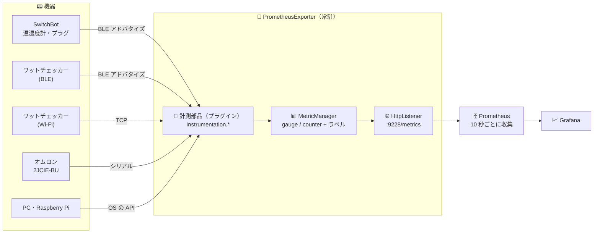
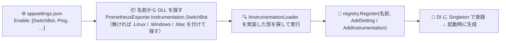
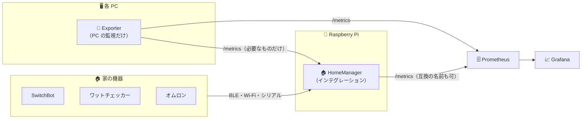

# 📡 10. Prometheus Exporter の取り込み検討

> 📁 対象: `D:\GitHubDevice\Service-PrometheusExporter`（GitHub: `usausa/prometheus-exporter-alternative`、v2.4.0 系）
> 🔍 方法: README・ホスト（`Program.cs`・プラグインの読み込み・HTTP の出力）・設定ファイル・各計測部品のソース・Grafana のダッシュボードを読んだ（ビルド・実行はしていない）

---

## 🎯 1. この Exporter で実現している機能

> **家の中のセンサー・電源・PC の状態を集めて、Prometheus 形式で公開する常駐サービス。** Prometheus が 10 秒ごとに取りに来て、Grafana で可視化している。

| 分類 | できること | 対象の機器 |
|---|---|---|
| 🌡️ 部屋の環境 | 温度・湿度・CO2・照度・気圧・騒音・不快指数・熱中症の危険度・TVOC・地震の揺れを測る | SwitchBot 温湿度計 / CO2 センサー（BLE）、オムロン 2JCIE-BU（USB シリアル） |
| ⚡ 電力 | 家電ごとの消費電力・電流・電圧を測る | ラトック ワットチェッカー（BLE 版・Wi-Fi 版）、SwitchBot プラグミニ（BLE） |
| 📶 ネットワーク | 機器・回線の死活と応答時間、BLE / Wi-Fi の電波の強さ | Ping、周囲の BLE 機器、Wi-Fi のアクセスポイント（Windows） |
| 🖥️ PC・サーバー | CPU・GPU・メモリ・ディスク・ネットワークの負荷と温度、ディスクの寿命（S.M.A.R.T.）、Raspberry Pi の温度・電圧低下、Hyper-V の VM、NPU | Windows / Linux / macOS / Raspberry Pi |
| 📊 可視化 | Grafana のダッシュボード 7 枚（部屋・電力・センサー・SMART・PC の概況・稼働時間・VM） | — |
| 🛠️ 運用 | Windows サービス・systemd で常駐、設定ファイルで使う計測を選ぶ | — |

> 💡 **HomeManager から見ると**: 「家の機器から値を集める」部分はすでに**実機で動いている実績のあるコード**。HomeManager はここに「部屋への割り当て・リアルタイムの画面・自動化・操作」を足すもの、と位置づけられる。

---

## 🗺️ 2. 全体構成



### 🧩 2-1. プラグインの仕組み



| 部品 | 内容 |
|---|---|
| 📄 `PrometheusExporter.Abstractions` | プラグインが参照する唯一の契約（`IInstrumentationLoader` / `IInstrumentationRegistry` / `IInstrumentationBuilder` / `IMetricManager` / `IMetric` / `IMetricSeries`） |
| 🔌 読み込み | 設定の `Enable` の名前 → `AssemblyLoadContext.Default.LoadFromAssemblyPath`。**OS ごとの実装を接尾辞（`.Linux` / `.Windows` / `.Mac`）で切り替え** |
| 🏗️ ビルド | csproj の条件（`BuildPlatform`）で、OS ごとに同梱する計測部品を選ぶ |
| 🛟 失敗 | 読み込めなかった計測部品はエラーを記録して**他は動かし続ける** |

### 📊 2-2. メトリクスの作り

- 📛 名前 + ラベル（例 `sensor_temperature{model="switchbot", address="…", name="My Room"}`）
- 🚫 機器を見失ったら値を **NaN** にする（Prometheus 側で欠損になる）
- ✍️ テキスト形式を `IBufferWriter<byte>` に直接書く**自前の軽量な実装**（Prometheus 用のライブラリは使っていない）

### ⏱️ 2-3. 値の取り方は 3 種類

| 型 | 使っている計測 | HomeManager での対応 |
|---|---|---|
| ⚡ **push**（届いたら更新） | SwitchBot・BLE ワットチェッカー・BLE の電波 | push 型のエンティティ（`WriteState()`） |
| ⏲️ **定期取得**（タイマー + 多重実行の防止） | Wi-Fi ワットチェッカー・オムロン・Ping | Coordinator（[02](02-ha-core-architecture.md) §4 の DataUpdateCoordinator 相当） |
| 📥 **収集時に取得**（Prometheus が来た時） | PC・Linux・Raspberry Pi・SMART など | 定期取得に置き換える |

### 🛠️ 2-4. 技術

- 🟣 net10.0（Windows は `net10.0-windows10.0.26100.0` も）、Worker SDK、Serilog、Windows サービス / systemd
- 🔵 BLE: Linux は **BlueZ を D-Bus で**（`Tmds.DBus`。`InterfacesAdded` / `PropertiesChanged` を購読）、Windows は **WinRT の `BluetoothLEAdvertisementWatcher`**
- 📚 自作の NuGet ライブラリ: `DeviceLib.WFWattch2` / `DeviceLib.SensorOmron` / `LinuxDotNet.SystemInfo` / `LinuxDotNet.Disk` / `RaspberryDotNet.SystemInfo` / `MacDotNet.*` / `HardwareInfo.Disk`

---

## 📟 3. 計測の一覧

| 計測（プラグイン） | 対象 | 取得方式 | OS | 主なメトリクス | 🏠 家の自動化での価値 |
|---|---|---|---|---|---|
| 🌡️ **SwitchBot** | 温湿度計・CO2 センサー・プラグミニ | BLE アドバタイズ（メーカー ID `0x0969`） | Linux / Windows | `sensor_temperature` / `humidity` / `co2` / `power` / `rssi` | ⭐⭐⭐ 部屋の温湿度・CO2・家電の電力 |
| ⚡ **BTWattch2** | ワットチェッカー（BLE 版） | BLE アドバタイズ（メーカー ID `0x0B60`） | Linux / Windows | `sensor_power` / `current` / `voltage` / `rssi` | ⭐⭐⭐ 家電の消費電力 |
| ⚡ **WFWattch2** | ワットチェッカー（Wi-Fi 版） | TCP で定期取得（`DeviceLib.WFWattch2`） | 全部 | `sensor_power` / `current` / `voltage` | ⭐⭐⭐ 家電の消費電力 |
| 🌫️ **SensorOmron** | オムロン 2JCIE-BU | USB シリアルで定期取得（`DeviceLib.SensorOmron`） | 全部 | `sensor_temperature` / `humidity` / `light` / `pressure` / `noise` / `discomfort` / `heat` / `tvoc` / `co2` / `seismic` | ⭐⭐⭐ 部屋の環境を 10 項目 |
| 📶 **Ping** | 任意のホスト | ICMP を定期送信 | 全部 | `ping_result_time` | ⭐⭐ 機器・回線の死活 |
| 📶 **Ble** | 周囲の BLE 機器すべて | BLE スキャン | Linux / Windows | `ble_rssi` | ⭐ 在宅の判定（スマホ・タグ） |
| 📶 **Wifi** | 周囲のアクセスポイント | WLAN の一覧（`ManagedNativeWifi`） | Windows | `wifi_rssi` | — 自動化での価値は低い |
| 🍓 **Raspberry** | Raspberry Pi 本体 | VideoCore（`RaspberryDotNet.SystemInfo`） | Linux | `hardware_vcio_temperature` / `frequency` / `voltage` / `throttled` / `gpio_level` | ⭐⭐ サーバー自身の温度・電圧低下 |
| 🐧 **Linux** | Linux 本体 | /proc など（`LinuxDotNet.SystemInfo`） | Linux | CPU・メモリ・ディスク・ネットワーク・負荷・稼働時間 など約 60 | ⭐ サーバーの監視 |
| 💽 **DiskInfo** | ディスク | S.M.A.R.T.（OS ごとのライブラリ） | 全部 | `smart_*` | ⭐ ディスクの寿命 |
| 🖥️ **HardwareMonitor** | Windows PC | LibreHardwareMonitor | Windows | `hardware_cpu_*` / `gpu_*` / `memory_*` / `storage_*` / `battery_*` など | ⭐ PC の温度・負荷 |
| 🪟 **PerformanceCounter** / **HyperV** / **Npu** / **Mac** | Windows・macOS | PDH・WMI など | Windows / macOS | `performance_*` / `hyperv_vm_*` / `hardware_npu_*` | — PC の監視専用 |

---

## 🔍 4. 実装の要点（移植するときに効くところ）

### 🌡️ 4-1. SwitchBot（BLE アドバタイズの解析）

```csharp
// メーカーデータ（会社 ID 0x0969）の中身から値を取り出す（Linux 版 SwitchBotInstrumentation より）
meter.Temperature.Value = (((double)(buffer[8] & 0x0f) / 10) + (buffer[9] & 0x7f)) * ((buffer[9] & 0x80) > 0 ? 1 : -1);
meter.Humidity.Value = buffer[10] & 0x7f;
meter.Co2.Value = buffer.Length >= 16 ? (buffer[13] << 8) + buffer[14] : double.NaN;
plug.Power.Value = (double)(((buffer[10] & 0b00111111) << 8) + (buffer[11] & 0b01111111)) / 10;
```

- 📡 **受け身**（アドバタイズを聞くだけ）なので、機器の電池を減らさず、何台でも同時に読める
- 🔁 解析のコードが **Linux 版と Windows 版に重複**している（受信の仕組みだけが違う）

### ⚡ 4-2. ワットチェッカー（BLE 版）

```csharp
// メーカーデータ（会社 ID 0x0B60）
device.Voltage.Value = (double)((buffer[2] << 8) + buffer[1]) / 10;              // V
device.Current.Value = (double)((buffer[4] << 8) + buffer[3]) / 1000;            // A
device.Power.Value = (double)((buffer[7] << 16) + (buffer[6] << 8) + buffer[5]) / 1000;  // W
```

### 🔵 4-3. BLE の受信（BlueZ）

- `BleScanSession`: D-Bus の `ObjectManager` で機器の追加・削除、`PropertiesChanged` で RSSI・メーカーデータの変化を受け、`DeviceEvent`（`Found` / `Updated` / `Lost`）として通知
- ⚠️ **計測部品ごとに別々のスキャンを開いている**（SwitchBot・BTWattch2・Ble がそれぞれ `BleScanSession` を作る）

### ⏲️ 4-4. 定期取得（Wi-Fi ワットチェッカー・オムロン・Ping）

- `Timer` + `Interlocked.CompareExchange` で**前回が終わっていなければ飛ばす**
- 失敗したら値を NaN にし、次の周期で接続し直す

---

## 🧩 5. HomeManager に取り込める要素

### 📟 5-1. デバイス連携（インテグレーションとして取り込む）

| # | 取り込むもの | HomeManager での形 | 作るエンティティ | 種類 | 提案 |
|:-:|---|---|---|---|:-:|
| 1 | 🌡️ SwitchBot（温湿度計・CO2・プラグミニ） | `Integration.SwitchBot`（BLE） | 温度・湿度・CO2・電力・電波 | ⚡ local_push | ⭐⭐⭐ |
| 2 | ⚡ ワットチェッカー（BLE 版・Wi-Fi 版） | `Integration.Wattchecker` | 電力・電流・電圧（+ 計算した**電力量 kWh**） | ⚡ push / ⏲️ polling | ⭐⭐⭐ |
| 3 | 🌫️ オムロン 2JCIE-BU | `Integration.OmronEnvSensor`（`DeviceLib.SensorOmron` をそのまま参照） | 10 項目のセンサー | ⏲️ local_polling | ⭐⭐⭐ |
| 4 | 📶 Ping | `Integration.Ping` | 接続状態（binary_sensor）+ 応答時間 | ⏲️ local_polling | ⭐⭐ |
| 5 | 🍓 Raspberry Pi・Linux・SMART | `Integration.SystemMonitor`（`RaspberryDotNet` / `LinuxDotNet` を参照） | CPU 温度・負荷・メモリ・ディスク・**電圧低下（problem）**・ディスク寿命 | ⏲️ local_polling | ⭐⭐ |
| 6 | 📶 BLE の電波 | `Integration.BleTracker` | 在宅の判定（電波の強さのしきい値で home / away） | ⚡ local_push | ⭐ |
| 7 | 🖥️ Windows PC の監視（HardwareMonitor ほか） | **取り込まない**。PC 側では Exporter を動かし続け、HomeManager は **8** で読む | — | — | — |
| 8 | 🔁 他の PC の Exporter | `Integration.PrometheusScrape`（`/metrics` を定期取得してセンサー化） | 選んだメトリクス | ⏲️ local_polling | ⭐ |

### 🧱 5-2. 基盤・設計（コードや考え方を取り込む）

| # | 取り込むもの | HomeManager での使い道 | 提案 |
|:-:|---|---|:-:|
| A | 🔵 **BLE 受信の基盤**（BlueZ / WinRT） | **共通の Bluetooth 基盤**にする: スキャンは 1 つだけ開き、インテグレーションは「メーカー ID」などの条件で購読する（HA の `bluetooth` インテグレーションと同じ形）。Exporter の「部品ごとに別スキャン」も解消できる | ⭐⭐⭐ |
| B | 🔍 BLE の**自動検出** | メーカー ID `0x0969` を受けたら「SwitchBot が見つかりました。追加しますか？」（HA の bluetooth discovery） | ⭐⭐ |
| C | 🧩 **プラグインの読み込み方式** | 設定の有効一覧 + `AssemblyLoadContext` + **OS 接尾辞での実装の切り替え** → HomeManager の INT-01 / INT-11 に流用 | ⭐⭐ |
| D | 📚 **自作ライブラリを共有** | `DeviceLib.*` / `LinuxDotNet.*` / `RaspberryDotNet.*` は HomeManager から**そのまま参照**。SwitchBot・BTWattch2 の解析は Exporter の中にあるので、**ライブラリに切り出して両方で使う** | ⭐⭐⭐ |
| E | ⏱️ 取得の 3 つの型（push / 定期 / 収集時） | push 型エンティティと Coordinator の実装例として | ⭐⭐ |
| F | 🚫 NaN = 見失った | エンティティの状態 **`unavailable`** に対応させる | ⭐⭐ |

### 📈 5-3. データ・画面（考え方を取り込む）

| # | 取り込むもの | HomeManager での使い道 | 提案 |
|:-:|---|---|:-:|
| G | 📤 **Prometheus への出力** | HomeManager が**エンティティの状態を `/metrics` で出す**（HA の `prometheus` インテグレーションと同じ）。Exporter の軽量な出力の実装（`IBufferWriter<byte>`）を流用 | ⭐⭐⭐ |
| H | 🔁 **既存の Grafana との互換** | 出力に **Exporter と同じ名前・ラベル**（`sensor_temperature{model,address,name}`）を選べるようにする → **今の Grafana のダッシュボードをそのまま使い続けられる** | ⭐⭐ |
| I | 📊 Grafana のダッシュボード | 部屋（電力・温度・電波・Ping）・センサー 9 項目・SMART の構成を、HomeManager のダッシュボードのカード構成の手本にする | ⭐⭐ |
| J | ⚡ 電力量（kWh）の計算 | ワットチェッカーの W を時間で積分して kWh にする**ヘルパー**（HA の `integration` ヘルパー）→ エネルギーダッシュボードの材料 | ⭐⭐⭐ |

---

## 🔀 6. Exporter との関係（共存か統合か）

| 案 | 内容 | 👍 | 👎 |
|---|---|---|---|
| A. 並行稼働だけ | Exporter はそのまま。HomeManager は Exporter の `/metrics` を読む（5-1 の 8） | すぐ使える | push でなく遅い（定期取得）。BLE を Exporter が握るので HomeManager で BLE を使いにくい。機器の登録や操作ができない |
| B. 全部 HomeManager へ | 家の機器も PC の監視も HomeManager に移す | 1 つにまとまる | Windows 専用の監視（LibreHardwareMonitor など）まで抱え込む。各 PC で HomeManager は動かせない |
| **C. 段階的に役割分担** ✅ 決定 | **家の機器（SwitchBot・ワットチェッカー・オムロン・Ping・Raspberry Pi）は HomeManager のインテグレーションに移す**。**PC の監視は各 PC の Exporter に残し**、必要なものだけ HomeManager が読む。HomeManager は `/metrics` を出し、Grafana は HomeManager を読む | 家の機器は push で即時・自動化に使える。PC 監視は今の資産のまま。Grafana も互換で続く | 移行の間、BLE を二重にスキャンしないよう、移したものから Exporter の `Enable` を外す |



---

## 🔄 7. メトリクス → エンティティの対応

| Exporter のメトリクス | HomeManager のエンティティ（例） | device_class | 単位 | state_class |
|---|---|---|---|---|
| `sensor_temperature` | `sensor.my_room_temperature` | temperature | °C | measurement |
| `sensor_humidity` | `sensor.my_room_humidity` | humidity | % | measurement |
| `sensor_co2` | `sensor.my_room_co2` | carbon_dioxide | ppm | measurement |
| `sensor_power` | `sensor.refrigerator_power` | power | W | measurement |
| `sensor_current` / `sensor_voltage` | `sensor.refrigerator_current` / `_voltage` | current / voltage | A / V | measurement |
| （計算） | `sensor.refrigerator_energy` | energy | kWh | total_increasing |
| `sensor_light` | `sensor.environment_illuminance` | illuminance | lx | measurement |
| `sensor_pressure` | `sensor.environment_pressure` | atmospheric_pressure | hPa | measurement |
| `sensor_noise` | `sensor.environment_sound_pressure` | sound_pressure | dB | measurement |
| `sensor_tvoc` | `sensor.environment_tvoc` | volatile_organic_compounds_parts | ppb | measurement |
| `sensor_discomfort` / `sensor_heat` / `sensor_seismic` | `sensor.environment_discomfort_index` / `_heatstroke` / `_seismic_intensity` | （なし） | — | measurement |
| `sensor_rssi` / `ble_rssi` | `sensor.my_room_signal_strength`（**診断・既定は無効**） | signal_strength | dBm | measurement |
| `ping_result_time` | `binary_sensor.router`（接続）+ `sensor.router_round_trip_time` | connectivity / duration | — / ms | measurement |
| `hardware_vcio_temperature` | `sensor.raspberry_pi_cpu_temperature` | temperature | °C | measurement |
| `hardware_vcio_throttled{name="under_voltage"}` | `binary_sensor.raspberry_pi_under_voltage` | problem | — | — |
| **NaN**（見失った） | 状態 **`unavailable`** | | | |

- 📟 デバイスは設定の `Name` / `Address` から作る（メーカー: SwitchBot / RATOC / OMRON、型番、`identifiers` = (`switchbot`, MAC)、`connections` = (`bluetooth`, MAC)）
- 🛋️ Exporter の設定にある名前（「My Room」「Server Room」「Refrigerator」）は、HomeManager では**エリア**や**デバイス名**になる

---

## 🤖 8. HomeManager にすると増えること（自動化の例）

| 例 | 使う機器 |
|---|---|
| 🌫️ CO2 が 1,000ppm を超えたら「換気してください」と通知 | SwitchBot CO2 センサー・オムロン |
| 🧺 洗濯機の消費電力が 5 分間 5W 未満になったら「洗濯が終わりました」 | ワットチェッカー |
| 🧊 冷蔵庫の電力が 30 分 0W のまま／庫内の温度が上がったら警告 | ワットチェッカー・SwitchBot 温湿度計 |
| 🔥 サーバー室が 30℃ を超えたら通知（＋エアコンを ON） | SwitchBot 温湿度計・Nature Remo など |
| 🥵 熱中症の危険度が「警戒」になったら通知 | オムロン |
| 🍓 Raspberry Pi の電圧低下を検知したら通知 | Raspberry Pi |
| 🌐 ルーターに Ping が届かなくなったら記録・通知 | Ping |
| 📅 家電ごとの電力量を日・月で比較 | ワットチェッカー（kWh の計算） |

---

## 🪜 9. フェーズと設計への反映（✅ 2026-10-31 に決定・反映済み）

| 反映先 | 内容 |
|---|---|
| 🧩 [05 機能](05-feature-scope.md) | DEV-09〜15 を追加（SwitchBot・ワットチェッカー・オムロン・Ping・システム監視・BLE 在宅判定・Prometheus 取り込み）、AUTO-11（電力量の計算ヘルパー）、DATA-08（Prometheus への出力）。**P2 の対象を「手持ちの機器」に寄せる**案 |
| 🏗️ [06 構成](06-dotnet-architecture.md) | `Integration.Bluetooth`（共通の BLE 基盤）と各インテグレーションのプロジェクト、自作ライブラリの参照 |
| 🖥️ [07 画面](07-screen-design.md) | 📶 **Bluetooth 診断**（受信中のアドバタイズの一覧。MAC アドレスを調べて機器を登録するため） |
| 🌐 [08 API](08-api-design.md) | 📤 `GET /api/v1/prometheus`（エンティティの状態を Prometheus 形式で） |
| 🗄️ [09 DB](09-db-design.md) | **追加の表は不要**。機器ごとの設定（MAC・IP・シリアルポート）は `ConfigEntry.Data`、出力の設定は `Setting`（`prometheus`） |

---

## ⚠️ 10. 注意点

| 項目 | 内容 |
|---|---|
| 🔵 BLE の取り合い | Exporter と HomeManager が同じアダプタでそれぞれスキャンすると、探索の設定がぶつかる可能性 → 移した機器から Exporter の `Enable` を外す |
| 🔐 権限（Linux） | BLE は BlueZ の D-Bus の権限、シリアルは `dialout` グループが必要（systemd のユニットで設定） |
| 🔒 暗号化されたアドバタイズ | 新しい機種は暗号化している場合がある → 今の解析がそのまま使えるかは機種ごとに確認 |
| 🖥️ Windows 専用の部品 | LibreHardwareMonitor は管理者権限が必要・Windows 専用 → HomeManager（Raspberry Pi）には入れない |
| 🔁 名前の互換 | Grafana の互換出力は便利だが、HomeManager 本来の名前（entity_id ベース）と二重管理になる → 互換は移行期間だけに使う |
