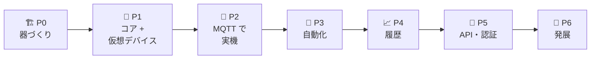

# 🏠 HomeManager — 調査ドキュメント

> 🎯 **ゴール**: [Home Assistant](https://github.com/home-assistant) のソースを分析し、
> **.NET スタックで自作するホームオートメーション基盤「HomeManager」**の「実装する機能」と「技術スタック構成案」をまとめる（個人学習用）。

---

## 🎯 HomeManager で実現する機能

> 🏠 **家の中の機器の状態を 1 か所に集め、ブラウザでリアルタイムに見て・操作し、条件に応じて自動で動かし、記録を残す ── Raspberry Pi で動く Web アプリ。**

| | 実現する機能 | 主な例 |
|:-:|---|---|
| 📡 | **集める** | SwitchBot の温湿度計・CO2 センサー・プラグミニ、ワットチェッカー（BLE・Wi-Fi）、オムロン環境センサー、Ping、（MQTT の機器） |
| 🖥️ | **見る・操作する** | 部屋ごとに自動で作るダッシュボード（開いている全員の画面が即座に変わる）、機器の詳細と操作、自分好みのダッシュボード |
| 🤖 | **自動で動かす** | 「CO2 が高ければ換気を通知」「洗濯機の電力が下がったら終了を通知」「日没後の人感で照明」、スクリプト・シーン・ヘルパー |
| 📈 | **記録する** | 履歴・ログブック・長期統計・家電ごとの電力量、Prometheus / Grafana への出力 |
| 🔌 | **外とつなぐ** | REST・リアルタイム API、長期アクセストークン、Webhook、（AI 連携） |

👉 **機能の一覧と採用の決定（⭐ 採用 / 🟡 保留 / ⛔ 見送り。2026-10-31 に決定）は [00 実現する機能](00-system-features.md)**。P0・P1 は実装済み（進み具合は [11](11-progress.md)）。

---

## 🚦 調査ステータス

| # | ドキュメント | 内容 | 状態 |
|:-:|---|---|:-:|
| 00 | [🎯 実現する機能](00-system-features.md) | HomeManager で実現する機能の一覧と採用の決定（2026-10-31） | ✅ 決定 |
| 01 | [🏠 Home Assistant の全体像](01-ha-overview.md) | 実現している機能／参考記事／リポジトリ構成／Open Home Foundation／インストール形態／最近の変化 | ✅ 完了 |
| 02 | [🔬 HA core ソース分析](02-ha-core-architecture.md) | イベントバス・ステートマシン・エンティティモデル 等 | ✅ 完了 |
| 03 | [🔌 外部 API とフロントエンド](03-ha-interfaces.md) | WebSocket API・REST API・認証・フロントエンド・モバイルアプリ | ✅ 完了 |
| 04 | [🧰 .NET テンプレート調査](04-template-survey.md) | `D:\GitHubTemplate` の各テンプレート比較 | ✅ 完了 |
| 05 | [🧩 実装機能の洗い出し](05-feature-scope.md) | MVP → 発展フェーズの機能一覧 | ✅ 完了 |
| 06 | [🏗️ .NET 技術スタック構成案](06-dotnet-architecture.md) | 構成・ライブラリ・ソリューション構造 | ✅ 完了 |
| 07 | [🖥️ 画面設計](07-screen-design.md) | 画面 42・ダイアログ 15・カード 13 種・画面遷移 | ✅ 完了 |
| 08 | [🌐 API 設計](08-api-design.md) | REST・SignalR・Webhook・サービス・イベント・内部 API | ✅ 完了 |
| 09 | [🗄️ DB 設計](09-db-design.md) | SQLite（core 27 表・履歴 11 表）・保持期間は少しずつ DELETE・マイグレーション | ✅ 完了 |
| 10 | [📡 Prometheus Exporter の取り込み](10-prometheus-exporter.md) | 手持ちの機器の計測（SwitchBot・ワットチェッカー・オムロン …）を HomeManager に取り込む検討 | ✅ 完了 |
| 11 | [📋 進捗チェックリスト](11-progress.md) | 実装の進み具合（フェーズごとのチェックリスト）。作業しながら更新する | 🚧 更新中 |
| 12 | [🗄️ DB の見直し](12-db-review.md) | PostgreSQL は必要か。SQLite で済むか（要件ごとの比較・切り替えでやること・今後の検討事項） | ✅ SQLite に決定 |

凡例: ✅ 完了 ／ 🚧 調査中・作成中 ／ ⏳ 未着手

📖 **読む順番**: まず **[00](00-system-features.md) で実現する機能（採用の決定）を見る**。構成は [05](05-feature-scope.md) → [06](06-dotnet-architecture.md)、設計は [07](07-screen-design.md) → [08](08-api-design.md) → [09](09-db-design.md)。背景から知りたいなら 01 から順に。

---

## ⚡ TL;DR（結論サマリー）

### 🔬 1. Home Assistant の正体

- 🧠 **小さなコア**（📣 EventBus・🗃️ StateMachine・🛎️ ServiceRegistry の 3 本柱）＋ **1,563 のインテグレーション**（＝プラグイン）
- 🧩 HTTP サーバー・WebSocket API・DB への記録・フロントエンドの配信でさえ「ただのインテグレーション」
- 🔄 すべては「**状態を書く → `state_changed` が飛ぶ → UI・オートメーション・記録が反応する**」で動く
- 📌 調査したのは `home-assistant/core` の 2026-10-31 時点（2026.12.0.dev0、Python 3.14）→ 詳しくは [02](02-ha-core-architecture.md)

### 🧩 2. 作るもの・作らないもの

| ✅ 作る | ❌ 作らない（代わりに） |
|---|---|
| コアの 3 本柱・エンティティモデル・Config Flow・レジストリ | 専用 OS・Supervisor・アドオン（→ systemd + Docker Compose） |
| MQTT 連携（HA 互換の Discovery → Zigbee2MQTT 等がつながる） | Zigbee / Thread の無線スタック（→ Zigbee2MQTT・Matter Server） |
| オートメーション（トリガー・条件・アクション・トレース） | 1,563 のインテグレーション（→ 手持ちの機器だけ） |
| 履歴・統計・ダッシュボード・外部 API・認証 | クラウド中継（→ Tailscale / Cloudflare Tunnel） |

→ 詳しくは [05](05-feature-scope.md)

### 🏗️ 3. .NET の構成

| 項目 | 提案 |
|---|---|
| 🏷️ 名前 | **HomeManager**（この `incubator-home` に作る） |
| 🏁 ベース | **`template-blazor-server`**（足りない部品は maui-server・web-api・blazor-wasm・web-fullstack から移植） |
| 🖥️ Web | **Blazor Server + 同じプロセスに外部 API（Minimal API + SignalR Hub）** |
| 🧠 コア | `Core` に HA の 3 本柱・エンティティ・レジストリ・オートメーション（ASP.NET 非依存） |
| 🧩 拡張 | **1 インテグレーション = 1 プロジェクト**（`Integration.Demo` / `Integration.Mqtt` …） |
| 🗄️ DB | **SQLite**（アプリの中・ファイル 1 つ）+ Smart.Data.Accessor + Microsoft.Data.Sqlite。履歴（P4）は別ファイル（2026-11-02 に PostgreSQL から変更。[12](12-db-review.md)） |
| 🚢 配置 | アプリは **systemd**（DB もアプリの中）、Mosquitto / Zigbee2MQTT は MQTT の機器を使うときだけ **Docker Compose**、開発は **Aspire** |

→ 詳しくは [04](04-template-survey.md)・[06](06-dotnet-architecture.md)

### 🪜 4. 進め方

> 🎯 最初の山場は **P1 の完了の目安**: 「ブラウザを 2 つ開き、片方で仮想ライトを切り替えると、もう片方に即座に反映される」
> 🏗️ **実装の状況**: P0 ✅（2026-10-31。`template-blazor-server` から派生し、PostgreSQL・マイグレーション・Aspire・配置用ファイルまで。2026-11-01 に PostgreSQL 18 での結合テストと Aspire での起動を確認。DB は 2026-11-02 に SQLite へ変更）。
> P1 ✅（2026-11-01〜02。コアの 3 本柱・エンティティ・インテグレーション基盤・仮想デバイス・概要・エンティティ詳細・開発者ツール。**完了の目安「ブラウザ 2 枚で即座に反映」を確認済み**。2026-11-02 に初回セットアップ・プロフィール・設定（全体設定・システム情報）を追加して機能がそろった。CARD-02 は P4 へ。DB を SQLite に変え、見直しと整理も済んだ。次は P2）。詳しくはリポジトリ直下の [README](../README.md)、進み具合は [11 進捗チェックリスト](11-progress.md)

### 📐 5. 設計（画面・API・DB）

| 設計 | 中身 |
|---|---|
| 🖥️ [画面](07-screen-design.md) | HA と同じ並び（概要・ダッシュボード・履歴・ログブック・開発者ツール・設定）。**画面 42**（P1 は 12）・ダイアログ 15・カード 13 種。状態を表示する画面はリアルタイム更新 |
| 🌐 [API](08-api-design.md) | 画面はコアを直接呼ぶ。外部向けは **REST `/api/v1`**（約 40 本）+ **SignalR `/hubs/home`**（HA と同じ差分圧縮）+ Webhook。機器の操作は HA と同じ名前の**サービス**（`light.turn_on` など約 80） |
| 🗄️ [DB](09-db-design.md) | **SQLite**。設定・レジストリ・自動化（`homemanager.db`）と履歴・統計（別ファイル）に分ける。古い履歴は少しずつ消す（日ごとのファイルも P4 で比べる）。番号付き SQL のマイグレーション |

### ✅ 6. 決定事項（2026-10-31）

| 項目 | 決定 |
|---|---|
| 🏷️ アプリ名 | **HomeManager**（プロジェクトは `HomeManager.Host` / `HomeManager.Core` …） |
| 📁 置き場所 | **この `incubator-home`**（空の `template-web-home` は使わない） |
| 🔐 画面の認証 | **Cookie 認証**（`template-blazor-server` 標準） |
| 🗄️ DB | ~~PostgreSQL~~ → **SQLite**（2026-11-02 の見直しで変更。ポータブルにする。[12](12-db-review.md)） |
| 🧩 採用する機能 | **[00](00-system-features.md) の提案どおり**（⭐ 採用・🟡 保留・⛔ 見送り） |
| 🔌 P2 でつなぐ機器 | **SwitchBot → ワットチェッカー → オムロン → Ping**（MQTT は機器があれば） |
| 📡 Prometheus Exporter | **段階的に役割分担**（家の機器は HomeManager、PC の監視は Exporter） |
| ⚡ エネルギー | **P4 に前倒し**（電力量の計算・エネルギーダッシュボード） |
| 📤 Prometheus 出力 | **Exporter 互換モードも作る**（移行の間だけ使う） |

---

## 📎 参考リンク

- 🐙 GitHub（Home Assistant org）: https://github.com/home-assistant
- 📘 開発者向け文書: https://contributors.home-assistant.io/ （2026-10-16 に developers.home-assistant.io から移転）
- 📰 ZDNet Japan: https://japan.zdnet.com/article/35253722/
- 📰 DIY Smart Matter: https://diysmartmatter.com/archives/341
- 📰 GIGAZINE（Open Home Foundation）: https://gigazine.net/news/20240423-open-home-foundation-iot/
- 🧰 テンプレート群: `D:\GitHubTemplate`（索引は `tmpl-readme.md`）
